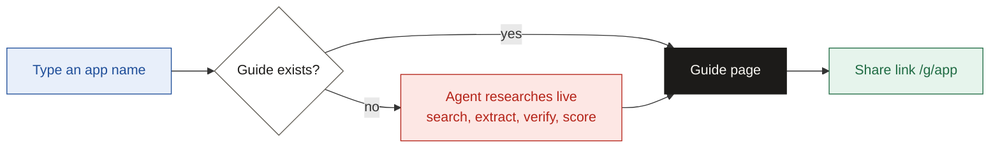

# Stamp

> Know what it takes to get your OAuth app stamped.

| | |
| --- | --- |
| Live app | TODO: add Vercel URL |
| Demo video | TODO: add Loom URL |
| Time spent | TODO: add real hours (budget was 6-8) |

---

## TL;DR

- **Problem:** before launch, developers cannot tell if OAuth app setup takes one hour or six weeks, or what will block approval.
- **Solution:** a guide that puts the verdict first (difficulty, time, top blocker, next step), then the steps.
- **Two modes:** a library of 5 hand-checked guides, and a live agent that researches any app in real time.
- **Evidence:** code checks every quote against its source page; unconfirmed claims are marked Uncertain.

---

## How it works



| A guide answers | Shown as |
| --- | --- |
| How hard is it? | Difficulty 1-5 from a fixed rule, with the reason |
| How long will it take? | Two milestones: first test connection, and production |
| What could block me? | Blocker cards: symptom, cause, fix, who to contact |
| What can an agent do? | Each step marked agent, human or agent-assist |

---

## Library guides

| App | Kind of hard |
| --- | --- |
| GitHub | Instant: no review unless listed on the GitHub Marketplace |
| HubSpot | Hidden limits: capped at 25 installs until listed on the HubSpot Marketplace |
| Gmail | Review needed: restricted scopes require a security assessment |
| LinkedIn | Partner-gated: API access needs vetting |
| Salesforce | Enterprise: new Connected Apps restricted; External Client Apps replace them |

Try the live agent with any app outside this list.

---

## Evidence labels

| Label | Meaning |
| --- | --- |
| Tested | We ran it and logged the result |
| Sourced | The quote appears word for word in the linked source |
| Uncertain | Not confirmed: no quote match, sources disagree, or only an old source exists |

---

## Run it locally

**Prerequisites:** Node.js 20.19 or later, pnpm, and a MySQL database.

1. Clone the repo and install:

   ```bash
   git clone <repo-url> stamp && cd stamp
   pnpm install
   ```

2. Create env files from the examples:

   ```bash
   cp apps/api/.env.example apps/api/.env
   cp apps/web/.env.example apps/web/.env
   ```

3. Fill in the values:

   | App | Variable | Purpose |
   | --- | --- | --- |
   | api | `OPENAI_API_KEY` | AI model access. Required only when `AGENT_MODE=real` |
   | api | `OPENAI_MODEL_FAST`, `OPENAI_MODEL_STRONG` | Models for planning (fast) and extraction (strong), for example `gpt-4.1-mini` and `gpt-4.1`. Required only when `AGENT_MODE=real` |
   | api | `TAVILY_API_KEY` | Search and page fetch. Required only when `AGENT_MODE=real` |
   | api | `DATABASE_URL` | MySQL connection string |
   | api | `WEB_ORIGIN` | Web app URL, for CORS |
   | api | `DAILY_RUN_CAP` | Max live runs per day |
   | api | `ENABLE_BROWSER_AGENT` | `false` by default |
   | api | `RATE_LIMIT_MAX`, `RATE_LIMIT_WINDOW_SECONDS` | Per-IP limit on starting runs and sending reports; defaults 10 per 60 seconds |
   | api | `TRUST_PROXY_HOPS` | Reverse proxies in front of the API (`1` on Railway); `0` locally |
   | api | `AGENT_MODE` | `stub` replays scripted test data, `real` runs the research agent. Defaults to `stub`; **required** when `NODE_ENV=production`, so the server refuses to boot without it. Set `real` on Railway |
   | api | `AGENT_RUN_BUDGET_MS` | Run time limit in milliseconds; can only lower the 120000 default, for example to test the partial-guide path |
   | api | `AGENT_EXTRACT_CONCURRENCY` | Parallel extraction calls, 1 to 8; default 5 |
   | api | `AGENT_PROBE` | `off` skips the outbound authorize-URL probe; default `on` |
   | api | `NODE_ENV` | `development` locally; `production` on Railway |
   | web | `VITE_API_URL` | Leave empty in development: the Vite dev server proxies `/api` to `http://localhost:3000`, so the browser only talks to its own origin and CORS never applies. In production, set it to the API origin with no trailing slash, for example `https://stamp-api.up.railway.app`. The API then allows only the origin in its `WEB_ORIGIN`, so that must equal the web app's origin. Every `VITE_` variable is public |

4. Set up the database and load the library guides:

   ```bash
   pnpm --filter api db:migrate
   pnpm --filter api db:seed
   ```

5. Start everything:

   ```bash
   pnpm dev
   ```

6. Run the tests:

   ```bash
   pnpm test
   ```

7. Optional: check your OpenAI and Tavily keys with one real search and one tiny model call. Run it by hand; tests never call the live services:

   ```bash
   pnpm --filter api smoke:live
   ```

   Add `--strong` to also call the strong model.

8. Optional: save real Tavily results as test fixtures for the agent's search and fetch stages. This spends about 35 Tavily credits; run it by hand, never in tests or CI:

   ```bash
   pnpm --filter api capture:fixtures --plan
   pnpm --filter api capture:fixtures
   ```

   `--plan` lists the calls without making any. Files go to `apps/api/tests/fixtures/`; commit them, and re-run when you want fresher snapshots.

---

## Deploy

| Part | Host | Notes |
| --- | --- | --- |
| `apps/web` | Vercel | Set `VITE_API_URL` to the API origin; SPA rewrite for `/g/:slug`. Set the API's `WEB_ORIGIN` to this site's origin |
| `apps/api` | Railway | Always on; set all API env variables |
| MySQL | Railway | Copy its connection string into `DATABASE_URL` |

---

## Key decisions

| Decision | Choice | Why |
| --- | --- | --- |
| Format | A readiness report, not a chat | Developers need a plan to act on and share |
| Evidence | Every fact is a claim with a label and source | A wrong guide can cost weeks of rejected reviews |
| Difficulty | Computed by a fixed rule, not the AI model | Same inputs give the same score, with a reason |
| Time | Split into "first test" and "production" | HubSpot takes about an hour to test but needs a listing past 25 installs |
| Agent | Fixed pipeline; the model plans and extracts, code verifies and scores | Predictable during a live demo; a model checking a model can agree with a mistake |
| Library | One app per kind of hard | Variety tests the product better than popularity |

Full reasoning and rejected options: [docs/design-decisions.md](./docs/design-decisions.md).

---

## Verification log

A sample of guidance checked against real sources or setup attempts.

| Claim | Status | What we learned |
| --- | --- | --- |
| HubSpot caps new apps at 25 installs until listed | Sourced ([changelog](https://developers.hubspot.com/changelog/new-marketplace-distribution-app-install-limits)) | Changed the time model to two milestones |
| HubSpot applies extra listing rules to AI connectors | Sourced ([forum](https://community.hubspot.com/t/ai-connector-as-legacy-public-app-install-limitation/148177)) | Added as a blocker for AI-agent developers |
| Salesforce restricts new Connected Apps | Sourced ([Salesforce](https://developer.salesforce.com/docs/atlas.en-us.api_rest.meta/api_rest/intro_understanding_authentication.htm)) | A popular third-party guide is out of date; official sources now win |
| Composio's callback path for custom auth | Uncertain: docs show both `/api/v3/` and `/api/v3.1/` | TODO: confirm in the Composio dashboard |
| GitHub OAuth app needs no review | TODO: confirm with a setup attempt | |
| HubSpot developer app setup steps | TODO: confirm with a setup attempt | |

---

## Limitations

- The library covers 5 apps, not 100.
- No real provider review was submitted, so approval waits are sourced, not tested.
- Live guides depend on public docs; partner-only docs stay Uncertain.
- The optional browser agent runs locally only and is off in the live app.
- Live generation has a daily cap to control cost; the library always works.

---

## Docs

| File | What it covers |
| --- | --- |
| [assignment.md](./docs/assignment.md) | The original brief |
| [problem.md](./docs/problem.md) | The problem and who has it |
| [solution.md](./docs/solution.md) | How Stamp solves it |
| [product.md](./docs/product.md) | Positioning, metrics, roadmap |
| [flow.md](./docs/flow.md) | The core user flow |
| [features.md](./docs/features.md) | Must, Should, Could, Won't |
| [design-decisions.md](./docs/design-decisions.md) | Every key decision and its trade-offs |
| [product-architecture.md](./docs/product-architecture.md) | Apps, routes, data, caching |
| [agent-architecture.md](./docs/agent-architecture.md) | The agent pipeline and labelling |
| [api-design.md](./docs/api-design.md) | Endpoints, events, errors |
| [db-schema-design.md](./docs/db-schema-design.md) | Tables and the Prisma schema |
| [tech-stack.md](./docs/tech-stack.md) | Tools by layer |
| [folder-structure.md](./docs/folder-structure.md) | Repo layout |
| [design-system.md](./docs/design-system.md) | Colours, type, components |
