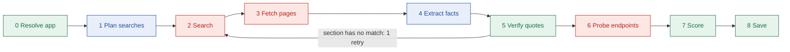
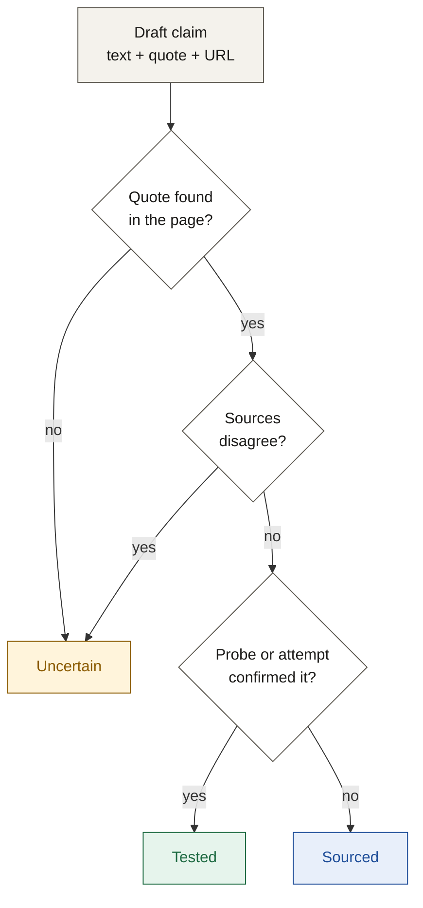

# Agent architecture

## TL;DR

- The agent is a **fixed pipeline** of 9 stages, built as a LangGraph graph.
- Only 2 stages call the AI model: planning searches and extracting facts.
- Code verifies every quote and computes the difficulty score, so results are checkable and repeatable.
- One bounded retry lets the agent adapt without looping forever.

---

## 1. The pipeline

Blue = AI model. Red = external call. Green = our code.

| # | Stage | What it does | Output |
| --- | --- | --- | --- |
| 0 | Resolve app | Turns a name or URL into one official domain; asks "Did you mean" if unclear | App identity |
| 1 | Plan searches | Writes targeted queries: setup, scopes, review, limits | Search queries |
| 2 | Search | Finds pages, official docs first | URLs with source tier |
| 3 | Fetch pages | Reads up to 6 pages; reuses cached pages | Page text |
| 4 | Extract facts | Fills each guide section from the pages; every claim needs a quote and URL | Draft claims |
| 5 | Verify quotes | Checks each quote appears in its page; downgrades misses to Uncertain | Labelled claims |
| 6 | Probe endpoints | Calls the authorize URL with a dummy client ID | Tested claims |
| 7 | Score | Applies the difficulty rule | Score + breakdown |
| 8 | Save | Stores the guide and log; returns the share link | Guide + slug |

---

## 2. Why a fixed pipeline

| Choice | Rejected alternative | Reason |
| --- | --- | --- |
| Fixed stages | One free agent loop | Predictable time and cost during a live demo |
| Code verifies quotes | An AI "verifier" agent | A model checking a model can agree with a mistake |
| Code scores difficulty | The model picks a score | Same inputs always give the same score |
| One retry edge | Multi-agent hand-offs | Fewer places for errors to compound |

---

## 3. Who does what: model vs code

| Task | Done by | Why |
| --- | --- | --- |
| Pick an official domain | Code (with search results) | Deterministic |
| Plan search queries | AI model (fast) | Needs judgment about the app |
| Pull facts from messy pages | AI model (strong) | Needs reading skill |
| Check quotes exist | Code | Must be exact and repeatable |
| Rank sources | Code | Official beats third-party, then newer |
| Score difficulty | Code | Must be explainable |

---

## 4. Graph state

The state passes from stage to stage (`apps/api/src/agent/state.ts`).

| Field | Holds | Set by |
| --- | --- | --- |
| `typed`, `slug` | What the user typed; the run's slug | Run input |
| `app` | Name, domain, slug | Stage 0 |
| `queries` | Planned searches | Stage 1 |
| `searchResults` | URLs with tier, no duplicates | Stage 2 |
| `pages` | URL, tier, text, hash; no duplicates | Stage 3 |
| `drafts` | Per section: drafted, unknown or failed | Stage 4 |
| `gates` | Auth method and the facts behind the score | Stage 4 |
| `claims`, `conflicts` | Labelled claims with stable ids; resolved conflicts | Stages 5-6 |
| `missingSections` | Sections with no matched quote | Stage 5 |
| `retryCount` | 0 or 1: retry passes started | The graph, when stage 2 starts a retry |
| `probeResult` | The probe's outcome, or none | Stage 6 |
| `difficulty`, `archetype` | Score and breakdown; archetype | Stage 7 |
| `guide` | The saved guide | Stage 8 |
| `partial` | True once any node sets it | Any node |
| `failure` | A failure that ends the run | Any node |
| `completed` | Stages that reached `stage.done` | Every stage |

- `events` is not in the state. Events are sent live through `emit`, so the stream and the stage record stay in step.
- `probeResult` and `difficulty` are not named `probe` and `score`, because LangGraph does not allow a state field to share a node's name.
- The token and call meter is not in the state either. It is a mutable object in the run's dependencies (`deps.ts`), passed to every model and Tavily call.

---

## 5. How a claim gets its label

- When sources disagree, the agent keeps both, prefers the official one, then the newer one, and explains why.
- Time estimates stay Uncertain until tested.

---

## 6. Budgets per run

| Limit | Value |
| --- | --- |
| Total run time | 120 seconds |
| Pages fetched | 6 |
| Retries | 1 |
| Schema-repair attempts per section | 1 |

- **Checked before each stage.** Every edge goes through one routing rule (`routes.ts`). A stage starts only if its minimum time remains (`NODE_MIN_REMAINING_MS` in `budget.ts`).
- **When time runs out,** the run skips ahead to `score`, then `save`, and the guide is partial. The stages in between never start, so they emit no events. `verify` and `score` are code only and need no minimum time, so `score` always runs. After a budget stop it may find no gates or claims, so it must treat missing facts as unknown.
- **Retry edge:** verify goes back to search only when a section has no matched quote, `retryCount` is 0 and at least 40 seconds remain. An edge cannot write state, so the search stage counts the retry when it starts one.
- **A failure ends the run** with no save: the failing stage emits `stage.started` but not `stage.done`, and the executor sends `run.error`.
- **An abort ends the run** at once. The run returns an `INTERNAL` failure at the stage that was running, and no more events are sent.

---

## 7. Agent-level failures

| Failure | Response |
| --- | --- |
| Time runs out | Save what exists; missing sections become Uncertain |
| No public docs | Return a stub that says so and suggests contacting the provider |
| App uses API keys, not OAuth | Mark it out of scope |
| Ambiguous name | Stop and ask "Did you mean" |
| AI output fails the schema | Retry that section once with the error; else mark it Uncertain |
| Hostile text in a page | Page text is treated as data only; code checks every quote |

- A section marked Uncertain because nothing was found becomes one Uncertain claim with no sources. Its text says what is unknown. Only Uncertain claims may have no sources; the schema rejects a Sourced or Tested claim without one.

---

## 8. Optional browser agent

- A Playwright agent can try parts of a developer-portal setup.
- It is off by default (`ENABLE_BROWSER_AGENT=false`) and runs locally only.
- When on, it feeds stage 6 and can upgrade claims to Tested.

---

## 9. Stub agent (`AGENT_MODE`)

- `AGENT_MODE=stub` replays a scripted run through the same `runAgent` contract the real agent uses. It makes no network or model calls, so the web app can be built and tested against a stable API.
- `AGENT_MODE=real` runs the research agent. Until the pipeline is switched on it ends every run with `run.error INTERNAL`. The graph and its runner (`run-real-agent.ts`) already exist with no-op stages, but are not wired to `AGENT_MODE=real` yet.
- **Default:** `stub` when `NODE_ENV` is not `production`. In production `AGENT_MODE` is required and the server refuses to boot without it, so a deploy cannot serve stub data by accident.

**Default run (any app name):** `stage.started` and `stage.done` for stages 0 to 8, 4 `search.query`, 5 `page.fetched` (official, third_party and forum), `claim.verified` for each sourced claim and one `claim.downgraded` (all in stage 5), then a saved live guide and `run.done`. Events arrive 150 to 400 ms apart, about 10 seconds in total.

**Scenarios,** picked by the app name you type:

| Name | Result |
| --- | --- |
| `stub-error` | Stages 0 to 3 finish, then `run.error INTERNAL` at stage 4 |
| `stub-partial` | All stages run, claims are downgraded for `time_budget`, partial guide, `run.done` with status `partial` |
| `stub-ambiguous` | `run.error AMBIGUOUS_APP` at stage 0 with two options |
| `stub-notoauth` | `run.error NOT_OAUTH` at stage 3 |

**Stub guides are marked as test data:**
- `appName` ends with `(stub data)` and `domain` is `example.com`.
- The verdict summary reads "Stub guide: scripted test data, not real research".
- Every other claim text starts with `[STUB]`, and every source is on an `example.com`, `.net` or `.org` page.
- Labels are only Sourced or Uncertain. Nothing in a stub is Tested.

**Stub guides are born expired.** They are readable at `/g/<slug>`, but they never count as a cached guide, so a stub can never stand in for real research. Looking up the same app again runs the stub again. Each stub run still counts against `DAILY_RUN_CAP`.

---

## Next

- Read [product-architecture.md](./product-architecture.md) for how runs reach the browser.
