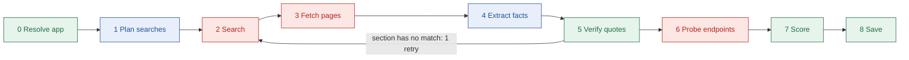
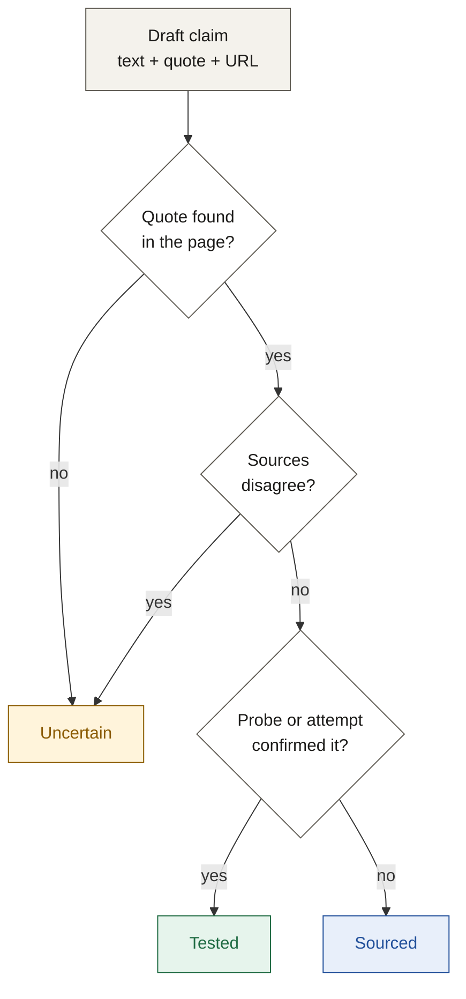

# Agent architecture

## TL;DR

- The agent is a **fixed pipeline** of 9 stages, built as a LangGraph graph.
- Only 2 stages call the AI model: planning searches and extracting facts.
- Code verifies every quote and computes the difficulty score, so results are checkable and repeatable.
- One bounded retry lets the agent adapt without looping forever.

---

## 1. The pipeline

Blue = AI model. Red = external call. Green = our code.

| # | Stage | What it does | Output |
| --- | --- | --- | --- |
| 0 | Resolve app | Turns a name or URL into the official app (its domains and product phrase); asks "Did you mean" if unclear | App identity |
| 1 | Plan searches | Writes targeted queries: setup, scopes, review, limits | Search queries |
| 2 | Search | Finds pages, official docs first | URLs with source tier |
| 3 | Fetch pages | Reads up to 6 pages; reuses cached pages | Page text |
| 4 | Extract facts | Fills each guide section from the pages; every claim needs a quote and URL | Draft claims |
| 5 | Verify quotes | Checks each quote appears in its page; downgrades misses to Uncertain | Labelled claims |
| 6 | Probe endpoints | Calls the authorize URL with a dummy client ID | Tested claims |
| 7 | Score | Applies the difficulty rule | Score + breakdown |
| 8 | Save | Stores the guide and log; returns the share link | Guide + slug |

---

## 2. Why a fixed pipeline

| Choice | Rejected alternative | Reason |
| --- | --- | --- |
| Fixed stages | One free agent loop | Predictable time and cost during a live demo |
| Code verifies quotes | An AI "verifier" agent | A model checking a model can agree with a mistake |
| Code scores difficulty | The model picks a score | Same inputs always give the same score |
| One retry edge | Multi-agent hand-offs | Fewer places for errors to compound |

---

## 3. Who does what: model vs code

| Task | Done by | Why |
| --- | --- | --- |
| Pick the official domains and the product phrase | Code (with search results) | Deterministic |
| Plan search queries | AI model (fast) | Needs judgment about the app |
| Pull facts from messy pages | AI model (strong) | Needs reading skill |
| Check quotes exist | Code | Must be exact and repeatable |
| Rank sources | Code | Official beats third-party, then newer |
| Score difficulty | Code | Must be explainable |

---

## 4. Graph state

The state passes from stage to stage (`apps/api/src/agent/state.ts`).

| Field | Holds | Set by |
| --- | --- | --- |
| `typed`, `slug` | What the user typed; the run's slug | Run input |
| `app` | Name, domain, slug | Stage 0 |
| `queries` | Planned searches | Stage 1 |
| `searchResults` | URLs with tier, no duplicates; each also lists the topics of the planned queries that found it | Stage 2 |
| `pages` | URL, tier, text, hash; no duplicates | Stage 3 |
| `drafts` | Per section: drafted claims, unknown, or failed with a reason | Stage 4 |
| `gates` | Auth method, review gate, approval wait and the prerequisites and limits behind the score, each with the claim that backs it | Stage 4 |
| `claims`, `conflicts` | Labelled claims with stable ids; confirmed conflicts. Stage 6 upgrades some claims to Tested | Stages 5, 6 |
| `missingSections` | What triggers the retry: `reviewGate` when the review gate is unknown, and `steps`, `scopes` or `blockers` with no Sourced claim | Stage 5 |
| `checks` | Every quote check and probe, for the verification log. Stage 5 replaces them each pass; stage 6 adds its own | Stages 5, 6 |
| `retryCount` | 0 or 1: retry passes started | The graph, when stage 2 starts a retry |
| `probeResult` | The probe's outcome, or none | Stage 6 |
| `difficulty`, `archetype` | Score and breakdown; archetype | Stage 7 |
| `guide` | The saved guide | Stage 8 |
| `libraryProtected` | True when a library guide owns the slug, so the live guide was not stored | Stage 8 |
| `partial` | True once any node sets it | Any node |
| `failure` | A failure that ends the run | Any node |
| `completed` | Stages that reached `stage.done` | Every stage |

- `events` is not in the state. Events are sent live through `emit`, so the stream and the stage record stay in step.
- `probeResult` and `difficulty` are not named `probe` and `score`, because LangGraph does not allow a state field to share a node's name.
- The token and call meter is not in the state either. It is a mutable object in the run's dependencies (`deps.ts`), passed to every model and Tavily call.

---

## 5. How a claim gets its label

- When sources disagree, the agent keeps both, prefers the official one, then the newer one, and explains why. The model only proposes a conflict; code confirms it (see stage 5).
- Time estimates stay Uncertain until tested.
- A claim whose quote is not found keeps its text as Uncertain and loses its source: a quote that could not be found is never shown as one.

---

## 6. Budgets per run

| Limit | Value |
| --- | --- |
| Total run time | 120 seconds |
| Pages fetched | 6 |
| Retries | 1 |
| Schema-repair attempts per section | 1 |

Time caps per stage (seconds). A stage also gets less when the run is running late, so verify, score and save always fit.

| Stage | First pass | Retry pass |
| --- | --- | --- |
| 0 Resolve | 6 | |
| 1 Plan | 6 | |
| 2 Search | 8 | 6 |
| 3 Fetch | 12 | 8 |
| 4 Extract | 40 | 18 |
| 5 Verify | 2 | 2 |
| 6 Probe | 4 | |
| 7 Score | 1 | |
| 8 Save | 5 | |
| **Total** | **84** | **+ 34 = 118** |

- Extract needs 20 seconds left to start, and a retry needs 45 seconds left (the 34-second retry pass plus the 10 seconds of probe, score and save).

- **Checked before each stage.** Every edge goes through one routing rule (`routes.ts`). A stage starts only if its minimum time remains (`NODE_MIN_REMAINING_MS` in `budget.ts`).
- **When time runs out,** the run skips ahead, then `score`, then `save`, and the guide is partial. If the run holds drafted sections or gates that `verify` has not checked, it goes through `verify` first; with no drafts it goes straight to `score`. The stages in between never start, so they emit no events. `verify` and `score` are code only and need no minimum time, so they always run: `verify` also runs right after `extract` with no time left. `routes.ts` states the rule (`hasUnverifiedWork`) so it does not depend on that minimum being 0, and a stop never sends the run back to `verify` once it has run. A stop before `extract` has no drafts, so `score` may find no gates or claims and must treat missing facts as unknown.
- **Retry edge:** verify goes back to search only when a section has no matched quote, `retryCount` is 0 and at least 45 seconds remain. An edge cannot write state, so the search stage counts the retry when it starts one.
- **A failure ends the run** with no save: the failing stage emits `stage.started` but not `stage.done`, and the executor sends `run.error`.
- **An abort ends the run** at once. The run returns an `INTERNAL` failure at the stage that was running, and no more events are sent.

---

## 7. Agent-level failures

| Failure | Response |
| --- | --- |
| Time runs out | Save what exists; missing sections become Uncertain |
| No public docs | Return a stub that says so and suggests contacting the provider |
| App uses API keys, not OAuth | Mark it out of scope |
| Ambiguous name | Stop and ask "Did you mean" |
| AI output fails the schema | Retry that section once with the error; else mark it Uncertain |
| Hostile text in a page | Page text is treated as data only; code checks every quote |

- A section marked Uncertain because nothing was found becomes one Uncertain claim with no sources. Its text says what is unknown. Only Uncertain claims may have no sources; the schema rejects a Sourced or Tested claim without one.

---

## 8. Optional browser agent

- A Playwright agent can try parts of a developer-portal setup.
- It is off by default (`ENABLE_BROWSER_AGENT=false`) and runs locally only.
- When on, it feeds stage 6 and can upgrade claims to Tested.

---

## 9. Stub agent (`AGENT_MODE`)

- `AGENT_MODE=stub` replays a scripted run through the same `runAgent` contract the real agent uses. It makes no network or model calls, so the web app can be built and tested against a stable API.
- `AGENT_MODE=real` runs the research agent. Until the pipeline is switched on it ends every run with `run.error INTERNAL`. The graph and its runner (`run-real-agent.ts`) already exist with no-op stages, but are not wired to `AGENT_MODE=real` yet.
- **Default:** `stub` when `NODE_ENV` is not `production`. In production `AGENT_MODE` is required and the server refuses to boot without it, so a deploy cannot serve stub data by accident.

**Default run (any app name):** `stage.started` and `stage.done` for stages 0 to 8, 4 `search.query`, 5 `page.fetched` (official, third_party and forum), `claim.verified` for each sourced claim and one `claim.downgraded` (all in stage 5), then a saved live guide and `run.done`. Events arrive 150 to 400 ms apart, about 10 seconds in total.

**Scenarios,** picked by the app name you type:

| Name | Result |
| --- | --- |
| `stub-error` | Stages 0 to 3 finish, then `run.error INTERNAL` at stage 4 |
| `stub-partial` | All stages run, claims are downgraded for `time_budget`, partial guide, `run.done` with status `partial` |
| `stub-ambiguous` | `run.error AMBIGUOUS_APP` at stage 0 with two options |
| `stub-notoauth` | `run.error NOT_OAUTH` at stage 3 |

**Stub guides are marked as test data:**
- `appName` ends with `(stub data)` and `domain` is `example.com`.
- The verdict summary reads "Stub guide: scripted test data, not real research".
- Every other claim text starts with `[STUB]`, and every source is on an `example.com`, `.net` or `.org` page.
- Labels are only Sourced or Uncertain. Nothing in a stub is Tested.

**Stub guides are born expired.** They are readable at `/g/<slug>`, but they never count as a cached guide, so a stub can never stand in for real research. Looking up the same app again runs the stub again. Each stub run still counts against `DAILY_RUN_CAP`.

---

## 10. Stages 0 to 8 in detail

**0 Resolve** (`nodes/resolve.ts`, code only)
- A typed domain or URL gives the official domain directly (`developers.notion.com` becomes `notion.com`), with no product phrase. There is no search and no "did you mean".
- A name runs one search, `<name> API developer documentation`, for 8 results.
- Hits are grouped by registrable domain. Forums, aggregators and code hosts are skipped unless the name is the site's own (`resolve/denylist.ts`). Each domain scores its search positions, a bonus for docs-looking pages, and a bonus for how well its brand label matches the name (equal, contained, or only in a page title).
- `AMBIGUOUS_APP` when two or more candidates with different brand labels match the name and the runner-up scores at least 60% of the leader. The options are `{name, domain}`, up to 3. `NO_PUBLIC_DOCS` when nothing matches the name.
- The weights (`SCORE_WEIGHTS`) and the thresholds (`RESOLVE_TUNING`) are defaults to tune against live searches.
- **Identity** (`resolve/identity.ts`). The app identity is `{appName, domain, slug, domains, product}`. `domain` is the best-scoring domain: the guide's domain and the only one the probe may contact. `domains` lists every official domain, the primary first (`resolve/official-domains.ts`): other candidates with the same brand label that had a docs-looking hit (`slack.com` and `slack.dev`), at most 3, never a shared hosting domain such as `github.io`, and none when the winner matched the name only by a page title (Gmail on `google.com`). `product` is the longest phrase that starts with the app's name and appears in the titles of at least two official, non-forum hits (`resolve/product-phrase.ts`): "Gmail API", "Microsoft Graph". It reads only the part of a title before the site name, ends at stop words and marks, and never ends on a generic word such as "docs" or "developers", so most apps get none and search by name as before.
- Limits: a name with no Latin letters needs a typed domain. The phrase comes from page titles, so a product that no two official titles share is not found.

**1 Plan** (`nodes/plan.ts`, fast model, prompt in `prompts/plan.ts`)
- The model returns one search query for each of 6 topics (setup, scopes, review, limits, auth type, approval wait), or `null` for "unknown". It is told never to state facts about the app.
- Code checks every query: it must name the app (the product phrase when the run has one, which the prompt also tells the model to use as written), be 8 to 160 characters and 3 to 16 words, and contain no URL; quotes and operators are stripped. A query that fails, a `null`, or a failed or slow model call is replaced by a template (`queries.ts`). The plan stage never fails the run.

**2 Search** (`nodes/search.ts`, code only)
- First pass: every query on the official domains, then the review and approval-wait queries across the web, up to 4 at a time inside the node's time window. Each distinct query is announced with `search.query`. Queries name the product phrase when the run has one (`searchName` in `queries.ts`), else the app.
- Retry pass: at most 3 differently worded searches on the official domains, for the sections that had no matched quote and for an unknown review gate (the gate first).
- The same page in several languages or with tracking parameters is one result, the English one, and every topic that found it is kept (`search/canonical-url.ts`). Results are tiered by code against every official domain and ordered official, third party, forum, then by Tavily's score. The run fails with `INTERNAL` only if every search fails.

**3 Fetch** (`nodes/fetch.ts`, `fetch/`)
- The first pass reads at most 4 pages and the retry pass the rest of the 6; cache hits count. Official pages are chosen by relevance (`fetch/relevance.ts`), not by search score alone: the best title and path for the topic each result was found for, OAuth words in the title, a documentation host, the product phrase, a soft penalty for blog, community, answers, help and template paths, a heavier one for legacy or deprecated pages, and the search score only as a tiebreak. Each round takes the page that also covers a topic no chosen page covers yet. With room for 3 or more, one slot is kept for a non-official page, but only one whose title answers a topic and scores past a floor; otherwise official pages take every slot. Nothing is excluded on its path: Gmail's verification FAQ lives under `/answer/`.
- A fresh cached page is reused (7 days). The rest go to one Tavily extract call. A page with under 300 characters of text is dropped. Each page is announced with `page.fetched`.
- A page's tier is always decided against this app's domain, even when the page came from the cache.
- No official page: `NO_PUBLIC_DOCS`. If the extract call itself failed and nothing is held, it is `INTERNAL` instead.

**4 Extract** (`nodes/extract.ts`, `extract/`, strong model, prompts in `prompts/extract*.ts`)
- One structured-output call per guide section: steps, scopes, requirements, blockers, milestones, gates, limits and conflicts, five at a time (`AGENT_EXTRACT_CONCURRENCY`, default 5). The verdict runs last, because it picks steps and blockers by position.
- Each call gets only the passages that matter: blocks of the fetched pages that match the section's keywords (about 14,000 characters, 8,000 for the verdict), official pages first, as exact slices of the original text so quotes stay word for word. A section with no matching passage is unknown and makes no call.
- A claim is `text`, `quote` and `url`; `null` or an empty list means unknown. There is no label or score field.
- Page text sits inside delimiters that carry a per-call token, so text in a page cannot close the block or fake a source. The prompt says the text is data, to ignore any instruction in it, that unknown is allowed, and never to invent facts.
- A reply that fails the schema is sent back once with the validation error. If that fails too, the section is marked failed and becomes Uncertain.
- On a 429 the call is retried once after a backoff (the server's hint if any, 0.5 to 8 seconds), unless there is no time left for it.
- Every claim whose URL was not fetched in this run is dropped; the URLs of the rest are rewritten to the fetched page's own. A gates fact whose evidence is dropped becomes unknown.
- One call may take 25 seconds, and none starts with under 5 seconds left in the stage's window; skipped sections make the run partial.
- `NOT_OAUTH` needs all of: the gates call says API keys only, its quote is found word for word on an official page, and neither the steps nor the scopes section found anything. `NO_PUBLIC_DOCS` when every section answered unknown; `INTERNAL` when every section failed.
- A retry pass redoes only the sections verify reported, and the verdict if steps or blockers were redone.
- Each model call logs its tier, model, section, tokens and duration; the stage logs one `extract summary` line with a row per section.

**5 Verify** (`nodes/verify.ts`, `verify/`, code only)
- Every claim in the drafts gets a stable id (`steps.0.detail`, `milestones.production.wait`, `blockers.1.fix` ...; `guide/claim-slots.ts`). Its quote is looked up in the page it cites, word for word after normalising whitespace and case (`evidence/quote-match.ts`). The label comes from `labelClaim`, never from the model: quote found gives Sourced; quote not found, a confirmed conflict, or a time estimate gives Uncertain.
- Time estimates (milestone effort and wait, step effort) stay Uncertain even with a real quote, with no downgrade event. Other downgrades send `claim.downgraded` with the reason (`quote_not_found` or `sources_disagree`); Sourced claims send `claim.verified`. On the retry pass only claims that are new or changed send events.
- Conflicts: the model proposes them; code confirms one only when both quotes are found, the two sources are different pages and the two statements differ. The preferred source is the more authoritative tier (official, then third party, then forum); with equal tiers and no page dates the first listed is shown first, and the reason says so. A claim that takes part in a confirmed conflict is downgraded to Uncertain with `sources_disagree`.
- Gates: every evidence quote behind a gates fact is checked too. A fact whose quote is not found becomes unknown, so the score never counts it.
- Retry flag: `missingSections` lists `reviewGate` when the review gate is unknown after verify, and `steps`, `scopes` or `blockers` when none of their claims ended up Sourced. The graph then goes back to search once, if at least 45 seconds remain.
- Every quote check (pass or fail) is recorded in `checks` with the page's content hash, so a claim can be traced to the exact page version.

**6 Probe** (`nodes/probe.ts`, `probe/`)
- Finds the first OAuth authorize URL (`/authorize`, `/oauth/authorize`, `/oauth2/v2/authorize`, `/oauth/auth`, `/o/oauth2/v2/auth`) that a Sourced claim quotes from an official page. No such claim, no probe.
- One GET, with a dummy client ID and `response_type=code`. No redirects are followed, no cookies are sent, the body is read up to 4 KB, and the request stops after 3 seconds (less if the run has less time).
- Passes (the claims that quote the URL become Tested) on: a 400, 401 or 403 whose body mentions `invalid_client`, `client_id` or `redirect_uri`; or a 3xx to a login or error page on the official domain. A 404, a 5xx, any other response and any network error leave the claims Sourced.
- Guards, all checked before anything is sent: https only, port 443, no credentials, no IP-address host, the host must be the app's primary domain or a subdomain of it (not its other official domains), and the host must resolve to public addresses only (no private, loopback, link-local or reserved range; `probe/ip.ts`).
- Known limit: the name is resolved once for the check and again by `fetch`, so a hostile DNS server could answer differently the second time (DNS rebinding). The domain guard (only the app's own domain, which the run resolved from the docs) keeps this out of reach in practice. Pinning the checked address would need a custom HTTP agent, which is a new dependency.
- `AGENT_PROBE=off` turns the stage into a no-op. The probe sends no claim events. Each upgraded claim gets a `probe` row in the verification log (also on failure).
- The probe never fails the run.

**7 Score** (`nodes/score.ts`, `scoring/`, code only)
- `scoreDifficulty` and `classifyArchetype` run on the verified gates. A missing fact is unknown: no review gate assumed, and an unknown wait counts 2, so the score is a lower bound.
- Gates the code never checked (verify has not run) score as unknown as well. Routing makes this rare: a run with gates or drafts goes through verify first, even after a budget stop.
- Score always runs, also after a budget stop.

**8 Save** (`nodes/save.ts`, `guide/assemble*.ts`)
- The guide is built from the drafts for structure and from the verified claims for content. A slot with no verified claim (no draft, the section failed, or the draft is newer than the last verify) becomes an Uncertain claim with no sources, with one of three texts: "Not found in the fetched sources.", "Could not be read reliably from the fetched sources." or "Not researched before the time budget ran out." The requirements and limits lists always hold at least one claim for that reason.
- The guide is checked against `GuideSchema` and stored through `saveLiveGuide` (live guides last 7 days). Coverage is `partial` when the budget stopped the run or a stage did not finish.
- `INTERNAL` when no claim is Sourced or Tested, or the guide does not pass the schema (the log names the paths of the problems, never the guide's text). A run stopped before extract has no drafts, so it has no verified claims and fails this way.
- A library guide that owns the slug is never overwritten: the run reports `done`, points at the library guide (`libraryProtected`), and writes no log rows.
- The checks are written to `verification_log` (one row per quote check or probe, with the run id; the page's content hash and any reason or HTTP status are in `detail`). A failure to write them is logged and does not fail the run.

---

## 11. What a run logs

One JSON object per line (`lib/logger.ts`); info goes to stdout, warnings and errors to stderr. Every line carries the `runId`. No line holds page text, claim text, quotes or keys.

| Message | From | Fields worth reading |
| --- | --- | --- |
| `resolve summary` | stage 0 | `decision` (`official`, `ambiguous`, `none`), top 5 `candidates` with `domain`, `match`, `score`, `hits`, and `resolveHits`, the `url` and `title` of every hit the decision was made from (no page text), and `identity` (`domains` and `product`, null unless the decision is `official`). This is the data the ambiguity thresholds are tuned against |
| `search summary` | stage 2 | `queries`, `failedQueries`, `results`, `byTier`, `retryPass` |
| `pages loaded` | stage 3 | pages from the network and from the cache |
| `extract summary` | stage 4 | one row per section: status, duration, tokens |
| `verify summary` | stage 5 | `claims`, `sourced`, `conflicts`, `missing` |
| `probe summary` | stage 6 | `reason` (`disabled`, `no_authorize_url` or the response reason), `outcome`, `status` |
| `guide saved` / `guide not saved` | stage 8 | `coverage`, `difficulty`, `checks`, or the reason it failed |
| `run summary` | the runner, once per run | `ok`, `status` or `code`, `durationMs`, `stageReached`, tokens per tier (`fastCalls`, `strongCalls`, `totalTokens`), `tavilySearchCalls`, `tavilyExtractCalls`, `tavilyCredits`, `pagesFetched`, `pageCacheHits`, `pagesHeld`, `claims`, `labels` (`sourced`, `tested`, `uncertain`), `coverage`, `retried`, `probe`, `libraryProtected` |

`labels` count the claims in the saved guide, so unknown claims count as Uncertain; with no guide they count the claims verify produced.

---

## Next

- Read [product-architecture.md](./product-architecture.md) for how runs reach the browser.
- Read [live-test-plan.md](./live-test-plan.md) to try the real agent by hand with live keys.
