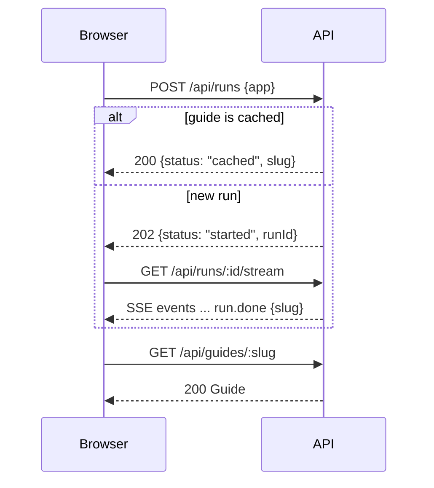

# API design

## TL;DR

- REST over JSON, plus one SSE stream for live progress.
- 7 endpoints: health, start a run, read a run, stream a run, list guides, read a guide, report a wrong claim.
- Every request and response body is validated by Zod schemas from `@stamp/schema`.
- Errors share one shape: `{ "error": { "code", "message" } }`.

---

## 1. Endpoints at a glance

| Method | Path | Purpose | Feature |
| --- | --- | --- | --- |
| `GET` | `/api/health` | Liveness check for Railway | M7 |
| `POST` | `/api/runs` | Return a cached guide, or start a live run | M2, M4 |
| `GET` | `/api/runs/:id` | Snapshot of a run (for reconnects) | M2 |
| `GET` | `/api/runs/:id/stream` | Live progress events (SSE) | M2 |
| `GET` | `/api/guides` | List library guides for the home page | M6 |
| `GET` | `/api/guides/:slug` | Read one guide | M1, M4 |
| `POST` | `/api/guides/:slug/reports` | Flag a wrong claim | S4 |

Markdown export (C2) runs in the browser. It needs no endpoint.

---

## 2. Main call sequence



---

## 3. Endpoint details

### `POST /api/runs`

Request:

```json
{ "app": "Notion", "force": false }
```

| Field | Type | Rule |
| --- | --- | --- |
| `app` | string | App name or URL, 2-100 characters |
| `force` | boolean, optional | `true` skips the cache and re-runs (the "Refresh" button) |

Responses:

| Status | Body | When |
| --- | --- | --- |
| `200` | `{ "status": "cached", "slug": "notion" }` | A fresh guide exists; library guides are always fresh, even with `force` |
| `202` | `{ "status": "started", "runId": "run_123" }` | A new run started |
| `202` | `{ "status": "running", "runId": "run_122" }` | A run for this app is already in progress; join it |
| `400` | error `VALIDATION_ERROR` | Bad input |
| `429` | error `RATE_LIMITED` + `Retry-After` header | Too many runs from this IP |
| `503` | error `RUN_CAP_REACHED` | Daily run cap hit (runs started since 00:00 UTC); cached guides and joining a running run still work |

### `GET /api/runs/:id`

| Status | Body |
| --- | --- |
| `200` | `{ "runId", "slug", "status", "stageReached", "startedAt", "finishedAt", "errorCode"? }` |
| `404` | error `NOT_FOUND` |

`status` is one of `running`, `done`, `partial`, `failed`.

### `GET /api/runs/:id/stream`

- Response type: `text/event-stream`.
- On connect, the server first sends a `run.snapshot` event, then every event the run has produced so far, then live events. Reconnecting replays the whole run.
- The stream closes after `run.done` or `run.error`.
- An unknown run id returns a normal JSON `404 NOT_FOUND`, before any stream starts.
- A comment line (`: heartbeat`) is sent every 15 seconds while the run is quiet.
- After an API restart, or 10 minutes after a run ends, the stream sends the snapshot and a `run.done` or `run.error` rebuilt from the database (`options` for `AMBIGUOUS_APP` is lost).

Wire format of one event:

```text
event: claim.verified
data: {"type":"claim.verified","runId":"run_123","claimId":"steps.3","url":"https://docs.composio.dev/..."}
```

The `data` JSON is the full event, including `type` (it matches the `event:` line), so the browser can parse it with `RunStreamEventSchema`.

| Event | Payload |
| --- | --- |
| `run.snapshot` | `{ runId, snapshot }`, always first; `snapshot` has the same shape as `GET /api/runs/:id` |
| `stage.started` | `{ runId, stage, name }` |
| `stage.done` | `{ runId, stage, durationMs }` |
| `search.query` | `{ runId, query }` |
| `page.fetched` | `{ runId, url, tier }` |
| `claim.verified` | `{ runId, claimId, url }` |
| `claim.downgraded` | `{ runId, claimId, reason }` |
| `run.done` | `{ runId, slug, status }` (`done` or `partial`) |
| `run.error` | `{ runId, stage, code, message, options? }` |

`run.error` codes:

| Code | Meaning | Extra |
| --- | --- | --- |
| `AMBIGUOUS_APP` | Name matches several apps | `options`: list of `{ name, domain }` |
| `NOT_OAUTH` | App uses API keys, not OAuth | none |
| `NO_PUBLIC_DOCS` | No usable docs found | none |
| `INTERNAL` | Unexpected failure | none |

### `GET /api/guides`

| Status | Body |
| --- | --- |
| `200` | `[{ "slug", "appName", "archetype", "difficulty", "mode", "asOf" }]` |

- Lists library guides only, by stored `difficulty` ascending, then `appName`. The web app re-sorts: a Not rated guide (archetype `unknown`, whose stored difficulty is only a lower bound) comes after every rated one in either direction.
- Live guides are never listed; they are reached by share link.

### `GET /api/guides/:slug`

| Status | Body |
| --- | --- |
| `200` | The full Guide (shape defined in `@stamp/schema`) |
| `404` | error `NOT_FOUND` |

- A live guide past its 7-day cache window is still returned, so share links keep working. Only `POST /api/runs` treats it as stale.

### `POST /api/guides/:slug/reports`

Request:

```json
{ "claimId": "steps.5", "note": "Callback path is v3.1 now" }
```

| Status | Body |
| --- | --- |
| `201` | `{ "reportId": "rep_1" }` |
| `400` | error `VALIDATION_ERROR` (bad body, or a `claimId` the guide does not contain) |
| `404` | error `NOT_FOUND` (unknown guide) |
| `429` | error `RATE_LIMITED` + `Retry-After` header |

---

## 4. Error shape

```json
{ "error": { "code": "RATE_LIMITED", "message": "Too many runs. Try again in a minute." } }
```

| Code | HTTP status |
| --- | --- |
| `VALIDATION_ERROR` | 400 |
| `NOT_FOUND` | 404 |
| `RATE_LIMITED` | 429 |
| `RUN_CAP_REACHED` | 503 |
| `INTERNAL` | 500 |

Raw exception text never reaches the client.

---

## 5. Cross-cutting rules

| Rule | Detail |
| --- | --- |
| Validation | Zod schemas from `@stamp/schema` on every body and response |
| CORS | Only the web app's origin (`WEB_ORIGIN`); `Retry-After` is exposed to the browser |
| Body size | JSON bodies over 16 KB are rejected with `400 VALIDATION_ERROR` |
| Rate limit | Applies to `POST /api/runs` and reports, per IP, each with its own counter; limits set by env (`RATE_LIMIT_MAX`, `RATE_LIMIT_WINDOW_SECONDS`, `TRUST_PROXY_HOPS`), not code |
| Secrets | API keys stay on the server; never in responses or logs |
| Slugs | Lowercase app name, e.g. `hubspot`; used in share links `/g/hubspot` |
| Claim IDs | Stable path inside the guide, e.g. `steps.5`, `blockers.2` |

---

## Next

- Read [db-schema-design.md](./db-schema-design.md) for where this data is stored.
