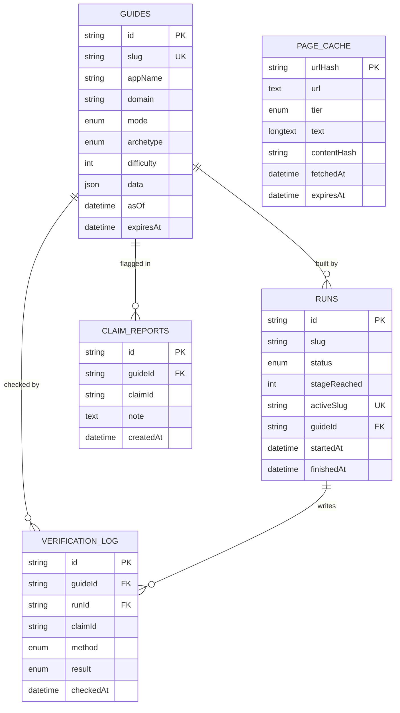

# Database schema design

## TL;DR

- MySQL with Prisma 7. Five tables: `guides`, `runs`, `page_cache`, `verification_log`, `claim_reports`.
- A whole guide is stored as one JSON column. Zod validates it; the app always reads it as one unit.
- The `runs` table doubles as the per-app lock, using a nullable unique column.
- Library guides are seeded from the JSON files in `apps/api/library/` into `guides`, so there is one read path. A code check runs before a file is exported or seeded.

---

## 1. Entity diagram



`page_cache` stands alone: it is keyed by URL and shared across all guides.

---

## 2. Tables

### `guides`

| Column | Type | Notes |
| --- | --- | --- |
| `id` | string, PK | cuid |
| `slug` | string, unique | e.g. `hubspot`; the share link key |
| `appName`, `domain` | string | Display name and official domain |
| `mode` | enum `LIBRARY`, `LIVE` | Where the guide came from |
| `archetype` | enum | `INSTANT`, `HIDDEN_LIMITS`, `REVIEW`, `PARTNER_GATED`, `ENTERPRISE`, `UNKNOWN` |
| `difficulty` | int 1-5 | Copied out of `data` for list sorting |
| `data` | JSON | The full guide: verdict, milestones, steps, claims, sources |
| `asOf` | datetime | Date of research |
| `expiresAt` | datetime, nullable | Live guides: +7 days. Library: null |

### `runs`

| Column | Type | Notes |
| --- | --- | --- |
| `id` | string, PK | cuid |
| `slug` | string | App being researched |
| `status` | enum | `RUNNING`, `DONE`, `PARTIAL`, `FAILED` |
| `stageReached` | int, nullable | 0-8 |
| `errorCode` | string, nullable | e.g. `NO_PUBLIC_DOCS` |
| `activeSlug` | string, nullable, unique | Set to `slug` while running, cleared when finished |
| `guideId` | FK to `guides`, nullable | Filled when the guide is saved |
| `startedAt`, `finishedAt` | datetime | `finishedAt` nullable |

### `page_cache`

| Column | Type | Notes |
| --- | --- | --- |
| `urlHash` | string, PK | SHA-256 of the URL; URLs are too long for a MySQL index |
| `url` | text | Full URL |
| `tier` | enum | `OFFICIAL`, `THIRD_PARTY`, `FORUM` |
| `text` | long text | Extracted page text |
| `contentHash` | string | Proves which version a quote was checked against |
| `fetchedAt`, `expiresAt` | datetime | Expires after 7 days |

### `verification_log`

| Column | Type | Notes |
| --- | --- | --- |
| `id` | string, PK | cuid |
| `guideId` | FK to `guides` | |
| `runId` | FK to `runs`, nullable | Null for manual checks on library guides |
| `claimId` | string | Path inside the guide, e.g. `steps.5` |
| `method` | enum | `QUOTE_MATCH`, `PROBE`, `MANUAL`, `BROWSER` |
| `result` | enum | `PASS`, `FAIL` |
| `detail` | text, nullable | JSON written by the agent: `contentHash` (the page version a quote was checked against, from `page_cache`), plus `reason` (e.g. `quote_not_found`, `page_not_fetched`) or the probe's HTTP `status`. Kept in `detail` so no column was added |
| `sourceUrl` | text, nullable | Page that was checked |
| `checkedAt` | datetime | |

### `claim_reports`

| Column | Type | Notes |
| --- | --- | --- |
| `id` | string, PK | cuid |
| `guideId` | FK to `guides` | |
| `claimId` | string | Which claim was flagged |
| `note` | text, nullable | What the reader thinks is wrong |
| `createdAt` | datetime | |

---

## 3. Key design choices

| Choice | Why | Trade-off |
| --- | --- | --- |
| Guide as one JSON column | The guide is always read whole; Zod enforces its shape; no 8-table joins | Cannot query single claims across guides in SQL |
| `difficulty`, `archetype` copied out of JSON | Home page sorts and filters without parsing JSON | Must be kept in sync on save |
| Lock via `runs.activeSlug` unique | MySQL allows many NULLs in a unique column, so only one active run per app can exist | Stale locks (over 3 minutes) are cleared in code |
| URL hash as page key | MySQL index size limits rule out long URLs as keys | Needs one hash step |
| Library seeded into `guides` | One read path for library and live guides | Re-export, re-check and re-seed after a library file changes |

---

## 4. Indexes

| Table | Index | Serves |
| --- | --- | --- |
| `guides` | unique `slug` | Share links, cache lookup |
| `guides` | `mode`, `difficulty` | Library list on the home page |
| `runs` | unique `activeSlug` | Run lock |
| `runs` | `slug`, `startedAt` | Latest run for an app |
| `page_cache` | `expiresAt` | Cleanup of old pages |
| `verification_log` | `guideId`, `claimId` | Verification log per guide and claim |
| `claim_reports` | `guideId` | Reports per guide |

---

## 5. Prisma schema (draft)

```prisma
generator client {
  provider = "prisma-client"
  output   = "../generated/prisma"
}

datasource db {
  provider = "mysql"
}

enum GuideMode {
  LIBRARY
  LIVE
}

enum Archetype {
  INSTANT
  HIDDEN_LIMITS
  REVIEW
  PARTNER_GATED
  ENTERPRISE
  UNKNOWN
}

enum RunStatus {
  RUNNING
  DONE
  PARTIAL
  FAILED
}

enum SourceTier {
  OFFICIAL
  THIRD_PARTY
  FORUM
}

enum CheckMethod {
  QUOTE_MATCH
  PROBE
  MANUAL
  BROWSER
}

enum CheckResult {
  PASS
  FAIL
}

model Guide {
  id         String    @id @default(cuid())
  slug       String    @unique
  appName    String
  domain     String
  mode       GuideMode
  archetype  Archetype
  difficulty Int
  data       Json
  asOf       DateTime
  expiresAt  DateTime?
  createdAt  DateTime  @default(now())
  updatedAt  DateTime  @updatedAt

  runs    Run[]
  checks  VerificationLog[]
  reports ClaimReport[]

  @@index([mode, difficulty])
  @@map("guides")
}

model Run {
  id           String    @id @default(cuid())
  slug         String
  status       RunStatus @default(RUNNING)
  stageReached Int?
  errorCode    String?
  activeSlug   String?   @unique
  guideId      String?
  guide        Guide?    @relation(fields: [guideId], references: [id])
  startedAt    DateTime  @default(now())
  finishedAt   DateTime?

  checks VerificationLog[]

  @@index([slug, startedAt])
  @@map("runs")
}

model PageCache {
  urlHash     String     @id
  url         String     @db.Text
  tier        SourceTier
  text        String     @db.LongText
  contentHash String
  fetchedAt   DateTime   @default(now())
  expiresAt   DateTime

  @@index([expiresAt])
  @@map("page_cache")
}

model VerificationLog {
  id        String      @id @default(cuid())
  guideId   String
  guide     Guide       @relation(fields: [guideId], references: [id], onDelete: Cascade)
  runId     String?
  run       Run?        @relation(fields: [runId], references: [id])
  claimId   String
  method    CheckMethod
  result    CheckResult
  detail    String?     @db.Text
  sourceUrl String?     @db.Text
  checkedAt DateTime    @default(now())

  @@index([guideId, claimId])
  @@map("verification_log")
}

model ClaimReport {
  id        String   @id @default(cuid())
  guideId   String
  guide     Guide    @relation(fields: [guideId], references: [id], onDelete: Cascade)
  claimId   String
  note      String?  @db.Text
  createdAt DateTime @default(now())

  @@index([guideId])
  @@map("claim_reports")
}
```

- The database URL lives in `prisma.config.ts` (Prisma 7), not in this file.
- Run `prisma validate` after setup to confirm the draft against your installed version.

---

## Next

- Read [api-design.md](./api-design.md) for the endpoints that read and write these tables.
