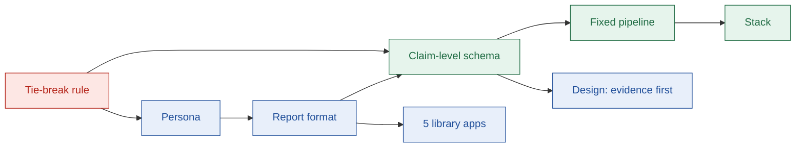

# Design decisions

## TL;DR

- 24 decisions shape Stamp. Each one lists what we chose, why, what we rejected, and the cost.
- The deciding rule for trade-offs: **evidence > useful guidance > problem fit > agent sophistication**.
- The biggest calls: a readiness report instead of a chat, claim-level evidence, and a fixed agent pipeline.

---

## 1. How the decisions connect

Red = the rule. Blue = product decisions. Green = technical decisions.

---

## 2. Summary

| # | Decision | Chosen |
| --- | --- | --- |
| 0 | Terminology | Plain OAuth terms in the UI, plus a glossary mapping them to Composio terms |
| 1 | Tie-break rule | Evidence > guidance > problem fit > agents |
| 2 | Persona | AI-agent developer moving to production who needs their own OAuth app |
| 3 | Format | A readiness report: library + live generator, one guide page |
| 4 | Feature scope | Must, Should and Could tiers; Won't list kept explicit |
| 5 | Library apps | GitHub, HubSpot, Gmail, LinkedIn, Salesforce |
| 6 | Guide schema | Claim-level evidence, rule-based difficulty, two milestones |
| 7 | Agent design | Fixed 9-stage pipeline, 1 bounded retry |
| 8 | Stack | Turborepo; React + Vite; Express; MySQL + Prisma; LangGraph JS; OpenAI; Tavily |
| 9 | Name | Stamp |
| 10 | Visual design | Paper and ink, one red accent, evidence labels in colour + icon + word |
| 11 | Evidence on demand | A claim shows its text and one compact label; sources, quote and Report open from it |
| 12 | Page frame | One 1120 px frame for every page; reading text near 70 characters |
| 13 | Colour and type roles | Label colours only on labels; red only on the stamp mark and the primary button; mono only for code-like values |
| 14 | Unknown values and clamps | One quiet "Not found" with the Uncertain label; headings cut on a word or a clause |
| 15 | One home per fact | The verdict summarises and links; a detail section holds the full version |
| 16 | A map for long pages | A sticky section nav that marks sections that are mostly Uncertain |
| 17 | Motion that explains | Five small motions, all with a still final state |
| 18 | One timeline for a run | The stage bar and the trace, grouped by stage in time order, in place of Progress and Trace |
| 19 | The run's app name | The saved guide's name, then the typed name made readable, then the slug |
| 20 | Same counts, same words | One sentence and one set of counts for the run result and the Guide; only Tested is confirmed |
| 21 | One loop | A live dot that pulses while a run works, and nothing else repeats |
| 22 | Follow the end of the trace | The page follows the newest row until the reader scrolls up |
| 23 | Labels beside their own text | Each label sits next to its text; a quiet fact has no label until it opens |
| 24 | A model may only downgrade a label | One batched check after the quote check; it can lower a label, never raise one |
| 25 | No number when the review gate is unverified | Archetype `unknown`; the web app says "Not rated" |
| 26 | The library is saved agent guides, checked by code | Six saved guides, each seeded only if it passes a code check; LinkedIn and Salesforce dropped |

---

## 3. Decisions in detail

### D0. Terminology

| | |
| --- | --- |
| Chosen | Plain terms ("provider OAuth app", "user connection") with a glossary to Composio terms ("auth config", "connected account") |
| Why | Any developer understands the plain terms; the glossary shows how they map to Composio |
| Rejected | Composio-only terms: confusing outside Composio, and there is no Composio term for provider review |

### D1. Tie-break rule

| | |
| --- | --- |
| Chosen | Evidence first, then useful guidance, then problem fit, then agent sophistication |
| Why | A wrong guide is worse than no guide: it can cost a developer weeks of rejected reviews |
| Rejected | Agents first: risks an impressive agent that hangs or invents steps |

### D2. Persona

| | |
| --- | --- |
| Chosen | A developer taking an AI agent to production who needs their own OAuth app (own branding, custom scopes, or no managed app) |
| Why | Managed OAuth apps already cover prototyping; the pain starts at production |
| Rejected | An internal integrations team: not the user the problem describes |

### D3. Format

| | |
| --- | --- |
| Chosen | A readiness report: verdict first, then steps, blockers and sources; shared by link |
| Why | Developers need a plan they can act on and share, not a conversation |
| Rejected | Chat agent: free text is hard to label, verify and share. Step-by-step wizard: approvals take weeks, so tracking needs accounts and state |

### D4. Feature scope

| | |
| --- | --- |
| Chosen | Must = core loop; Should = proof features; Could = polish; Won't = explicit |
| Why | The core loop must work end to end before anything else |
| Cost | Could features are cut first if time runs short |

### D5. Library apps

**Superseded by D26** (LinkedIn and Salesforce dropped; the library is built from saved agent guides).

| | |
| --- | --- |
| Chosen | One app per kind of hard: GitHub (instant), HubSpot (hidden limits), Gmail (review), LinkedIn (partner-gated), Salesforce (enterprise) |
| Why | Variety tests the product better than popularity |
| Rejected | Only easy apps: hides the real pain. A sixth app (Slack): overlaps GitHub's kind of hard |

### D6. Guide schema

| | |
| --- | --- |
| Chosen | Every fact is a claim with a label (Tested, Sourced, Uncertain) and sources; difficulty comes from a fixed rule; time is split into "first test" and "production" |
| Why | Labels can be checked by code; the same inputs always give the same score; HubSpot shows why one time estimate is not enough (about 1 hour to test, but a listing is needed past 25 installs) |
| Rejected | Sources per section: labels become decoration. Model-picked difficulty: scores drift between runs |
| Cost | A larger schema; the agent fills it section by section to keep output valid |

### D7. Agent design

| | |
| --- | --- |
| Chosen | A fixed pipeline: the model plans searches and extracts facts; code verifies quotes and scores; one retry if a section has no verified quote |
| Why | Predictable time and cost during a live demo; quote checks in code cannot agree with a mistake |
| Rejected | A free agent loop: unbounded time and cost. Multi-agent hand-offs: errors compound, and a model checking a model can agree with a hallucination. Revised in part by [D24](#d24-a-model-may-only-downgrade-a-label): a model may now check support, but only to remove a label |

### D8. Stack

| | |
| --- | --- |
| Chosen | Turborepo with pnpm; React + Vite on Vercel; Express, MySQL and Prisma on Railway; LangGraph JS; OpenAI; Tavily; Zod shared by both apps |
| Why | Fits the team's skills; an always-on API keeps long runs and streams stable; one shared schema prevents drift |
| Rejected | CopilotKit and chat UI kits: Stamp has no chat. Free hosts that sleep: the first request would hang |

### D9. Name

| | |
| --- | --- |
| Chosen | Stamp: "Know what it takes to get your OAuth app stamped." |
| Why | One syllable; names the outcome the developer wants: approval |
| Rejected | ReviewETA, OAuth Preflight (clashes with CORS preflight), Vet (clashes with an existing developer tool) |

### D10. Visual design

| | |
| --- | --- |
| Chosen | Paper and ink, one red accent for the verdict, three label colours, each with an icon and a word |
| Why | Makes evidence the visual centre; passes WCAG AA in light and dark modes |
| Rejected | Dark terminal look: bright accents hurt label contrast. Default component styles: look like every other project |

### D11. Evidence on demand

| | |
| --- | --- |
| Chosen | One `ClaimEvidence` trigger for every claim: the label with a source count ("Sourced · 1"). It opens one `EvidencePanel` with the label's meaning, the full claim, each source as a chip, the verbatim quote, the retrieved date and Report wrong claim. A popover from the tablet width, a bottom sheet on a phone. Sources are chips with no fetched favicon |
| Why | On the Gmail guide the inline form was 4 to 5 lines of metadata for each line of content and about 40 visible Report links. The label stays visible, so nothing is hidden; the rest is one step away. A favicon request would tell a third party every domain a guide cites |
| Rejected | Evidence inline: buries the facts. A hover tooltip: not reachable by touch or keyboard. A favicon service: a privacy leak for a small gain |
| Cost | One click to read a quote. The count in the label tells you whether there is one to read |

### D12. Page frame

| | |
| --- | --- |
| Chosen | One `PageContainer` (1120 px, 16 px gutters, 24 px from the tablet breakpoint) shared by the header, every page and the footer. Reading text stays near 70 characters with `max-w-prose`. This replaces the 880 px content width, which no page used consistently |
| Why | The content column used to start at a different x on Landing, Library and Guide. Tables and the timeline need the width; sentences do not |
| Rejected | A narrow column for prose pages: the Library table and the timeline would not fit. A frame per page: the drift we are fixing |

### D13. Colour and type roles

| | |
| --- | --- |
| Chosen | Green, blue and amber appear only on label badges. Stamp red marks the stamp (the score in an outline, turned a little) and the primary button. Data text is ink. A warning or a blocker is a neutral callout with a left bar and an icon. Mono is for scope strings, durations, counts, the score and labels; every sentence is Inter. No new token |
| Why | Red verdict values read as errors. An amber blocker with a Sourced claim sent two messages at once. Long mono paragraphs are slow to read |
| Rejected | A "warning" token: a left bar and an icon say it with no new colour to keep accessible |

### D14. Unknown values and clamps

| | |
| --- | --- |
| Chosen | `UnknownValue` is a muted inline "Not found" and the Uncertain label; the reason is in the evidence panel. A value that is not a claim (a duration the text does not state) says "No duration stated" with no label. Headings are cut on a word, or on a clause for a blocker title (`clampWords`, `clauseTitle`), and the full text is in the body |
| Why | "Unknown" as a heading and an empty card stretched to a neighbour are loud for a fact that is only missing. A label on a missing duration would contradict the label on the sentence beside it |
| Rejected | Hiding unknown rows: a gap must be visible. A cut at a fixed length: it split words ("disco…") |

### D15. One home per fact

| | |
| --- | --- |
| Chosen | The verdict holds the one-line summary of each answer. Timeline, steps and blockers hold the full version, and each verdict row links to its section. The next step and top blocker section, the share strip and the second "Read how we verify" link are gone. Durations on chips are read from the claim text and never replace it. The library reads each guide for its times, because the list endpoint has none |
| Why | The same blocker and the same milestones appeared twice on the Gmail guide. A duration read from text can misread a sentence, so the sentence stays beside it |
| Rejected | Putting the extracted duration in the verdict row: a first match can mislead. Adding times to the list endpoint: out of scope for this pass |
| Cost | The library makes one read per row. That is fine for a small library; add list fields when it grows |

### D16. A map for long pages

| | |
| --- | --- |
| Chosen | A sticky section nav on a wide screen and a "Jump to" select on a phone, on the Guide and How we verify. The active section is highlighted. A section is marked when more than half of its content claims are Uncertain; a step's effort is left out because time estimates are always Uncertain |
| Why | The Gmail guide is about 15 screens tall |
| Rejected | Top tabs: they hide the order of the sections. Counting every claim: every steps section would be marked for its efforts alone |

### D17. Motion that explains

| | |
| --- | --- |
| Chosen | Five motions: the active step and progress line on Landing (wide screens only), one stamp press, the evidence popover, the steps and blockers accordion, and the section nav. CSS and one `IntersectionObserver`. With reduced motion each shows its final state |
| Why | Motion is for order, origin and place. Nothing loops |
| Rejected | An animation library: CSS does the job. Parallax and scroll-jacking: they cost the reader control |

### D18. One timeline for a run

| | |
| --- | --- |
| Chosen | A nine segment stage bar, then the trace grouped by stage in time order. A group header carries the stage, who runs it, its state and time, and a one-line summary, so the "started" and "done in" rows are gone. The running group is open and done groups close. Stage numbers are dropped |
| Why | Progress and Trace repeated each other, and the trace was a newest-first debug log with raw addresses and schema paths. Grouped by stage it reads as the story of the run, and a quote reads "Blocker 1, Fix" |
| Rejected | Keeping two columns: the lifecycle rows duplicated the progress column. An inner scroll box: it cut content off and hid new rows |
| Cost | Only 4 of 9 stages send events (Resolve, Search, Fetch, Verify), so the other five groups are a header only |

### D19. The run's app name

| | |
| --- | --- |
| Chosen | The saved guide's `appName` once the run is done, then what the visitor typed (`?app=`) made readable (a domain or URL gives its name; all lower case is title-cased; text with a capital stays as typed), then the slug made readable |
| Why | The stream carries no name: the snapshot has only `slug`. The Guide page shows the guide's name, so the two pages must agree |
| Rejected | A name from the resolve stage: no such event exists, and the API is out of scope |

### D20. Same counts, same words

| | |
| --- | --- |
| Chosen | The run result and the Guide count the guide's own claims: "24 claims: 11 sourced, 13 uncertain (2 downgraded, 10 not found, 1 time estimate)". The downgraded ones come from the stream; "not found" means no source; a time estimate with a source stays Uncertain by rule. Only Tested is confirmed, so the header says "11 of 24 claims sourced" |
| Why | The run said "kept 11 claims and downgraded 2" and the Guide said "11 of 24 claims confirmed". The events cover only claims that went through the quote check: estimates and unknown claims send none. Sourced is not confirmed |
| Rejected | Counting events: it leaves 11 claims unaccounted for. Calling Sourced "confirmed": it softens the difference from Tested |
| Cost | A run whose trace is gone shows the counts without the downgraded split |

### D21. One loop

| | |
| --- | --- |
| Chosen | The running segment, the status dot and a running group's dot pulse while a run is live, and stop when it ends. Under reduced motion it is a still dot with the word "Running" |
| Why | A live run needs one signal that it is still working. This is an exception to "nothing loops" in D17, and the only one |
| Rejected | A spinner on every row: it is noise. No signal: a 120 second wait looks stuck |

### D22. Follow the end of the trace

| | |
| --- | --- |
| Chosen | The page follows the newest row while the reader is at the end. If they scroll up it stops and shows "Jump to latest". When the run ends while it follows, it scrolls to the result |
| Why | Oldest-first reads as a story but needs the page to keep up. Stopping when the reader scrolls up keeps their place |
| Rejected | Newest first (the Phase 1 choice): it reads backwards. Always scrolling: it fights the reader |

### D23. Labels beside their own text

| | |
| --- | --- |
| Chosen | A step shows its detail label at the right of the title, a quiet "Human · Effort not stated" line with no label, and the effort with its label only when the step is open. A timeline node says "No duration found" once, with one label, and leaves out an unknown "Waits on". Requirements are a plain list, not a checklist |
| Why | Two labels side by side made a step read as both Uncertain and Sourced. A checklist box looks clickable, and saving progress is on the Won't list (W1) |
| Rejected | A checklist saved in the browser: W1. Hiding the effort label for good: it must stay reachable |
| Cost | An unknown "Waits on" has no row, so it has no Report control. It has no text to report |

### D24. A model may only downgrade a label

| | |
| --- | --- |
| Chosen | After code has checked every quote, one batched fast-model call asks, for the claims code left Sourced and for the review gate and approval wait, whether the quote states the claim and whether the page is about this app. It lists only the items with a problem. Code then turns those claims into Uncertain (no source) or those facts into unknown. The model can **only downgrade a label, never upgrade it**: it is never asked about an Uncertain claim, an omission changes nothing, and if the call fails twice the labels stay as code set them and the guide is partial |
| Why | The quote check proves a quote is on a page, not that it says what the claim says or that the page is about this product. In the baseline 150 of 188 Sourced claims stood on another product's, a legacy or a third-party page, and 94 on another product's. Text comparison catches numbers and scope names, not meaning |
| Rejected | Model only: one wrong answer becomes a wrong label with nothing behind it. Code only: misses a right quote on a right page that says something else. Failing closed when the call fails: a transient outage would turn a whole guide Uncertain |
| Cost | One fast-model call per verify pass (about $0.003 and 1 to 2 seconds in the first measurements), up to 8 seconds allowed. A model can still wrongly remove a good claim; that costs coverage, never trust. Revises the second half of D7's last rejection |

### D25. No number when the review gate is unverified

| | |
| --- | --- |
| Chosen | A guide whose review gate was not verified gets the archetype `unknown`, and the web app shows "Not rated" instead of the dots, the stamp's number and the card number. The stored difficulty is kept as a lower bound for sorting, and the breakdown says "points so far" |
| Why | The review gate is the biggest factor. An unknown gate scored 0 points, so apps with an unverified gate came out as an easy 2 of 5, a confident number built on nothing. A confident wrong claim is worse than an honest "Not rated" |
| Rejected | A nullable difficulty: needs a schema change and a database migration (`guides.difficulty` is a non-null, indexed column). A new "lower bound" field in the shared schema: the clearest contract, but the same cost for a flag the archetype already carries |
| Cost | More guides read "Not rated" until the gate is verified. Revised by D26: the library is built from saved agent guides, so it holds Not rated guides too |

### D26. The library is saved agent guides, checked by code

| | |
| --- | --- |
| Chosen | The library is the guides the agent already wrote and saved in the Stage 5 tuning run (2026-10-29): GitHub, HubSpot, Notion, Slack, Gmail and Microsoft. A guide is exported and seeded only if a code check passes (it parses, is full coverage, has no Sourced claim without an official source, and has no scope name that fails the scope rules). The exporter copies a guide and never edits it. **LinkedIn and Salesforce are dropped** from the library, decided by the owner on 2026-10-30. Plan and file list: [library-plan.md](./library-plan.md) |
| Why | A guide written by hand puts provider facts in the repo with no quote check behind them. The agent's guides carry a source, a quote and a label set by code for every claim, so the library is held to the same evidence rules as a live guide. The owner dropped LinkedIn and Salesforce; the facts at the time: neither has a saved guide or a golden answer set, and this month's search credits are spent |
| Rejected | Hand-written guides: the facts would not be checked by code. Researching LinkedIn and Salesforce now: credits, and no golden answers to measure them against. Editing a saved guide to make it pass: it would change a provider fact, and only code sets labels |
| Cost | "One app per kind of hard" (D5) no longer holds. The saved set has two `hidden_limits` guides and four that read "Not rated"; no guide is `instant`, `review`, `partner_gated` or `enterprise`. Gmail (22 Sourced claims on a personal blog) and Microsoft (a `/.default` scope) fail the check today and are held out unless the owner decides otherwise (library-plan.md, L1) |

---

## 4. Findings that shaped the decisions

| Finding | Effect | Source |
| --- | --- | --- |
| Composio's own setup guides list clicks but not waits or blockers | Defined the gap Stamp fills | [composio.dev/auth/hubspot](https://composio.dev/auth/hubspot) |
| New HubSpot apps stop at 25 installs until listed | Led to the two-milestone time model | [HubSpot changelog](https://developers.hubspot.com/changelog/new-marketplace-distribution-app-install-limits) |
| HubSpot treats apps that connect it to AI agents as "AI connectors" with extra listing rules | A blocker every AI-agent developer should see | [HubSpot forum](https://community.hubspot.com/t/ai-connector-as-legacy-public-app-install-limitation/148177) |
| A popular Salesforce guide still recommends a path Salesforce now restricts | Official sources must win over third-party ones | [Salesforce](https://developer.salesforce.com/docs/atlas.en-us.api_rest.meta/api_rest/intro_understanding_authentication.htm) |
| Composio docs show two callback paths, `/api/v3/` and `/api/v3.1/` | A live example of the Uncertain label | [docs 1](https://docs.composio.dev/docs/custom-app-vs-managed-app.md), [docs 2](https://docs.composio.dev/docs/auth-configuration/custom-auth-configs) |

---

## Next

- Read [solution.md](./solution.md) to see the decisions as one product.
