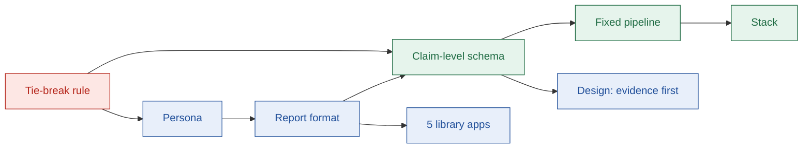

# Design decisions

## TL;DR

- 18 decisions shape Stamp. Each one lists what we chose, why, what we rejected, and the cost.
- The deciding rule for trade-offs: **evidence > useful guidance > problem fit > agent sophistication**.
- The biggest calls: a readiness report instead of a chat, claim-level evidence, and a fixed agent pipeline.

---

## 1. How the decisions connect

Red = the rule. Blue = product decisions. Green = technical decisions.

---

## 2. Summary

| # | Decision | Chosen |
| --- | --- | --- |
| 0 | Terminology | Plain OAuth terms in the UI, plus a glossary mapping them to Composio terms |
| 1 | Tie-break rule | Evidence > guidance > problem fit > agents |
| 2 | Persona | AI-agent developer moving to production who needs their own OAuth app |
| 3 | Format | A readiness report: library + live generator, one guide page |
| 4 | Feature scope | Must, Should and Could tiers; Won't list kept explicit |
| 5 | Library apps | GitHub, HubSpot, Gmail, LinkedIn, Salesforce |
| 6 | Guide schema | Claim-level evidence, rule-based difficulty, two milestones |
| 7 | Agent design | Fixed 9-stage pipeline, 1 bounded retry |
| 8 | Stack | Turborepo; React + Vite; Express; MySQL + Prisma; LangGraph JS; OpenAI; Tavily |
| 9 | Name | Stamp |
| 10 | Visual design | Paper and ink, one red accent, evidence labels in colour + icon + word |
| 11 | Evidence on demand | A claim shows its text and one compact label; sources, quote and Report open from it |
| 12 | Page frame | One 1120 px frame for every page; reading text near 70 characters |
| 13 | Colour and type roles | Label colours only on labels; red only on the stamp mark and the primary button; mono only for code-like values |
| 14 | Unknown values and clamps | One quiet "Not found" with the Uncertain label; headings cut on a word or a clause |
| 15 | One home per fact | The verdict summarises and links; a detail section holds the full version |
| 16 | A map for long pages | A sticky section nav that marks sections that are mostly Uncertain |
| 17 | Motion that explains | Five small motions, all with a still final state |

---

## 3. Decisions in detail

### D0. Terminology

| | |
| --- | --- |
| Chosen | Plain terms ("provider OAuth app", "user connection") with a glossary to Composio terms ("auth config", "connected account") |
| Why | Any developer understands the plain terms; the glossary shows how they map to Composio |
| Rejected | Composio-only terms: confusing outside Composio, and there is no Composio term for provider review |

### D1. Tie-break rule

| | |
| --- | --- |
| Chosen | Evidence first, then useful guidance, then problem fit, then agent sophistication |
| Why | A wrong guide is worse than no guide: it can cost a developer weeks of rejected reviews |
| Rejected | Agents first: risks an impressive agent that hangs or invents steps |

### D2. Persona

| | |
| --- | --- |
| Chosen | A developer taking an AI agent to production who needs their own OAuth app (own branding, custom scopes, or no managed app) |
| Why | Managed OAuth apps already cover prototyping; the pain starts at production |
| Rejected | An internal integrations team: not the user the problem describes |

### D3. Format

| | |
| --- | --- |
| Chosen | A readiness report: verdict first, then steps, blockers and sources; shared by link |
| Why | Developers need a plan they can act on and share, not a conversation |
| Rejected | Chat agent: free text is hard to label, verify and share. Step-by-step wizard: approvals take weeks, so tracking needs accounts and state |

### D4. Feature scope

| | |
| --- | --- |
| Chosen | Must = core loop; Should = proof features; Could = polish; Won't = explicit |
| Why | The core loop must work end to end before anything else |
| Cost | Could features are cut first if time runs short |

### D5. Library apps

| | |
| --- | --- |
| Chosen | One app per kind of hard: GitHub (instant), HubSpot (hidden limits), Gmail (review), LinkedIn (partner-gated), Salesforce (enterprise) |
| Why | Variety tests the product better than popularity |
| Rejected | Only easy apps: hides the real pain. A sixth app (Slack): overlaps GitHub's kind of hard |

### D6. Guide schema

| | |
| --- | --- |
| Chosen | Every fact is a claim with a label (Tested, Sourced, Uncertain) and sources; difficulty comes from a fixed rule; time is split into "first test" and "production" |
| Why | Labels can be checked by code; the same inputs always give the same score; HubSpot shows why one time estimate is not enough (about 1 hour to test, but a listing is needed past 25 installs) |
| Rejected | Sources per section: labels become decoration. Model-picked difficulty: scores drift between runs |
| Cost | A larger schema; the agent fills it section by section to keep output valid |

### D7. Agent design

| | |
| --- | --- |
| Chosen | A fixed pipeline: the model plans searches and extracts facts; code verifies quotes and scores; one retry if a section has no verified quote |
| Why | Predictable time and cost during a live demo; quote checks in code cannot agree with a mistake |
| Rejected | A free agent loop: unbounded time and cost. Multi-agent hand-offs: errors compound, and a model checking a model can agree with a hallucination |

### D8. Stack

| | |
| --- | --- |
| Chosen | Turborepo with pnpm; React + Vite on Vercel; Express, MySQL and Prisma on Railway; LangGraph JS; OpenAI; Tavily; Zod shared by both apps |
| Why | Fits the team's skills; an always-on API keeps long runs and streams stable; one shared schema prevents drift |
| Rejected | CopilotKit and chat UI kits: Stamp has no chat. Free hosts that sleep: the first request would hang |

### D9. Name

| | |
| --- | --- |
| Chosen | Stamp: "Know what it takes to get your OAuth app stamped." |
| Why | One syllable; names the outcome the developer wants: approval |
| Rejected | ReviewETA, OAuth Preflight (clashes with CORS preflight), Vet (clashes with an existing developer tool) |

### D10. Visual design

| | |
| --- | --- |
| Chosen | Paper and ink, one red accent for the verdict, three label colours, each with an icon and a word |
| Why | Makes evidence the visual centre; passes WCAG AA in light and dark modes |
| Rejected | Dark terminal look: bright accents hurt label contrast. Default component styles: look like every other project |

### D11. Evidence on demand

| | |
| --- | --- |
| Chosen | One `ClaimEvidence` trigger for every claim: the label with a source count ("Sourced · 1"). It opens one `EvidencePanel` with the label's meaning, the full claim, each source as a chip, the verbatim quote, the retrieved date and Report wrong claim. A popover from the tablet width, a bottom sheet on a phone. Sources are chips with no fetched favicon |
| Why | On the Gmail guide the inline form was 4 to 5 lines of metadata for each line of content and about 40 visible Report links. The label stays visible, so nothing is hidden; the rest is one step away. A favicon request would tell a third party every domain a guide cites |
| Rejected | Evidence inline: buries the facts. A hover tooltip: not reachable by touch or keyboard. A favicon service: a privacy leak for a small gain |
| Cost | One click to read a quote. The count in the label tells you whether there is one to read |

### D12. Page frame

| | |
| --- | --- |
| Chosen | One `PageContainer` (1120 px, 16 px gutters, 24 px from the tablet breakpoint) shared by the header, every page and the footer. Reading text stays near 70 characters with `max-w-prose`. This replaces the 880 px content width, which no page used consistently |
| Why | The content column used to start at a different x on Landing, Library and Guide. Tables and the timeline need the width; sentences do not |
| Rejected | A narrow column for prose pages: the Library table and the timeline would not fit. A frame per page: the drift we are fixing |

### D13. Colour and type roles

| | |
| --- | --- |
| Chosen | Green, blue and amber appear only on label badges. Stamp red marks the stamp (the score in an outline, turned a little) and the primary button. Data text is ink. A warning or a blocker is a neutral callout with a left bar and an icon. Mono is for scope strings, durations, counts, the score and labels; every sentence is Inter. No new token |
| Why | Red verdict values read as errors. An amber blocker with a Sourced claim sent two messages at once. Long mono paragraphs are slow to read |
| Rejected | A "warning" token: a left bar and an icon say it with no new colour to keep accessible |

### D14. Unknown values and clamps

| | |
| --- | --- |
| Chosen | `UnknownValue` is a muted inline "Not found" and the Uncertain label; the reason is in the evidence panel. A value that is not a claim (a duration the text does not state) says "No duration stated" with no label. Headings are cut on a word, or on a clause for a blocker title (`clampWords`, `clauseTitle`), and the full text is in the body |
| Why | "Unknown" as a heading and an empty card stretched to a neighbour are loud for a fact that is only missing. A label on a missing duration would contradict the label on the sentence beside it |
| Rejected | Hiding unknown rows: a gap must be visible. A cut at a fixed length: it split words ("disco…") |

### D15. One home per fact

| | |
| --- | --- |
| Chosen | The verdict holds the one-line summary of each answer. Timeline, steps and blockers hold the full version, and each verdict row links to its section. The next step and top blocker section, the share strip and the second "Read how we verify" link are gone. Durations on chips are read from the claim text and never replace it. The library reads each guide for its times, because the list endpoint has none |
| Why | The same blocker and the same milestones appeared twice on the Gmail guide. A duration read from text can misread a sentence, so the sentence stays beside it |
| Rejected | Putting the extracted duration in the verdict row: a first match can mislead. Adding times to the list endpoint: out of scope for this pass |
| Cost | The library makes one read per row. That is fine for a small library; add list fields when it grows |

### D16. A map for long pages

| | |
| --- | --- |
| Chosen | A sticky section nav on a wide screen and a "Jump to" select on a phone, on the Guide and How we verify. The active section is highlighted. A section is marked when more than half of its content claims are Uncertain; a step's effort is left out because time estimates are always Uncertain |
| Why | The Gmail guide is about 15 screens tall |
| Rejected | Top tabs: they hide the order of the sections. Counting every claim: every steps section would be marked for its efforts alone |

### D17. Motion that explains

| | |
| --- | --- |
| Chosen | Five motions: the active step and progress line on Landing (wide screens only), one stamp press, the evidence popover, the steps and blockers accordion, and the section nav. CSS and one `IntersectionObserver`. With reduced motion each shows its final state |
| Why | Motion is for order, origin and place. Nothing loops |
| Rejected | An animation library: CSS does the job. Parallax and scroll-jacking: they cost the reader control |

---

## 4. Findings that shaped the decisions

| Finding | Effect | Source |
| --- | --- | --- |
| Composio's own setup guides list clicks but not waits or blockers | Defined the gap Stamp fills | [composio.dev/auth/hubspot](https://composio.dev/auth/hubspot) |
| New HubSpot apps stop at 25 installs until listed | Led to the two-milestone time model | [HubSpot changelog](https://developers.hubspot.com/changelog/new-marketplace-distribution-app-install-limits) |
| HubSpot treats apps that connect it to AI agents as "AI connectors" with extra listing rules | A blocker every AI-agent developer should see | [HubSpot forum](https://community.hubspot.com/t/ai-connector-as-legacy-public-app-install-limitation/148177) |
| A popular Salesforce guide still recommends a path Salesforce now restricts | Official sources must win over third-party ones | [Salesforce](https://developer.salesforce.com/docs/atlas.en-us.api_rest.meta/api_rest/intro_understanding_authentication.htm) |
| Composio docs show two callback paths, `/api/v3/` and `/api/v3.1/` | A live example of the Uncertain label | [docs 1](https://docs.composio.dev/docs/custom-app-vs-managed-app.md), [docs 2](https://docs.composio.dev/docs/auth-configuration/custom-auth-configs) |

---

## Next

- Read [solution.md](./solution.md) to see the decisions as one product.
