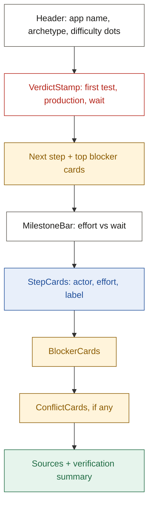

# Design system

## TL;DR

- **Look:** paper and ink. Calm off-white pages, dark ink text, one red accent: the stamp.
- **Colour means something:** red = verdict, green = Tested, blue = Sourced, amber = Uncertain.
- **Never colour alone:** every label also has an icon and a word.
- **Type:** Inter for reading, JetBrains Mono for data. Light and dark modes; all text passes WCAG AA.

---

## 1. Principles

| Principle | In practice |
| --- | --- |
| Evidence first | Labels are the most visible element after the verdict |
| Answer before detail | The verdict stamp sits above every step |
| One accent | Stamp red is used only for the verdict and the primary button |
| Readable at a glance | Monospace for scopes, URLs and labels; sans for sentences |
| Accessible by default | AA contrast in both modes; colour is never the only signal |

---

## 2. Colour tokens

Contrast is the WCAG ratio against the token's background. AA needs 4.5:1 for normal text.

| Token | Light | Dark | Use | Contrast (light / dark) |
| --- | --- | --- | --- | --- |
| `--paper` | `#FAF8F3` | `#141311` | Page background | - |
| `--card` | `#FFFFFF` | `#1D1C19` | Cards, guide body | - |
| `--ink` | `#1C1B19` | `#F2EFE8` | Body text | 16.2 / 16.2 |
| `--ink-muted` | `#5F5B53` | `#A8A397` | Secondary text | 6.4 / 7.4 |
| `--rule` | `#E4DFD3` | `#2E2C27` | Hairlines (decorative) | - |
| `--stamp` | `#B42318` | `#F4735F` | Verdict stamp, primary button | 6.2 / 6.6 |
| `--on-stamp` | `#FFFFFF` | `#141311` | Text on a stamp-filled button | 6.6 / 6.6 |
| `--tested` / `--tested-bg` | `#1F6B43` / `#E6F4EC` | `#7FD4A6` / `#11301F` | Tested label | 5.7 / 8.1 |
| `--sourced` / `--sourced-bg` | `#1F4E99` / `#E8EFFA` | `#9EBEF7` / `#17294A` | Sourced label, links, focus ring | 7.0 / 7.7 |
| `--uncertain` / `--uncertain-bg` | `#8A5A00` / `#FFF4DB` | `#F3C467` / `#3A2A08` | Uncertain label, blockers | 5.4 / 8.5 |

- **Dark-mode trap:** white text on the dark `--stamp` fails AA. Always use `--on-stamp`.

```css
:root {
  --paper: #FAF8F3; --card: #FFFFFF; --ink: #1C1B19; --ink-muted: #5F5B53; --rule: #E4DFD3;
  --stamp: #B42318; --on-stamp: #FFFFFF;
  --tested: #1F6B43; --tested-bg: #E6F4EC;
  --sourced: #1F4E99; --sourced-bg: #E8EFFA;
  --uncertain: #8A5A00; --uncertain-bg: #FFF4DB;
}
.dark {
  --paper: #141311; --card: #1D1C19; --ink: #F2EFE8; --ink-muted: #A8A397; --rule: #2E2C27;
  --stamp: #F4735F; --on-stamp: #141311;
  --tested: #7FD4A6; --tested-bg: #11301F;
  --sourced: #9EBEF7; --sourced-bg: #17294A;
  --uncertain: #F3C467; --uncertain-bg: #3A2A08;
}
```

Map these variables into the Tailwind theme so classes like `bg-paper` and `text-stamp` work.

---

## 3. Typography

| Role | Font | Size / weight | Example |
| --- | --- | --- | --- |
| Page title | Inter | 32 / 600 | HubSpot |
| Section heading | Inter | 24 / 600 | Steps |
| Card title | Inter | 18 / 600 | Create a developer account |
| Body | Inter | 15 / 400 | Copy the client secret into the auth config. |
| Small | Inter | 13 / 400 | Human · about 10 min |
| Data | JetBrains Mono | 13 / 400 | `crm.objects.contacts.read` |
| Stamp | JetBrains Mono | 13 / 600 | First test: about 1 hour |

- Line height: 1.5 for body, 1.25 for headings.
- Sentence case everywhere.

---

## 4. Spacing, radius, layout

| Token | Value |
| --- | --- |
| Spacing scale | 4, 8, 12, 16, 24, 32, 48 px |
| Radius | 6 px for cards and inputs; pills fully rounded |
| Content width | 880 px max, centred |
| Card padding | 16 px (mobile), 24 px (desktop) |
| Section gap | 32 px |
| Breakpoint: phone | Default (base styles); no min-width |
| Breakpoint: tablet | 768 px (`tablet:` in Tailwind) |
| Breakpoint: desktop | 1024 px (`desktop:` in Tailwind) |

---

## 5. Guide page layout



Top to bottom = most important to least.

---

## 6. Voice in the UI

| Do | Don't |
| --- | --- |
| "Approval wait: unknown" | "Approval should be quick!" |
| "Quote not found in source" | "Error: verification failed" |
| "Copy link" | "Click here to share" |

---

## Next

- Read [flow.md](./flow.md) to see this system in the user's journey.
