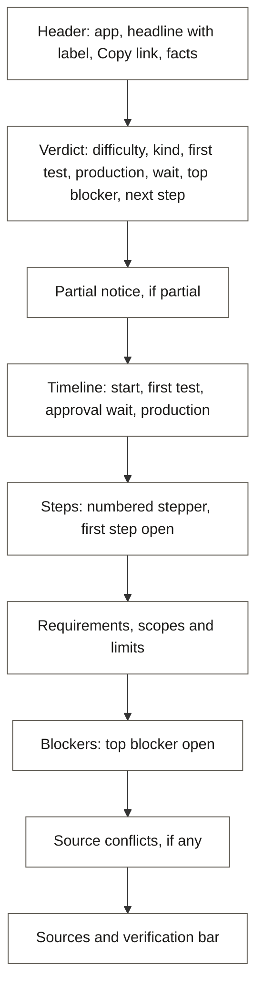

# Design system

## TL;DR

- **Look:** paper and ink. Calm off-white pages, dark ink text, one red accent: the stamp.
- **Colour means something:** green = Tested, blue = Sourced, amber = Uncertain, and only on label badges. Red is the brand stamp and the primary button.
- **Never colour alone:** every label also has an icon and a word.
- **Type:** Inter for every sentence, JetBrains Mono only for code-like values. Light and dark modes; all text passes WCAG AA.
- **Evidence on demand:** a claim shows its text and one compact label. Sources, quote and Report open from it.

---

## 1. Principles

| Principle | In practice |
| --- | --- |
| Evidence first | Labels are the most visible element after the verdict |
| Answer before detail | The verdict stamp sits above every step |
| One accent | Stamp red is used only for the stamp mark and the primary button |
| Readable at a glance | Monospace for scope strings, durations, counts, the score and labels; sans for sentences |
| Accessible by default | AA contrast in both modes; colour is never the only signal |
| Focus | The sourced focus ring appears on links and buttons. Text inputs keep the field border only; no focus outline on inputs |

---

## 2. Colour tokens

Contrast is the WCAG ratio against the token's background. AA needs 4.5:1 for normal text.

| Token | Light | Dark | Use | Contrast (light / dark) |
| --- | --- | --- | --- | --- |
| `--paper` | `#FAF8F3` | `#141311` | Page background | - |
| `--card` | `#FFFFFF` | `#1D1C19` | Cards, guide body | - |
| `--ink` | `#1C1B19` | `#F2EFE8` | Body text | 16.2 / 16.2 |
| `--ink-muted` | `#5F5B53` | `#A8A397` | Secondary text | 6.4 / 7.4 |
| `--rule` | `#E4DFD3` | `#2E2C27` | Hairlines (decorative) | - |
| `--stamp` | `#B42318` | `#F4735F` | Stamp mark, primary button | 6.2 / 6.6 |
| `--on-stamp` | `#FFFFFF` | `#141311` | Text on a stamp-filled button | 6.6 / 6.6 |
| `--tested` / `--tested-bg` | `#1F6B43` / `#E6F4EC` | `#7FD4A6` / `#11301F` | Tested label | 5.7 / 8.1 |
| `--sourced` / `--sourced-bg` | `#1F4E99` / `#E8EFFA` | `#9EBEF7` / `#17294A` | Sourced label, links, focus ring on links and buttons | 7.0 / 7.7 |
| `--uncertain` / `--uncertain-bg` | `#8A5A00` / `#FFF4DB` | `#F3C467` / `#3A2A08` | Uncertain label | 5.4 / 8.5 |

- **Dark-mode trap:** white text on the dark `--stamp` fails AA. Always use `--on-stamp`.
- **No new token was needed** for the redesign. Warnings and blockers use a neutral callout (ink bar and icon) instead of an amber fill.

Pairings the redesign adds. Text needs 4.5:1 (3:1 for the large stamp score); a graphic needs 3:1.

| Pairing | Use | Contrast (light / dark) |
| --- | --- | --- |
| `--ink` on `--card` | Row values, callout text | 17.2 / 14.8 |
| `--ink-muted` on `--card` | Labels, helper text, inactive nav | 6.8 / 6.8 |
| `--ink-muted` on `--paper` | Helper text on the page | 6.4 / 7.4 |
| `--stamp` on `--card` | Stamp mark outline and score | 6.6 / 6.1 |
| `--tested`, `--sourced`, `--uncertain` fills on `--card` | Verification bar segments | 6.5 / 9.6, 8.1 / 9.1, 5.9 / 10.5 |
| `--uncertain` on `--paper` | Uncertain marker in the section nav | 5.6 / 11.4 |
| `--sourced` on `--paper` or `--card` | Focus ring | 7.6 / 9.9 or 8.1 / 9.1 |
| `--ink-muted` on `--card` | Left bar of a callout | 6.8 / 6.8 |

Lines that only decorate (the timeline and stepper connectors, ghost rows, the banner grid) use `--ink-muted` at 25 to 40 percent or `--rule`. Their meaning is also in the numbers and words beside them.

```css
:root {
  --paper: #FAF8F3; --card: #FFFFFF; --ink: #1C1B19; --ink-muted: #5F5B53; --rule: #E4DFD3;
  --stamp: #B42318; --on-stamp: #FFFFFF;
  --tested: #1F6B43; --tested-bg: #E6F4EC;
  --sourced: #1F4E99; --sourced-bg: #E8EFFA;
  --uncertain: #8A5A00; --uncertain-bg: #FFF4DB;
}
.dark {
  --paper: #141311; --card: #1D1C19; --ink: #F2EFE8; --ink-muted: #A8A397; --rule: #2E2C27;
  --stamp: #F4735F; --on-stamp: #141311;
  --tested: #7FD4A6; --tested-bg: #11301F;
  --sourced: #9EBEF7; --sourced-bg: #17294A;
  --uncertain: #F3C467; --uncertain-bg: #3A2A08;
}
```

Map these variables into the Tailwind theme so classes like `bg-paper` and `text-stamp` work.

---

## 3. Typography

| Role | Font | Size / weight | Example |
| --- | --- | --- | --- |
| Page title | Inter | 32 / 600 | HubSpot |
| Section heading | Inter | 24 / 600 | Steps |
| Card title | Inter | 18 / 600 | Create a developer account |
| Body | Inter | 15 / 400 | Copy the client secret into the auth config. |
| Small | Inter | 13 / 400 | Human · about 10 min |
| Data | JetBrains Mono | 13 / 400 | `crm.objects.contacts.read`, `1 to 4 weeks`, `3/5` |
| Stamp | JetBrains Mono | 13 / 600 | First test: about 1 hour |

- Line height: 1.5 for body, 1.25 for headings.
- Sentence case everywhere.
- Mono is for code-like values only (see R4). Every sentence is Inter.

---

## 4. Spacing, radius, layout

| Token | Value |
| --- | --- |
| Spacing scale | 4, 8, 12, 16, 24, 32, 48 px |
| Radius | 6 px for cards and inputs; pills fully rounded |
| Page frame | 1120 px (70rem) max, centred, 16 px gutters (24 px from the tablet breakpoint). One frame for the header, every page and the footer |
| Reading width | About 70 characters (`max-w-prose`) inside the frame |
| Card padding | 16 px (mobile), 24 px (desktop) |
| Section gap | 32 px |
| Breakpoint: phone | Default (base styles); no min-width |
| Breakpoint: tablet | 768 px (`tablet:` in Tailwind) |
| Breakpoint: desktop | 1024 px (`desktop:` in Tailwind) |

---

## 5. Guide page layout



Top to bottom = most important to least. A sticky section navigation sits beside the page (a "Jump to" select on a phone) and marks a section that is mostly Uncertain.

- **Verdict** is the one summary. The stamp mark holds the score, so there is no difficulty row; the kind of hard row ends with "Why this score". The page title already names the app, so the verdict does not. Each claim row links to the section that holds the full version, so no fact is told twice.
- **Timeline** runs across on a wide screen and down on a phone. A node shows the duration its text states in mono, or "No duration found" once. When no node states a duration, one callout says so. An unknown "Waits on" is left out.
- **Steps** are a numbered stepper. An actor summary explains the count ("11 steps: 11 by you, 0 by an agent"). The label of the detail sits at the right of the title; a quiet line says who does it and the effort; the effort and its label open with the detail.
- **Requirements, scopes and limits** are three stacked subsections. Requirements are a plain list, since a box looks clickable and saving progress is on the Won't list. Scopes are a table; a scope string is mono with a copy button, and a scope the sources describe in words is plain text.
- **Blockers** are warning callouts. The top blocker is tagged and open; the others start closed.
- **Sources** are a table (source, tier, claims that use it) beside a stacked bar of Tested, Sourced and Uncertain with the numbers.

---

## 6. Rules for evidence and data

Eleven causes of clutter, each fixed once in a shared component.

| # | Rule | Where it lives |
| --- | --- | --- |
| R1 | A claim shows its text and one compact label with a source count ("Sourced · 1"). The label opens the evidence panel: label meaning, full claim, sources, quote, retrieved date, Report wrong claim. A popover from the tablet width, a bottom sheet on a phone. A label is never hidden. | `ClaimEvidence`, `EvidencePanel` |
| R2 | A source is a chip: domain initial, domain, short title, tier tag, external icon. It never wraps. The full URL is in the tooltip and the accessible name. No favicon is fetched, which would tell a third party every domain a guide cites. A navigation link is ink, with no underline at rest and an arrow. | `SourceChip`, `TextLink` |
| R3 | Label colours appear only on label badges. Stamp red is the stamp mark and the primary button. Data is ink. Warnings and blockers are a neutral callout with a left bar and an icon. | `Callout` |
| R4 | Mono only for code-like values: scope strings, durations, counts, the score, labels. Sentences are Inter. | `font-mono`, `text-data` |
| R5 | Each fact has one home. The verdict holds the one-line summary, a detail section the full version, and the row links to it. | `Verdict`, section ids |
| R6 | An unknown value is a muted inline "Not found" and the Uncertain label. The full reason is in the evidence panel. Never an empty card, never stretched to a neighbour. A value that is not a claim (a duration the text does not state) takes no label. | `UnknownValue` |
| R7 | Never cut a heading mid-word. Cut on a word or a clause, and show the full text in the body. | `clampWords`, `clauseTitle` |
| R8 | One page frame (1120 px, 16 / 24 px gutters) for the header, every page and the footer. Reading text stays near 70 characters. | `PageContainer` |
| R9 | A long page has a map: a sticky nav on a wide screen, a "Jump to" select on a phone, the active section highlighted, a marker on a section that is mostly Uncertain (more than half of its content claims). | `SectionNav` |
| R10 | The run summary and the guide use the same counts and the same words. Only Tested is confirmed, so Sourced reads "sourced" ("11 of 24 claims sourced"). An Uncertain claim says why: downgraded (the stream says which), not found (no source), or a time estimate (an estimate with a source stays Uncertain by rule). Counts: "24 claims: 11 sourced, 13 uncertain (2 downgraded, 10 not found, 1 time estimate)". | `claimSummary`, `describeClaimCounts` |
| R11 | A label sits beside the text it belongs to. A row never puts two labels side by side. A quiet fact in a meta line ("Human · Effort not stated") has no label; its label shows where its text is shown in full. | `StepRow`, `BlockerCallout` |

---

## 7. Shared components

| Component | Purpose |
| --- | --- |
| `PageContainer` | R8. The one frame |
| `SectionHeading` | Title, one-line description, optional right-side action |
| `PageSection` | A section of a long page: anchor id, hairline, heading, content |
| `ClaimEvidence`, `EvidenceBadge`, `EvidenceChip`, `EvidencePanel` | R1. The trigger (badge, or a value with its label) and the panel |
| `ClaimLine` | A claim as a list line: text, label, or `UnknownValue` |
| `ReportClaim` | Report wrong claim, inside the panel. It shows only inside a guide |
| `SourceChip` | R2. A source as a chip |
| `TextLink` | R2. An ink link with an arrow |
| `Callout` | R3. Neutral card with a left bar and an icon; info and warning |
| `UnknownValue` | R6. Muted "Not found" and the Uncertain label |
| `AppIdentity` | App mark and the guide's own display name, never one made from the slug |
| `Verdict`, `StampMark` | The summary. The stamp mark is the score in a stamp-red outline, pressed once when it first shows |
| `SectionNav`, `JumpToSelect` | R9 |
| `CopyButton` | Copies a value and says so |
| `KindChip`, `ActorChip` | The kind of hard and who does a step. Neutral, never a label colour |
| `LabelBar` | The claims by label as one stacked bar with the numbers. On the Guide and on the run result |
| `RunHeader`, `RunStatusPill`, `RunMeters` | The sticky bar of the run page, its status pill and its time and page meters |
| `StageBar`, `TraceTimeline`, `StageGroup`, `EventRow`, `QuoteRow` | The run's stage bar and its trace grouped by stage |
| `RunResultCard`, `RunNotice` | The run's result (the compact Verdict) and the callout for a run that did not finish |
| Primitives | `popover`, `sheet`, `accordion`, `table` over the `radix-ui` package |

---

## 8. Live run page

The page answers four questions in order: is it working, how long is left, can I trust what it finds, and where do I go.

- **Sticky bar:** the app (the guide's own name once the run is done, else what the visitor typed made readable, else the slug), a status pill (Researching, Done, Partial, Stopped, Disconnected, Not found), the current stage in plain words ("Reading pages"), and time and page meters. Retries show only after a retry. Only the stage line is a polite live region.
- **Merged timeline:** a nine segment stage bar (a check for done, a pulse for running, a dash for not run; each segment opens its group), then the trace grouped by stage in time order. A group header names the stage, who runs it (our code, an AI model, an outside call), its state, its time and a summary ("4 pages read: 3 official, 1 third party", "13 quotes checked: 11 matched, 2 downgraded"). The running group is open and a done group closes. A stage that sends no events has a header only.
- **Rows:** a search is the query in mono; a page is a source chip, never a raw address; a quote reads "Blocker 1, Fix" with its chip and the Sourced label; a downgrade has an ink bar, the Uncertain label and its reason, and a filter shows only those; a retry says why the run searched again.
- **Follow:** the page scrolls, with no inner scroll box. It follows the newest row while the reader is at the end, and "Jump to latest" appears when they scroll up. When the run ends while it follows, it scrolls to the result.
- **Result:** the compact Verdict, the count sentence (R10) with a label bar, and "Open the guide" (plus "Retry run" when partial). The trace stays below, closed, as the audit trail.
- **Not finished:** a run error, a lost stream or an unknown run is a callout with its actions. The trace so far stays under it, closed.

---

## 9. Motion

Motion appears only where it explains something. CSS transitions and one `IntersectionObserver`; no animation library. With `prefers-reduced-motion`, every item shows its final state at once.

| Where | Motion | Why |
| --- | --- | --- |
| Landing "How Stamp works" | The active step and a progress line follow the scroll, on a wide screen only | Shows the three steps in order |
| Stamp mark | One press: scale and turn in, about 250 ms, once | The brand moment |
| Evidence popover and sheet | Fade and scale, or slide, 150 to 200 ms | Shows where the panel comes from |
| Steps and blockers | Height and opacity, 200 ms | Keeps the reader's place |
| Section nav | Active item colour | Shows the scroll position |
| Run page: stage bar and meters | A segment changes colour over 200 ms; a meter fills over 250 ms | Shows progress |
| Run page: new rows and groups | A row fades in over 150 ms; a group opens over 200 ms | Shows where an event came from |
| Run page: follow and "Jump to latest" | The page follows the newest row at the end of the trace; "Jump to latest" fades in when the reader scrolled up. Instant under reduced motion | Keeps the newest event in view without taking the reader's place |
| Run page: live dot | The running segment, the status dot and a running group's dot pulse, and stop when the run ends | The one loop: it says "this is still working". Under reduced motion it is a still dot and the word "Running" |

There is no parallax and no scroll-jacking. The live dot is the only motion that repeats, and only while a run is live.

---

## 10. Voice in the UI

| Do | Don't |
| --- | --- |
| "Approval wait: unknown" | "Approval should be quick!" |
| "Quote not found in the page" | "Error: verification failed" |
| "Copy link" | "Click here to share" |
| "Not found" with the Uncertain label | A large "Unknown" heading |

---

## Next

- Read [flow.md](./flow.md) to see this system in the user's journey.
