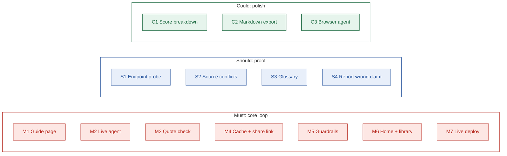

# Features

## TL;DR

- Features are ranked Must, Should, Could and Won't.
- **Must** is the core loop: look up an app, get a sourced guide, share it.
- **Should** turns labels into proof: tested claims, source conflicts, a glossary, error reports.
- **Could** adds polish and a browser agent. **Won't** lists what we left out and why.

---

## 1. Feature map

Must is the base. Build from the bottom up: every Must works before any Should starts.

---

## 2. Must: the core loop

| ID | Feature | What it does | Why it matters |
| --- | --- | --- | --- |
| M1 | Guide page | Shows the verdict first (difficulty, time, top blocker, next step), then steps, blockers and sources | Answers the developer's four questions in under 2 minutes |
| M2 | Live agent | Researches any app and writes its guide; progress streams on screen | Covers apps outside the library |
| M3 | Quote check | Confirms each claim's quote appears in its source page; downgrades it to Uncertain if not | Stops made-up steps from looking trustworthy |
| M4 | Cache + share link | Saves every guide at `/g/[app]` | Repeat lookups are instant; teams share one link |
| M5 | Guardrails | Timeouts, rate limit, daily run cap; keys stay on the server | The live demo never hangs or runs up costs |
| M6 | Home + library | Search box plus the library: guides the agent already researched, each checked by code before it is added (GitHub, HubSpot, Notion, Slack; see D26) | Instant answers for common apps |
| M7 | Live deploy | A public link anyone can open | Reviewers can try an unfamiliar app themselves |

---

## 3. Should: proof

| ID | Feature | What it does | Why it matters |
| --- | --- | --- | --- |
| S1 | Endpoint probe | Calls the provider's authorize URL with a dummy client ID and records the response | Turns some claims from Sourced into Tested |
| S2 | Source conflicts | Shows two sources that disagree, which one wins, and why | Honest about stale or conflicting docs |
| S3 | Glossary | Explains each OAuth term once, mapped to Composio's terms | Removes confusion between the app and a user connection |
| S4 | Report wrong claim | A link on each claim to flag it | Guides improve as people use them |

---

## 4. Could: polish

| ID | Feature | What it does | Why it matters |
| --- | --- | --- | --- |
| C1 | Score breakdown | Click the difficulty score to see the four factors behind it | Makes the score explainable |
| C2 | Markdown export | Download a guide as a `.md` file | Easy to paste into a team wiki |
| C3 | Browser agent | Tries parts of a developer-portal setup in a real browser; off by default, local only | Shows agents attempting setup, not just reading about it |

---

## 5. Won't: left out on purpose

| ID | Not building | Why |
| --- | --- | --- |
| W1 | Accounts and progress tracking | Approvals take weeks; tracking needs logins and stored state |
| W2 | All 100 guides | The brief asks for a few varied apps plus live generation |
| W3 | Submitting real provider reviews | Needs a real company and weeks of waiting |
| W4 | Chat interface | The developer needs a plan to act on and share, not a conversation |

---

## 6. Build order

| Order | Tier | Rule |
| --- | --- | --- |
| 1 | Must | Ship the full loop end to end before anything else |
| 2 | Should | Start only after every Must works on the live link |
| 3 | Could | C1, then C2, then C3; cut from the end if time runs out |

---

## Next

- Read [flow.md](./flow.md) to see the features in one user journey.
