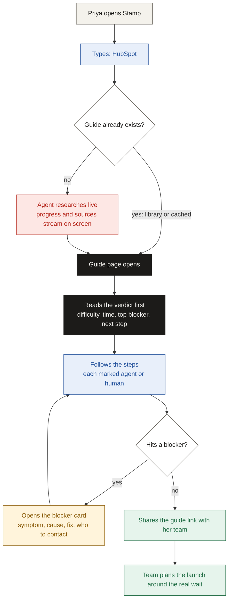

# Core user flow

## TL;DR

- One flow: a developer looks up an app and leaves with a plan they can act on and share.
- Stamp answers four questions first: how hard, how long, what blocks it, what an agent can do.
- Then it gives the steps, a fix for each blocker, and a share link.

---

## 1. Who and why

| Field | Detail |
| --- | --- |
| User | Priya, building a sales agent, moving to production |
| Goal | Let her users connect HubSpot with her own branded OAuth app |
| Question in her head | "Is this one hour or six weeks, and what will stop me?" |

---

## 2. The flow

---

## 3. Step by step

| # | Priya does | Stamp shows | Her question answered |
| --- | --- | --- | --- |
| 1 | Types "HubSpot" | Library guide, or a live agent run with progress | Where do I start? |
| 2 | Reads the verdict | Difficulty 4/5, about 1 hour to first test, Marketplace listing needed past 25 installs | How hard, and how long? |
| 3 | Checks the top blocker | The 26th install is blocked until the app is listed | What could stop me? |
| 4 | Follows the steps | 8 steps, each marked agent, human, or agent-assist | What can an agent do for me? |
| 5 | Hits a 400 error at token exchange | Blocker card: likely a wrong client secret; copy the current one | How do I get unstuck? |
| 6 | Copies the link | `/g/hubspot` with the date and every source | How do I align my team? |

Every fact on screen carries a label: Tested, Sourced or Uncertain.

---

## 4. Before and after

| | Without Stamp | With Stamp |
| --- | --- | --- |
| First answer | After reading docs, forums and changelogs | In under 2 minutes |
| The wait | Found after starting | Shown first |
| Blockers | Found by hitting them | Listed with a fix |
| Trust | Unknown which source is current | Every claim labelled with its source |
| Sharing | Notes in a chat thread | One link |

---

## Next

- Read [solution.md](./solution.md) for how each part works.
