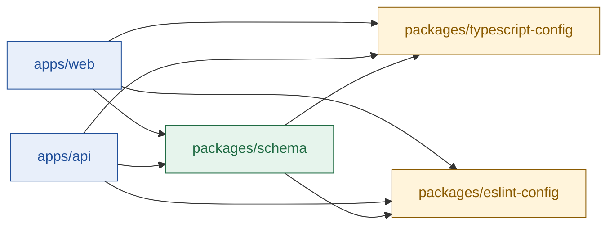

# Folder structure

## TL;DR

- **2 apps:** `apps/web` (UI on Vercel) and `apps/api` (server + agent on Railway).
- **3 packages:** `packages/schema` (shared Zod schemas and types), `packages/typescript-config` (shared tsconfig) and `packages/eslint-config` (shared lint rules).
- **Rule:** code becomes a package only if 2 or more workspaces import it.
- **No separate types package:** types come from the Zod schemas with `z.infer`, so there is one source of truth.

---

## 1. Root level

| Path | Purpose |
| --- | --- |
| `apps/` | Deployable apps: `web`, `api` |
| `packages/` | Shared code: `schema`, `typescript-config`, `eslint-config` |
| `docs/` | Project context: assignment, problem, solution, tech stack, this file |
| `package.json` | Root scripts: `dev`, `build`, `test`, `lint` (run through Turbo) |
| `pnpm-workspace.yaml` | Declares `apps/*` and `packages/*` as workspaces |
| `turbo.json` | Task pipeline; packages build before apps |
| `.npmrc` | pnpm settings |
| `.prettierrc` | One formatting config for every workspace |
| `.gitignore` | Ignores `node_modules`, `dist`, `.env`, `.turbo` |
| `README.md` | Setup, key decisions, limitations, verification log |
| `AGENTS.md`, `CLAUDE.md` | Instructions for AI coding agents |

---

## 2. Workspaces

Arrows point from a workspace to what it imports.

| Workspace | Package name | Deployed to | Imported by |
| --- | --- | --- | --- |
| `apps/web` | `web` | Vercel | none |
| `apps/api` | `api` | Railway | none |
| `packages/schema` | `@stamp/schema` | not deployed | web, api |
| `packages/typescript-config` | `@stamp/typescript-config` | not deployed | web, api, schema |
| `packages/eslint-config` | `@stamp/eslint-config` | not deployed | web, api, schema |

---

## Next

- Read [tech-stack.md](./tech-stack.md) for the tools in each workspace.
