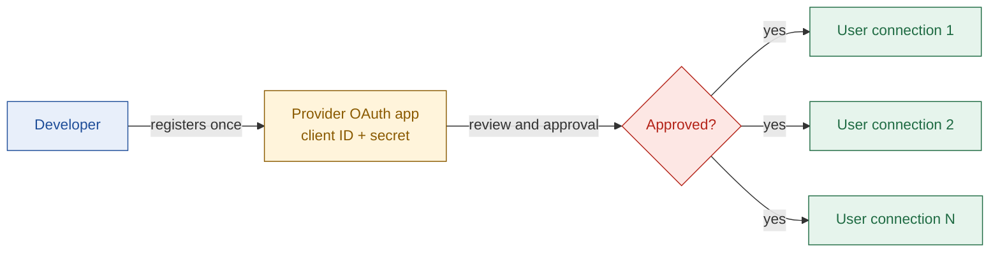

# Problem

## TL;DR

- AI-agent developers must set up their own OAuth app with each provider before they launch.
- Before they start, they cannot tell if setup takes one hour or six weeks.
- Docs list the clicks. They hide the approval wait, the hidden limits and the blockers.
- So launches slip while developers dig through docs and email providers.

---

## 1. Who has this problem

| Field | Detail |
| --- | --- |
| Persona | A developer building an AI agent product, moving from prototype to production |
| Situation | Their users must connect apps like Gmail, HubSpot or Salesforce to the agent |
| Trigger | They need their own OAuth app: own brand on the consent screen, custom scopes, or an app with no ready-made OAuth app |

Example: Priya builds a sales agent. Her users must connect HubSpot. In production, the HubSpot consent screen must show her product name, not someone else's. So she must create her own HubSpot OAuth app.

---

## 2. Background: two layers of OAuth

OAuth lets a user give an app limited access to their account without sharing a password.

There are two layers. People mix them up.

| Layer | What it is | How often | Who does it |
| --- | --- | --- | --- |
| Provider OAuth app | A one-time registration of the developer's product with the provider | Once per product, per provider | The developer |
| User connection | One end user's permission for the product to access their account | Once per end user | Each end user |

- **This project is about the first layer:** the provider OAuth app.
- The pain sits in the review step. Nothing reaches users until it passes.

---

## 3. The problem

A developer cannot answer four questions before they start:

| # | Question | Why they cannot answer it today |
| --- | --- | --- |
| 1 | How hard is setup for this app? | Every provider has a different process |
| 2 | How long will it take, including the approval wait? | Docs show steps, not wait times |
| 3 | What could block or limit approval? | Limits and review rules sit in changelogs, forums and policy pages |
| 4 | What can an agent do for me, and where must I take over? | Nobody splits the work this way |

---

## 4. Why the problem exists

| Cause | Example | Source |
| --- | --- | --- |
| Guides list clicks, not waits | Composio's HubSpot guide has 3 setup steps and no review, time or blocker info | [composio.dev/auth/hubspot](https://composio.dev/auth/hubspot) |
| Each provider works differently | GitHub needs no review. LinkedIn needs a vetting form and a screen recording. | [Nango](https://www.nango.dev/docs/api-integrations/github-app-oauth/how-to-register-your-own-github-app-api-oauth-app), [Microsoft Learn](https://learn.microsoft.com/en-us/linkedin/shared/linkedin-api-partner-support-guide) |
| Rules change | Salesforce restricted new Connected Apps in Spring '26 | [Salesforce](https://developer.salesforce.com/docs/atlas.en-us.api_rest.meta/api_rest/intro_understanding_authentication.htm) |
| Limits are hidden | New HubSpot apps stop at 25 installs until listed on the Marketplace | [HubSpot changelog](https://developers.hubspot.com/changelog/new-marketplace-distribution-app-install-limits) |
| Sources go stale or disagree | A popular third-party Salesforce guide still recommends the restricted path | [Nango](https://nango.dev/docs/api-integrations/salesforce/salesforce-api-oauth-app-setup) |

---

## 5. How different "hard" looks

| App | Type of hard | What catches developers | Source |
| --- | --- | --- | --- |
| GitHub | Instant | Nothing. No review unless listed on the GitHub Marketplace. | [Nango](https://www.nango.dev/docs/api-integrations/github-app-oauth/how-to-register-your-own-github-app-api-oauth-app) |
| HubSpot | Hidden limits | Easy to start, capped at 25 installs until listed | [HubSpot changelog](https://developers.hubspot.com/changelog/new-marketplace-distribution-app-install-limits) |
| Gmail | Review needed | Restricted scopes need a third-party security assessment (CASA): weeks plus a fee | [Google](https://developers.google.com/health/app-verification) |
| LinkedIn | Partner-gated | API access needs vetting, then a second review with a screen recording | [Microsoft Learn](https://learn.microsoft.com/en-us/linkedin/shared/linkedin-api-partner-support-guide) |
| Salesforce | Enterprise | New Connected Apps restricted; External Client Apps replace them | [Salesforce](https://developer.salesforce.com/docs/atlas.en-us.api_rest.meta/api_rest/intro_understanding_authentication.htm) |

---

## 6. Problem statement

> An AI-agent developer going to production must set up their own OAuth app with each provider. Before starting, they cannot tell if it takes an hour or six weeks, or what will block approval. So launches slip while they dig through docs and email providers.

---

## 7. What success looks like

| Measure | Target |
| --- | --- |
| Time to plan | In under 2 minutes, the developer can name the difficulty, total time, next step and top blocker |
| Trust | Every claim shows a source and says if it was tested, sourced or uncertain |

---

## 8. Not in scope

| Out | Why |
| --- | --- |
| User connections and token handling | Platforms like Composio already handle this layer |
| Non-OAuth auth (API keys, basic auth) | The problem is about OAuth apps |
| Submitting real provider reviews | Needs a real company and weeks of waiting |

---

## Next

- Read [solution.md](./solution.md) to see how Stamp solves this.
