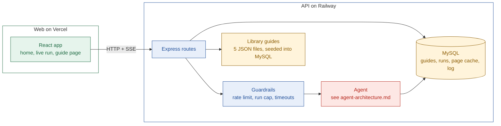
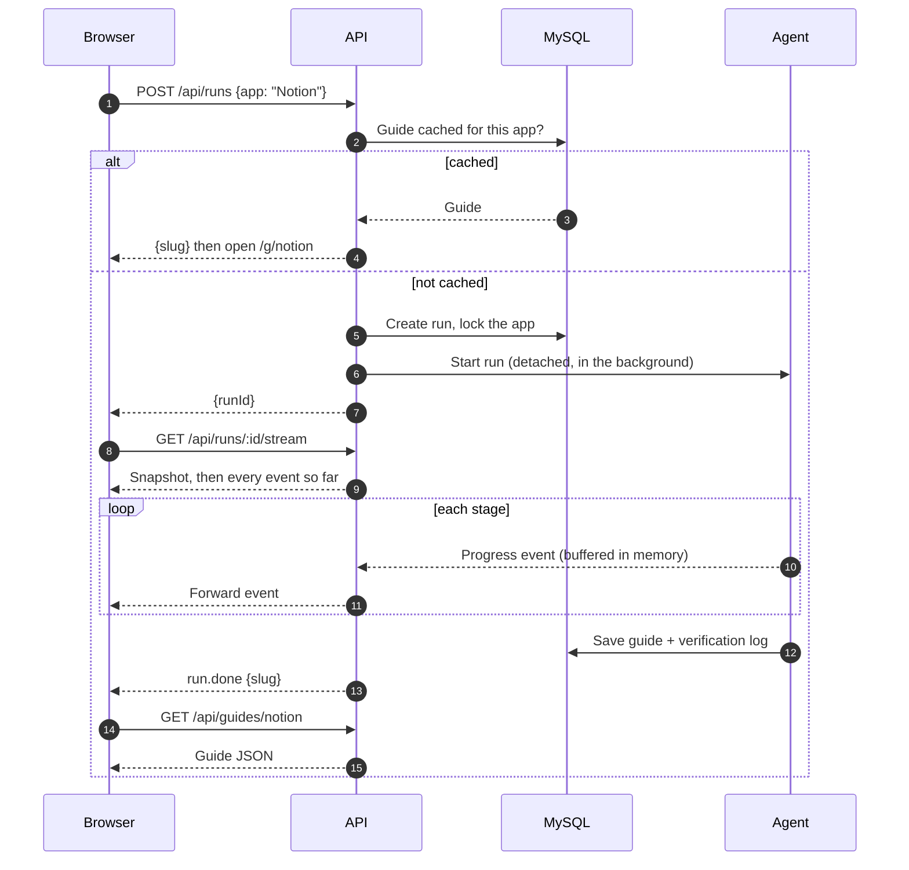

# Product architecture

## TL;DR

- Two apps: a React web app on Vercel and an Express API on Railway. MySQL stores guides and runs.
- The API starts agent runs, streams progress to the browser over SSE, and serves saved guides.
- Guides are cached by app and shared by link. Library guides need no agent run.
- How the agent itself works is in [agent-architecture.md](./agent-architecture.md).

---

## 1. System overview

| Component | Job |
| --- | --- |
| React app | Search, live progress, guide page |
| Express routes | Start runs, stream progress, serve guides |
| Guardrails | Keep the live demo fast and cheap |
| Agent | Research an app and build its guide |
| MySQL | Store guides, runs, fetched pages and the verification log |
| Library guides | 5 curated JSON files, seeded into MySQL; no agent run needed |

- The browser never holds an API key. Every external call goes through the API.

---

## 2. API routes

| Route | Does |
| --- | --- |
| `GET /api/health` | Liveness check |
| `POST /api/runs` | Returns a cached guide's slug, or starts a run and returns its ID |
| `GET /api/runs/:id` | Run snapshot, used on reconnect |
| `GET /api/runs/:id/stream` | Streams progress events for a run (SSE) |
| `GET /api/guides` | Lists library guides for the home page |
| `GET /api/guides/:slug` | Returns one guide |
| `POST /api/guides/:slug/reports` | Flags a wrong claim |

Full request and response shapes are in [api-design.md](./api-design.md).

SSE (server-sent events) is a one-way stream from server to browser.

---

## 3. Live run: request to guide

- **The run starts at `POST /api/runs`**, detached from the request. The stream is only a view of it, so a dropped connection, a late joiner and a reconnect never affect the run.
- **Lock:** two people asking for the same app share one run. The second `POST` gets `202 {status: "running", runId}` for the run already in progress.
- **Replay buffer:** the API keeps each run's events in memory. A stream sends the run snapshot, then every buffered event from the start, then live events, and closes after `run.done` or `run.error`. Any number of clients can follow one run. The buffer is kept for 10 minutes after the run ends.
- **No buffer (restart or expiry):** the stream sends the snapshot, then a `run.done` or `run.error` rebuilt from the `runs` row. A run still marked `running` after 3 minutes is failed with `INTERNAL`, which also frees its lock.
- **Single instance:** the buffer lives in the API process, so run and stream requests must reach the same instance. Railway runs one.
- **Order of checks in `POST /api/runs`:** cached guide, then join a running run, then the daily cap, then take the lock. Cached and joined requests never count against the cap, so the library keeps working when it is reached.
- **Library guides are never re-run:** `force` on a library slug returns `cached`, and a live save never overwrites a library guide.

---

## 4. Stream events

The contract between the API and the web app. Defined once in `@stamp/schema`.

| Event | Sent when |
| --- | --- |
| `stage.started` / `stage.done` | A stage begins or ends |
| `search.query` | A search runs |
| `page.fetched` | A page is read |
| `claim.verified` / `claim.downgraded` | A quote check passes or fails |
| `run.done` | The guide is saved; carries the slug |
| `run.error` | A stage fails; carries the stage and message |

---

## 5. Data stored

| Table | Holds | Key |
| --- | --- | --- |
| `guides` | The full guide as JSON, mode (library or live), as-of date | app slug |
| `runs` | Run status, stage reached, errors; also acts as the lock | run ID |
| `page_cache` | Fetched page text and a hash of it | URL hash |
| `verification_log` | Each check: claim, method, result, time | claim ID |
| `claim_reports` | Claims flagged as wrong by readers | report ID |

Full columns and the Prisma draft are in [db-schema-design.md](./db-schema-design.md).

---

## 6. Caching

| What | Kept for | Why |
| --- | --- | --- |
| Library guides | Until edited by hand and re-seeded | Curated and reviewed |
| Live guides | 7 days, then "Refresh" | Repeat lookups cost nothing |
| Fetched pages | 7 days, with a text hash | Quote checks stay repeatable |
| Run lock | 3 minutes | No duplicate runs for the same app |
| Run event buffer | 10 minutes after the run ends, in memory | Reconnects and late joiners see the full run |

---

## 7. Guardrails and product-level failures

| Risk | Guard | User sees |
| --- | --- | --- |
| A run hangs | 120-second budget per run | Partial guide with Retry |
| Too many requests | Rate limit per IP | "Try again in a minute" |
| Costs spike | Daily run cap | "Live generation paused, try a library guide" |
| Leaked keys | Keys only on the server; `.env` never committed | Nothing |
| Same app requested twice | Run lock | Both see the same run |
| API restarts mid-run | Stale-run check (3 minutes), then the run is failed and the lock freed | A failed run with Retry |

---

## Next

- Read [agent-architecture.md](./agent-architecture.md) for how one run builds a guide.
