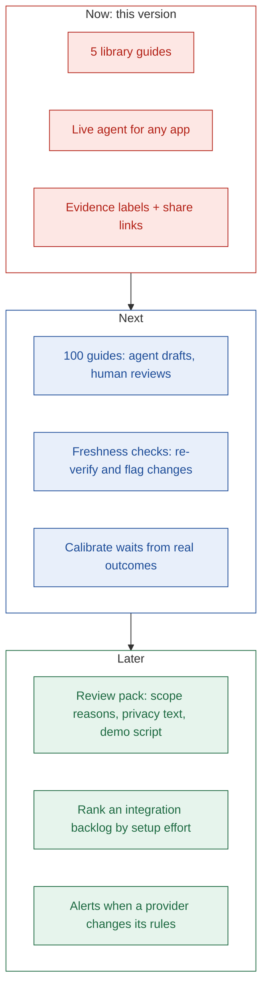

# Product: Stamp

> Know what it takes to get your OAuth app stamped.

## TL;DR

- **What:** an OAuth readiness report for any app: how hard, how long, what blocks approval, what an agent can do.
- **For:** AI-agent developers moving to production who need their own OAuth app.
- **Different because:** it shows the wait and the blockers first, and every claim carries a source and a label.
- **Measured by:** time to plan, accuracy of claims, and how well predicted waits match reality.

---

## 1. Positioning

| Field | Statement |
| --- | --- |
| For | AI-agent developers moving to production |
| Who need | Their own OAuth app with each provider their users connect |
| Stamp is | An OAuth readiness report |
| That | Shows how hard, how long, and what blocks approval, with every claim sourced |
| Unlike | Step-by-step setup guides |
| Stamp | Puts the wait and the blockers first |

---

## 2. User and jobs

| Field | Detail |
| --- | --- |
| Primary user | Developer of an AI agent product, prototype done, production next |
| Main job | "When I add an app to my agent, I want the full path to an approved OAuth app up front, so I can plan my launch and start today." |
| Related jobs | Unblock a failed setup step; brief the team on the timeline; decide which integrations to launch first |

---

## 3. Value

| Developer gets | Instead of |
| --- | --- |
| A verdict in under 2 minutes | Hours across docs, forums and changelogs |
| The approval wait before starting | Finding it after submitting |
| Blockers with fixes | Learning them by hitting them |
| Clear trust signals | Guessing which source is current |
| One shareable link | Notes scattered in chat threads |

---

## 4. How it compares

| Option | Steps | Wait time | Blockers | Sources on each claim | Any app, live |
| --- | --- | --- | --- | --- | --- |
| Provider docs | Yes | Rarely | Spread across pages | n/a | No |
| Composio setup guides ([example](https://composio.dev/auth/hubspot)) | Yes | No | No | No | No |
| Third-party integration guides | Yes | Sometimes | Sometimes | No | No |
| Asking a general AI chatbot | Yes | Guessed | Guessed | Rarely | Yes |
| **Stamp** | Yes | **Yes, labelled** | **Yes, with fixes** | **Yes** | **Yes** |

Third-party guides vary a lot. This row reflects the few we read, not a full survey.

---

## 5. Core capabilities

| Capability | Answers |
| --- | --- |
| Verdict stamp and difficulty score | How hard is it? |
| Two milestones: first test and production | How long will it take? |
| Blocker cards and hidden limits | What could stop me? |
| Steps marked agent, human or agent-assist | What can an agent do for me? |
| Evidence labels: Tested, Sourced, Uncertain | Can I trust this? |
| Library of 5 guides + live agent for any app | Does it cover my app? |
| Share link | How do I align my team? |

Full list in [features.md](./features.md).

---

## 6. Success metrics

| Metric | What it measures | Target for this version |
| --- | --- | --- |
| Time to plan | Seconds until a developer can state difficulty, time, next step, top blocker | Under 2 minutes |
| Claim coverage | Share of claims with a label and a source | 100% |
| Correction rate | Claims flagged wrong per guide | Tracked, no target yet |
| Wait calibration | Predicted approval wait vs actual | Tracked once real reviews finish |
| Live success rate | Live runs that finish with a full or partial guide | Tracked in the runs table |

---

## 7. Roadmap

Next and Later are ideas, not commitments.

- **Beyond developers:** the same guides can feed an integrations team's supply pipeline: which apps to bring live next, and which live ones need re-checking.

---

## 8. Risks

| Risk | Mitigation |
| --- | --- |
| Provider rules change and guides go stale | As-of date on every guide; 7-day cache; freshness checks next |
| The agent extracts a wrong fact | Code checks every quote; misses become Uncertain |
| Wait times are hard to confirm | Shown as Sourced or Uncertain until a real review confirms them |
| Live runs cost money | Page and retry limits per run, rate limit, daily run cap |

---

## Next

- Read [problem.md](./problem.md) and [solution.md](./solution.md) for the full story.
