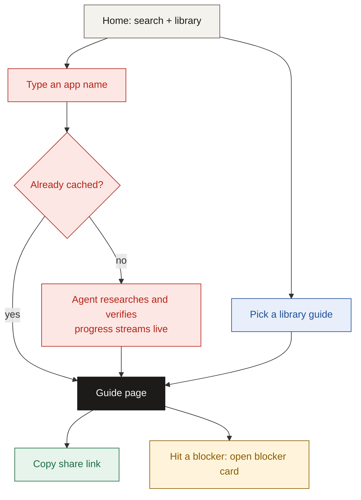
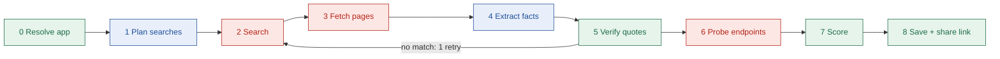

# Solution: Stamp

> Know what it takes to get your OAuth app stamped.

## TL;DR

- Stamp gives a developer an **OAuth readiness report** for any app.
- The report shows how hard setup is, how long it takes, what blocks approval, and what an agent can do for you.
- It works in two modes: a **library** of 5 ready guides and a **live agent** that researches any app.
- Every claim carries a label: **Tested**, **Sourced** or **Uncertain**, with its source.

---

## 1. The idea in one line

Type an app name. Get a sourced report that puts the wait and the blockers first, then the steps.

---

## 2. How Stamp answers the four questions

| Developer question | What Stamp shows |
| --- | --- |
| How hard is it? | A difficulty score from 1 to 5, with the reason behind it |
| How long will it take? | Two milestones: time to the first test connection, and time to production |
| What could block me? | Blocker cards: symptom, cause, fix, and who to contact |
| What can an agent do? | Each step is marked agent, human, or agent-assist |

Example (HubSpot):

| Field | Value |
| --- | --- |
| Difficulty | 4/5 |
| First test | About 1 hour, no approval wait |
| Production | Over 25 installs needs a Marketplace listing; wait unknown |
| Top blocker | The 26th install is blocked until the app is listed |
| Next step | Create a HubSpot developer account |

---

## 3. Two modes

| Mode | What it is | When to use |
| --- | --- | --- |
| Library | 5 hand-checked guides: GitHub, HubSpot, Gmail, LinkedIn, Salesforce | Instant answer for common apps |
| Live | An agent researches any app and writes its guide in real time | The app is not in the library |

The five library apps each show a different kind of hard: instant, hidden limits, review needed, partner-gated, enterprise.

---

## 4. User journeys

---

## 5. Evidence: how Stamp stays honest

Every fact in a guide is a **claim**. A claim has text, a label, and sources.

| Label | Meaning | How it is set |
| --- | --- | --- |
| Tested | We ran it and logged the result | An endpoint check or a manual setup attempt |
| Sourced | A source page says it, word for word | Code checks that the quote appears in the fetched page |
| Uncertain | Not confirmed | No quote match, sources disagree, or only an old source exists |

- Official docs win over third-party guides.
- When sources disagree, Stamp shows both and explains which one it trusts.
- Time estimates stay Uncertain until tested.

---

## 6. How difficulty is scored

The score comes from a fixed rule, not from the AI model. Same inputs, same score.

| Factor | 0 | 1 | 2 | 3 |
| --- | --- | --- | --- | --- |
| Review gate | none | optional listing | required to scale | security assessment or partner vetting |
| Approval wait | under 1 day | 1 to 7 days | 1 to 4 weeks, or unknown | over 4 weeks |
| Prerequisites | none | 1 | 2 or more | - |
| Hidden limits | none | 1 or more | - | - |

Total points map to the score: 0-1 = 1, 2-3 = 2, 4-5 = 3, 6-7 = 4, 8-9 = 5.

---

## 7. How the live agent works

The agent is a fixed pipeline. Only two stages use the AI model. Code does the checking and scoring.

Blue = AI model. Red = external call. Green = our code.

- Each stage streams a progress event to the browser, so you watch the agent work.
- A trace panel shows every search, every page read, and every claim kept or downgraded.

**Why a fixed pipeline and not a free agent?**

- Predictable time and cost during a live demo.
- An AI model checking another AI model can agree with a mistake. Code checking a quote cannot.
- Each stage can be tested on its own.

---

## 8. What happens when things go wrong

| Failure | What Stamp does |
| --- | --- |
| Research runs too long | Saves what it has, marks the rest Uncertain, offers Retry |
| No public docs found | Says so plainly and suggests contacting the provider |
| App uses API keys, not OAuth | Says the app is out of scope |
| Name matches several apps | Asks "Did you mean..." |
| Costs spike | Caps pages, retries and daily spend; the library keeps working |

---

## 9. Limitations

- Library guides cover 5 apps, not 100.
- No real provider review was submitted, so approval wait times are sourced, not tested.
- Live guides depend on public docs. Private or partner-only docs stay Uncertain.

---

## Next

- Read the README for setup instructions and the verification log.
