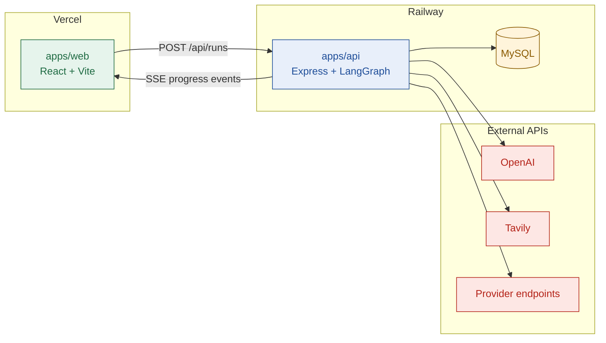

# Tech stack

## TL;DR

- One TypeScript monorepo: **Turborepo** with **pnpm** workspaces.
- **Web:** React + Vite on Vercel. **API:** Express on Railway. **Database:** MySQL on Railway.
- **Agent:** LangGraph JS runs a fixed pipeline. OpenAI is the AI model. Tavily does search and page fetch.
- **Shared types:** Zod schemas in one package, used by both web and API.
- **ORM:** Prisma 7 talks to MySQL through its MariaDB driver adapter.

---

## 1. How the parts connect

- The browser never holds an API key. Every external call goes through the API.
- SSE (server-sent events) is a one-way stream from server to browser. It carries live agent progress.

---

## 2. Stack by layer

| Layer | Tool | Why |
| --- | --- | --- |
| Package manager | pnpm | Fast installs, strict dependencies, native workspaces |
| Monorepo | Turborepo | Runs tasks across apps; caches builds |
| Language | TypeScript (everywhere) | One language, shared types |
| Shared contracts | Zod | One schema validates AI output, API payloads and UI data |
| Web framework | React + Vite | Fast dev server, simple static deploy |
| Routing | React Router | Share links like `/g/hubspot` |
| Styling | Tailwind CSS + shadcn/ui | Quick, consistent components we own |
| Fonts | Inter (UI), JetBrains Mono (data) | Readable text; monospace for scopes, URLs, labels |
| API server | Express | Long-running requests and SSE streams |
| Agent framework | LangGraph JS | Fixed graph: nodes are stages, one conditional edge is the retry |
| AI model | OpenAI | A fast model plans searches; a strong model extracts facts |
| Search + fetch | Tavily (search + extract) | One key for both; free tier covers the demo |
| Database | MySQL | Guides, runs, page cache, verification log |
| ORM | Prisma 7 | Typed queries and migrations from one schema file |
| DB driver | `mariadb` via `@prisma/adapter-mariadb` | Prisma 7 needs a driver adapter; this is the MySQL one |
| Tests | Vitest | Tests for quote verification and difficulty scoring |
| Browser agent (optional) | Playwright | Local only, behind a flag; never in the live path |
| Web hosting | Vercel | Free static hosting, free `*.vercel.app` URL |
| API + DB hosting | Railway | Always-on container; no cold starts |

---

## Next

- Read [solution.md](./solution.md) for what the stack builds.
