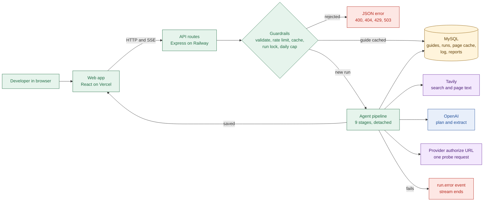

# Stamp walkthrough: index

- Checked against commit `240cad9` on 2026-10-29. Docs only: no code was changed.

## Why this set exists
- You own the product, and Claude Code wrote most of the code. This set explains every flow.
- Goal: direct the reliability work, and explain failure modes in the Composio interview.
- Every section cites files like `apps/api/src/agent/nodes/verify.ts:19`. Line numbers match the commit above.
- Product intent lives in `docs/problem.md` and `docs/solution.md`. Where code and docs differ, the code wins here.

## Reading order

| # | File | You learn | Min |
| --- | --- | --- | --- |
| 00 | `00-index.md` | Map, terms, fast path | 2 |
| 01 | `01-system-map.md` | Deployables, packages, what enters and leaves | 3 |
| 02a | `02a-feature-flows-search.md` | Search an app, watch a live run | 3 |
| 02b | `02b-feature-flows-read.md` | Open a guide, report, library, Not found | 3 |
| 03a | `03a-api-start-run.md` | Shared API rules, health, `POST /api/runs` | 3 |
| 03b | `03b-api-run-stream.md` | Run snapshot, SSE stream, all 9 events | 3 |
| 03c | `03c-api-guides-reports.md` | Guide list, guide read, claim reports | 2 |
| 04a | `04a-run-state.md` | Run states, lock, stale rule, daily cap | 3 |
| 04b | `04b-run-stream-bus.md` | Detached run, event bus, reconnect, restart | 3 |
| 05a | `05a-agent-graph.md` | Graph, retry edge, budget stop, one full run | 4 |
| 05b | `05b-nodes-resolve-plan-search.md` | Cards for stages 0 to 2 | 3 |
| 05c | `05c-nodes-fetch-extract-verify.md` | Cards for stages 3 to 5 | 3 |
| 05d | `05d-nodes-probe-score-save.md` | Cards for stages 6 to 8 | 3 |
| 06a | `06a-evidence.md` | Claim lifecycle, quote check, tiers, downgrades | 3 |
| 06b | `06b-unknowns-difficulty.md` | Unknown texts, difficulty rule, worked example | 3 |
| 07 | `07-data-model.md` | Tables, guide lifecycle, page cache | 3 |
| 08a | `08a-trust-stage-map.md` | Where wrong facts can enter, per stage | 3 |
| 08b | `08b-trust-real-cases.md` | Your six real cases | 3 |
| 09 | `09-self-check.md` | 20 questions with hidden answers | 5 |

- Full set: about 58 minutes. Each file is 150 lines or fewer.

## 15-minute fast path
- Read `00-index.md` (2 min), then `02a-feature-flows-search.md` (3 min).
- Then `04a-run-state.md` (3 min) and `05a-agent-graph.md` (4 min).
- Finish with `08b-trust-real-cases.md` (3 min). That is about 15 minutes.
- Skim `09-self-check.md` last. Aim for 16 of 20 without opening answers.

## The whole system in one diagram

- The browser never calls OpenAI or Tavily. Only the API holds keys (`apps/api/src/config.ts:22`).
- A run starts at `POST /api/runs` and goes on without the browser (`services/run-executor.ts:153`).
- The stream is only a view of the run, so a closed tab does not stop it.
- Errors leave in two ways: JSON before a run starts, or a `run.error` event after.
- Only code sets labels and scores. The model drafts text, quotes and URLs (`agent/draft-claim.ts:9`).

## Colour key
- Flowcharts and state diagrams use these five colours. Sequence diagrams use shaded blocks.

| Colour | Meaning |
| --- | --- |
| Green | Our code |
| Blue | AI model call (OpenAI) |
| Purple | Outside call (Tavily, provider URL, DNS) |
| Amber | Database |
| Red | Error path |

- Source for the stage kinds: `apps/web/src/utils/run-stages.ts:14`.

## Terms, defined once

| Term | Meaning |
| --- | --- |
| OAuth | Sign-in standard that lets an app act for a user without the password |
| OAuth app | The registration a developer makes at a provider to get a client ID |
| Scope | One permission an OAuth app asks for, like `read_contacts` |
| Claim | One fact in a guide: text, quote, source URL, label |
| Label | Tested, Sourced or Uncertain (`packages/schema/src/enums.ts:9`) |
| Quote check | Code check that a quote appears word for word in its page |
| Source tier | Official, third party or forum, set by code from the URL host |
| Guide | The saved report for one app; library (hand-made) or live (agent-made) |
| Run | One research attempt for one app, stored in `runs` |
| Slug | Lowercase app key used in URLs and as the cache key, like `notion` |
| Stage or node | One pipeline step; LangGraph calls it a node |
| LangGraph | Library that runs the stages as a graph with conditional edges |
| State | The data object passed from stage to stage |
| SSE | Server-sent events: a one-way stream from API to browser |
| Tavily | Outside service that searches the web and returns page text |
| Zod | Library that checks data shapes at run time |
| Cache hit | A saved guide or page reused instead of researching again |
| TTL | Time to live: how long a cached item stays fresh |
| Heartbeat | A comment line on the stream that keeps the connection open |
| Probe | One GET to a provider's authorize URL with a fake client ID |
| Gate | A review or approval step that blocks growth (listing, assessment, vetting) |
| Archetype | The guide's kind of hard: instant, hidden limits, review, partner, enterprise |
| Prompt injection | Page text that tries to give the model orders |

## How "Confirmed" and "Likely" are used
- Confirmed: the symptom is visible in code or in a stored guide read through the API.
- Likely: it follows from code, but no stored data or log proves it.
- The entry stage of a wrong fact is always an inference. The files say so.
- Stored guides were read with `GET /api/guides/:slug` (`apps/api/src/routes/guides.ts:19`). The database was not queried.

## Docs that disagree with the code
- Found while reading. None of these docs were edited. The code wins in this walkthrough.

| Doc | Says | Code does | Code reference |
| --- | --- | --- | --- |
| `docs/agent-architecture.md:182` | Real mode ends every run `INTERNAL`; nodes are no-ops | All 9 real nodes are wired and a real run finished | `apps/api/src/agent/run-agent.ts:42` |
| `AGENTS.md:55`, `README.md:114`, `docs/product-architecture.md:24` | 5 library guides loaded by `db:seed` | No seed script and no library files; the list is empty | `apps/api/package.json` |
| `docs/agent-architecture.md:171`, `docs/tech-stack.md:67`, `README.md:100` | Browser agent behind `ENABLE_BROWSER_AGENT` | Flag is parsed and never read; no Playwright | `apps/api/src/config.ts:28` |
| `docs/schema-design.md:47` | Five downgrade reasons on the stream | Real agent sends two; `stale_source` is never set | `apps/api/src/agent/verify/claim-events.ts:27` |
| `docs/solution.md:116`, `docs/design-decisions.md:123` | One retry when "a section" has no match | Only `steps` or `scopes` can trigger it | `apps/api/src/agent/verify/missing-sections.ts:10` |
| `docs/api-design.md:90` | Heartbeat while the run is quiet | Fixed 15 s timer, always on | `apps/api/src/controllers/runs.ts:42` |
| `docs/api-design.md:91`, `docs/product-architecture.md:106` | Restart rebuilds the stream from the database | A `running` row is polled every 2 s; new requests join it for up to 3 min | `apps/api/src/services/run-stream.ts:17` |
| `docs/solution.md:93` | Difficulty table | Two rules are missing: a `none` gate zeroes the wait; prerequisites count distinct quotes | `apps/api/src/agent/scoring/difficulty.ts:101` |
| `docs/api-design.md:16` | Health endpoint listed with no response shape | Plain text, no database check | `apps/api/src/controllers/health.ts:11` |

- The web page `/how-we-verify` repeats the retry wording of row 5 (`apps/web/src/content/run-limits.ts:28`).
