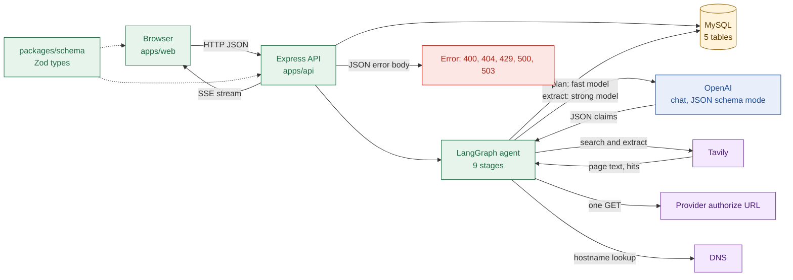

# 01 System map

## Deployables
- Hosting comes from `docs/tech-stack.md`. The code itself does not name Vercel or Railway.

| Part | Runs on | Built with | Entry point |
| --- | --- | --- | --- |
| Web app | Vercel (per docs) | React, Vite, React Router | `apps/web/src/main.tsx`, `apps/web/src/router.tsx:16` |
| API | Railway (per docs) | Express 5, LangGraph | `apps/api/src/lib/server.ts:14` |
| Database | MySQL (per docs) | Prisma 7, MariaDB driver | `apps/api/src/lib/prisma.ts:32` |

- The API keeps at most 5 database connections open (`apps/api/src/lib/prisma.ts:12`).
- One API process holds run events in memory, so it must be a single instance (`apps/api/src/services/run-events.ts:20`).
- Web routes: `/`, `/how-we-verify`, `/app`, `/run/:id`, `/g/:slug`, and `*` for Not found.

## Packages
- `@stamp/schema` holds Zod schemas and types shared by web and API (`packages/schema/src/index.ts`).
- `@stamp/typescript-config` and `@stamp/eslint-config` share compiler and lint rules.
- Both apps parse every API payload with the same schemas (`apps/web/src/lib/parse-response.ts`).
- The stream event union is one schema: `RunStreamEventSchema` (`packages/schema/src/events.ts:79`).

## System map

- Three outside services are called: OpenAI, Tavily and the provider's authorize URL. DNS is a fourth, for the probe only.
- The agent writes to MySQL itself (page cache, guide, log); the executor writes the run row.
- Model names are env values (`OPENAI_MODEL_FAST`, `OPENAI_MODEL_STRONG`). `api.log` shows `gpt-4.1-mini` and `gpt-4.1`.
- Tavily is called with `searchDepth: "basic"` for search and `extractDepth: "basic"` for pages (`apps/api/src/lib/tavily.ts:78`).
- The shared schema is the only contract between web and API (dotted lines).

## What enters the system

| Enters | From | Checked by | Where |
| --- | --- | --- | --- |
| App name or URL, 2 to 100 chars, optional `force` | Browser | `StartRunInputSchema` | `packages/schema/src/api/runs.ts:10` |
| Claim report: `claimId`, note up to 2000 chars | Browser | `CreateClaimReportInputSchema` | `packages/schema/src/api/guides.ts:10` |
| Search hits: URL, title, score | Tavily | Zod, URL cleaning | `apps/api/src/lib/tavily.ts:43` |
| Page text | Tavily | Zod, 300-char minimum | `apps/api/src/agent/fetch/select-pages.ts:12` |
| Claims as JSON | OpenAI | Strict JSON schema, then Zod | `apps/api/src/lib/openai-params.ts:113` |
| Probe response: status, first 4 KB, `Location` | Provider | `evaluateResponse` | `apps/api/src/agent/probe/evaluate-response.ts:30` |
| Environment values | Process env | `EnvSchema` | `apps/api/src/config.ts:64` |

## What leaves the system

| Leaves | To | Contains | Where |
| --- | --- | --- | --- |
| Guide JSON | Browser | Whole guide, claims, sources | `apps/api/src/services/guides.ts:31` |
| Library list | Browser | Slug, name, archetype, difficulty, mode, date | `apps/api/src/services/guides.ts:14` |
| Run snapshot and SSE events | Browser | Status, stage, events, slug | `apps/api/src/utils/sse.ts:30` |
| Error body | Browser | `{ error: { code, message } }`, no raw text | `apps/api/src/middleware/error-handler.ts:29` |
| Search queries | Tavily | Query text, optional domain filter | `apps/api/src/agent/nodes/search.ts:44` |
| Page excerpts and prompts | OpenAI | Up to 14,000 chars per section | `apps/api/src/agent/extract/keywords.ts:10` |
| Probe request | Provider | GET with `client_id=stamp-probe-not-a-real-client` | `apps/api/src/agent/probe/probe-url.ts:14` |
| Log lines | stdout, stderr | Ids, counts, timings; no page or claim text | `apps/api/src/lib/logger.ts` |
| Rows | MySQL | Guides, runs, pages, checks, reports | `apps/api/prisma/schema.prisma` |

## Config that changes behaviour

| Variable | Default | Effect |
| --- | --- | --- |
| `AGENT_MODE` | `stub` outside production | `stub` replays fake data; `real` runs the agent. Production must set it |
| `DAILY_RUN_CAP` | none, required | Max runs started per UTC day |
| `RATE_LIMIT_MAX` and `RATE_LIMIT_WINDOW_SECONDS` | 10 and 60 | Per-IP limit on start-run and report |
| `AGENT_RUN_BUDGET_MS` | 120000, can only be lowered | Total time for one run |
| `AGENT_EXTRACT_CONCURRENCY` | 5, range 1 to 8 | Parallel extraction calls |
| `AGENT_PROBE` | `on` | `off` skips the probe request |
| `ENABLE_BROWSER_AGENT` | required `true` or `false` | Parsed only; nothing reads it |

- Source for every row: `apps/api/src/config.ts:19`. A bad value stops the API at boot (`apps/api/src/lib/server.ts:12`).
