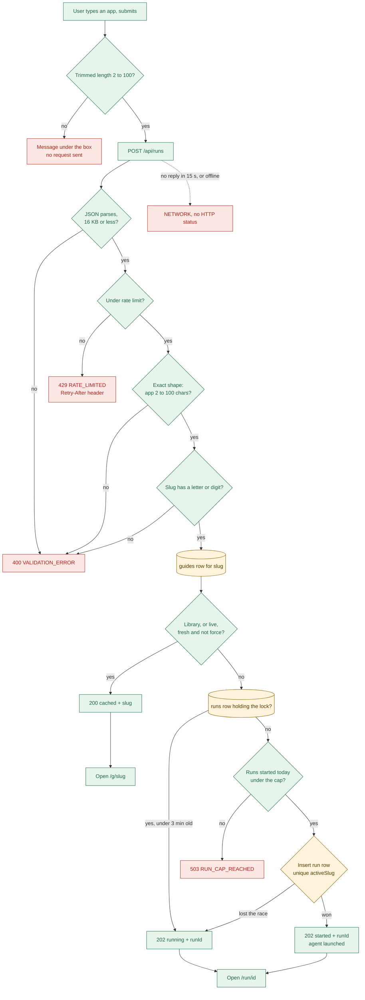
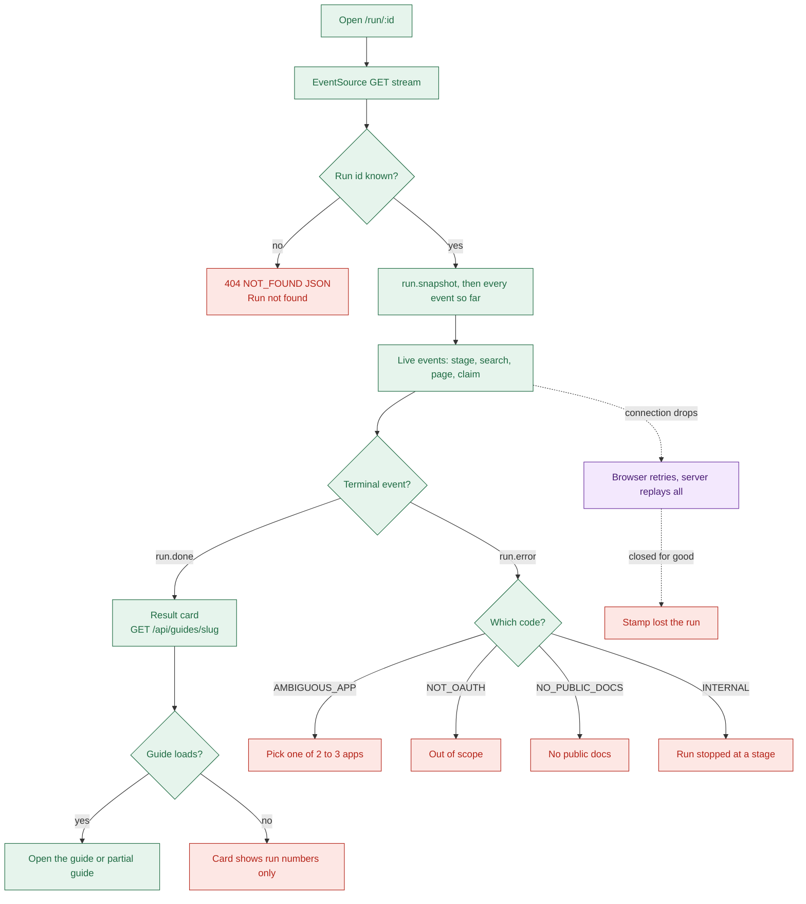

# 02a Feature flows: search an app, watch a live run

## Flow 1: search an app (cached, new run, or already running)
- Every search box uses one hook: `useStartRun` (`apps/web/src/hooks/useStartRun.ts:21`).
- It calls `POST /api/runs`, then opens a guide or a run page (`apps/web/src/utils/run-destination.ts:10`).

- Check order is rate limit, validation, cache, join, cap, lock (`apps/api/src/services/runs.ts:36`).
- Library guides always count as cached, even with `force` (`apps/api/src/services/runs.ts:23`).
- Cached and joined requests never count toward the daily cap (`apps/api/src/services/runs.ts:50`).
- Rate limit comes after the JSON parser but before shape checks, so shape errors still count (`apps/api/src/app.ts:26`).
- A typed URL becomes its brand label: `developers.hubspot.com` gives `hubspot` (`apps/api/src/utils/slugify.ts:12`).
- While waiting, the box says "Looking up <app>" (`apps/web/src/utils/search-message.ts:14`).

### Errors on this flow

| Trigger | Code | HTTP | User sees |
| --- | --- | --- | --- |
| Under 2 characters | none (browser check) | none | "The app name is too short. Enter at least 2 characters." |
| More than 10 requests in 60 s from one IP (defaults) | `RATE_LIMITED` | 429 | "You have made too many requests. Try again in N seconds." |
| Bad JSON, over 16 KB, extra field, `app` under 2 or over 100 chars | `VALIDATION_ERROR` | 400 | "Stamp could not use that input. Check what you entered, then try again." |
| Input with no letters or digits, like `!!` | `VALIDATION_ERROR` | 400 | Same text as above |
| Daily cap reached | `RUN_CAP_REACHED` | 503 | "Live generation paused" notice; saved guides still open |
| Database or other server fault | `INTERNAL` | 500 | "Something went wrong on our side. Try again in a moment." |
| No reply in 15 s, offline, or a proxy 5xx page | `NETWORK` (browser) | none or 5xx | "Stamp could not reach the server. Check your connection, then try again." |
| Reply fails the shared schema | `INVALID_RESPONSE` (browser) | 200 or 202 | "Stamp got a reply it could not read. Try again, or reload the page." |

- Sources: `apps/web/src/utils/error-messages.ts:22`, `apps/web/src/lib/to-api-error.ts:27`, `apps/web/src/lib/api-client.ts:11`.
- Rate-limit defaults: `apps/api/src/config.ts:33`. Cap text: `apps/web/src/components/shared/PausedNotice.tsx:19`.

## Flow 2: watch a live run
- The run page opens `GET /api/runs/:id/stream` with the browser `EventSource` (`apps/web/src/services/run-stream.service.ts:94`).
- `EventSource` is the browser's built-in SSE client; it retries a dropped connection by itself.

- Every connect starts with a snapshot and a full replay, so a reconnect shows no duplicate rows (`apps/web/src/utils/run-stream-state.ts:37`).
- A terminal event wins over a stream failure that follows it (`apps/web/src/utils/run-phase.ts:22`).
- Both `done` and `partial` end in `run.done`; partial reads "Time ran out. Guide saved" (`apps/web/src/components/run/run-copy.ts:42`).
- "Retry run" starts a new run with `force: true` and the typed name (`apps/web/src/components/run/RunScreen.tsx:66`).
- Picking a "Did you mean" option starts a run with that app's domain (`apps/web/src/components/run/RunScreen.tsx:87`).
- Reconnect re-keys the screen, which opens a fresh `EventSource` (`apps/web/src/pages/RunPage.tsx:19`).

### Errors on this flow
- Run errors arrive after a 200 response, so they have no HTTP status of their own.

| Trigger | Code | HTTP | User sees |
| --- | --- | --- | --- |
| Run id not in `runs` | `NOT_FOUND` | 404, before any stream | "Run not found" and a "Search for an app" button |
| Name matches 2 or more apps | `AMBIGUOUS_APP` | none | "More than one app matches" with name and domain buttons |
| App uses API keys only | `NOT_OAUTH` | none | "This app is out of scope", search again, "Read how we verify" |
| No usable official docs, or every section unknown | `NO_PUBLIC_DOCS` | none | "No public docs for this app" and a search button |
| Stage failure, timeout, crash | `INTERNAL` | none | "The run stopped at <stage>", "Retry run", "Open the library" |
| Stream closed, run still exists | `NETWORK` (browser) | none | "Stamp lost the run", "Reconnect to the run" |
| Event fails `RunStreamEventSchema` | `INVALID_RESPONSE` (browser) | none | Same notice, text "Stamp got a reply it could not read." |

- Copy sources: `apps/web/src/components/run/run-error-copy.ts:19` and `apps/web/src/utils/error-messages.ts:43`.
- The stream is closed and explained by `getRun` when `EventSource` is closed (`apps/web/src/services/run-stream.service.ts:83`).
