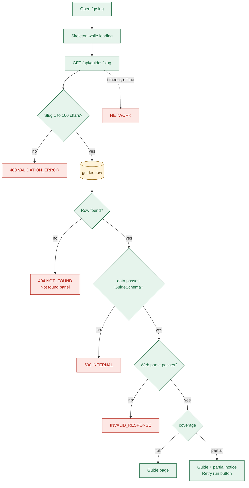
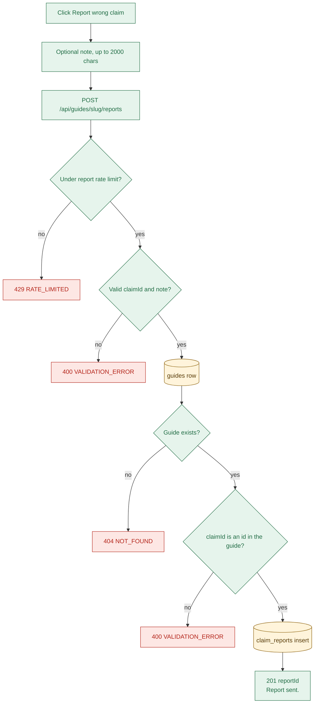
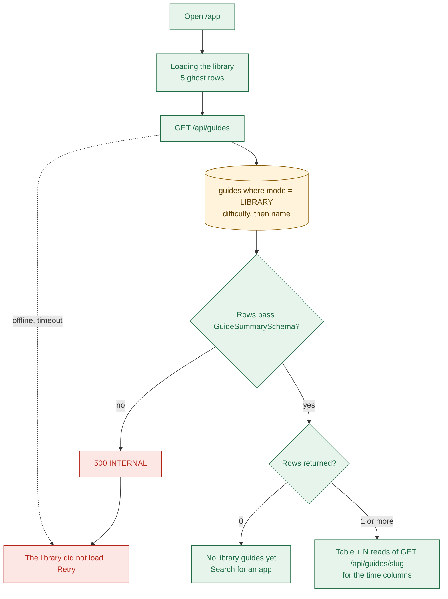
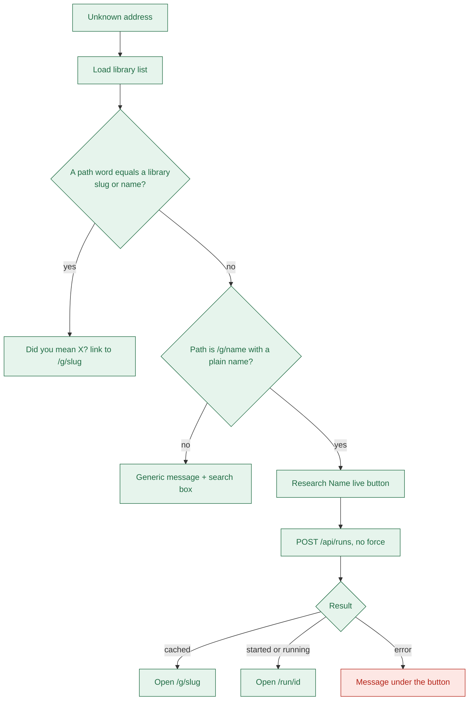

# 02b Feature flows: open a guide, report, library, Not found

## Flow 3: open a guide
- Route `/g/:slug` runs `GET /api/guides/:slug` through `useGuide` (`apps/web/src/pages/GuidePage.tsx:18`).

- An expired live guide is still returned, so share links keep working (`apps/api/src/services/guides.ts:30`).
- `toGuide` re-checks stored JSON on every read and overlays the indexed columns (`apps/api/src/mappers/guide-mapper.ts:17`).
- A stub guide is saved already expired but is readable here (`apps/api/src/agent/stub/run-stub-agent.ts:93`).
- Partial notice lists the Uncertain sections; "Retry run" sends `force: true` (`apps/web/src/components/guide/PartialNotice.tsx:29`).

| Trigger | Code | HTTP | User sees |
| --- | --- | --- | --- |
| Slug over 100 characters | `VALIDATION_ERROR` | 400 | "The guide did not load" and the input message |
| No row for the slug | `NOT_FOUND` | 404 | Not found panel; "Research <Name> live" if the slug looks like a name |
| Stored JSON fails `GuideSchema` | `INTERNAL` | 500 | "The guide did not load", "Something went wrong on our side." |
| Offline or 15 s timeout | `NETWORK` (browser) | none | Same screen, "Stamp could not reach the server." |

- Retry button: "Retry loading the guide", plus "Open the library" (`apps/web/src/components/guide/GuideLoadError.tsx:31`).

## Flow 4: report a wrong claim
- Control: `ReportClaim` on each claim (`apps/web/src/components/evidence/ReportClaim.tsx:19`).

- Reports have their own rate-limit counter, separate from run starts (`apps/api/src/app.ts:30`).
- Any `id` in the guide is accepted: claims, steps, scopes, blockers, conflicts (`apps/api/src/utils/collect-guide-ids.ts:9`).
- A report stores guide, claim id, note and time. It keeps no claim text or run id (`apps/api/prisma/schema.prisma`).
- An empty note is stored as `null` (`apps/api/src/services/reports.ts:30`).
- Nothing reads reports yet: no endpoint, job or screen uses them.

| Trigger | Code | HTTP | User sees |
| --- | --- | --- | --- |
| Over 10 reports in 60 s from one IP | `RATE_LIMITED` | 429 | "You have made too many requests. Try again in N seconds." |
| Bad `claimId` shape, note over 2000, extra field | `VALIDATION_ERROR` | 400 | "Stamp could not use that input." |
| Unknown guide slug | `NOT_FOUND` | 404 | "Stamp could not find that." |
| `claimId` not in this guide | `VALIDATION_ERROR` | 400 | "Stamp could not use that input." |

## Flow 5: browse the library
- Route `/app` runs `GET /api/guides` through `useGuides` (`apps/web/src/pages/AppHomePage.tsx:16`).

- Only `LIBRARY` guides are listed; live guides are reached by link (`apps/api/src/services/guides.ts:16`).
- Today the list is `[]`: no seed script or library files exist, so the empty state shows.
- Each row triggers its own guide read, and a failed read only blanks that row's times (`apps/web/src/hooks/useLibraryTimes.ts:20`).
- Durations come from a regex over claim text, not from a field (`apps/web/src/utils/extract-duration.ts:13`).
- Error text: "The library did not load." plus the API message (`apps/web/src/components/app-home/LibraryStates.tsx:29`).

## Flow 6: Not found "Research live"
- Any unknown route, and a `/g/:slug` that returns 404, render `NotFoundPanel` (`apps/web/src/components/not-found/NotFoundPanel.tsx:25`).

- The name is guessed from the last path segment and capitalised (`apps/web/src/utils/not-found-hint.ts:33`).
- With an empty library the "Did you mean" branch can never fire (`apps/web/src/utils/find-guide.ts:11`).
- The button reuses Flow 1, so every Flow 1 error can appear here (`apps/web/src/hooks/useStartRun.ts:21`).
- A typo in a share link can start a paid run for a made-up name.
- Only the rate limit and the daily cap limit that cost.
