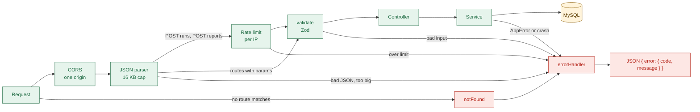
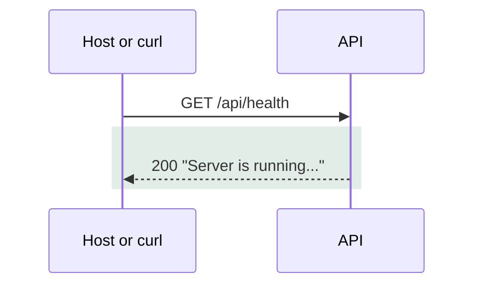
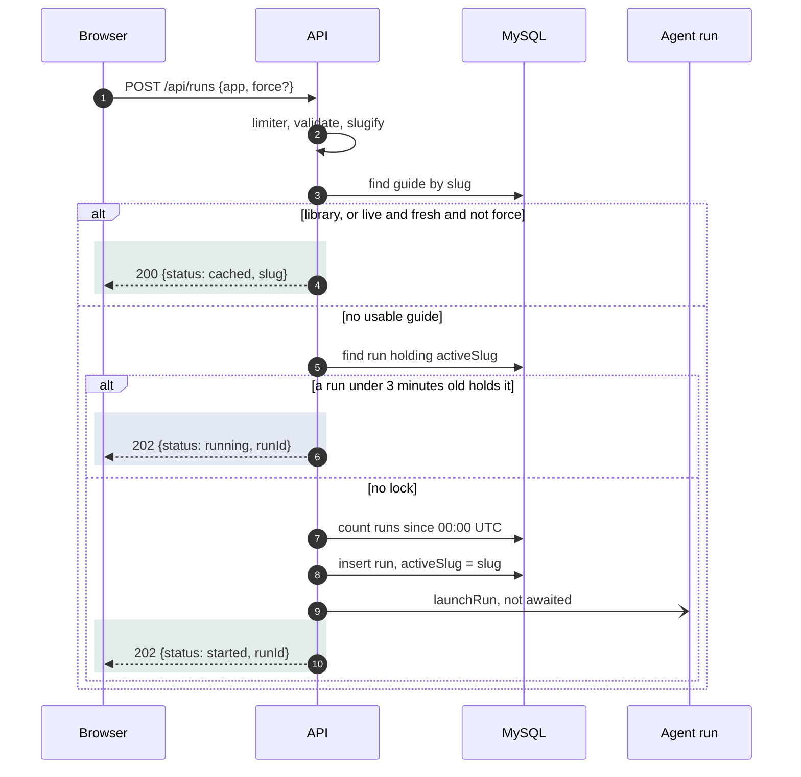

# 03a API: shared rules, health, start a run

## Shared rules for all 7 endpoints
- The seven endpoints: health, start run, read run, stream run, list guides, read guide, report claim.
- Middleware order is fixed in `apps/api/src/app.ts:20`.

- Malformed or oversize JSON fails before the rate limiter, so it does not count (`apps/api/src/app.ts:26`).
- Shape errors fail after the limiter, so they do count (`apps/api/src/app.ts:29`).
- Unknown errors become `INTERNAL` 500 with a fixed message; the real error is only logged (`apps/api/src/middleware/error-handler.ts:24`).
- CORS allows GET and POST, one origin (`WEB_ORIGIN`), header `Content-Type`, and exposes `Retry-After` (`apps/api/src/middleware/cors.ts:13`).
- Rate-limit counters are in process memory: a restart resets them (`apps/api/src/middleware/rate-limit.ts:21`).
- Behind a proxy with `TRUST_PROXY_HOPS=0` every visitor shares one IP, so one counter (`apps/api/src/app.ts:23`).

| Code | HTTP | Raised by | Message |
| --- | --- | --- | --- |
| `VALIDATION_ERROR` | 400 | `validate`, JSON parser, service checks | `<path>: <reason>`, or fixed text for bad JSON and big bodies |
| `NOT_FOUND` | 404 | Services, `notFound` | "Guide not found.", "Run not found.", "We could not find that resource." |
| `RATE_LIMITED` | 429 | Rate limiter | "Too many runs. Try again in a minute." (or "reports"); `Retry-After` set |
| `RUN_CAP_REACHED` | 503 | `assertUnderRunCap` | "Live generation is paused. Try a library guide." |
| `INTERNAL` | 500 | Anything else, including Zod errors on stored data | "Something went wrong." |

- Sources: `apps/api/src/errors/app-error.ts:36`, `apps/api/src/errors/resolve-api-error.ts:30`, `apps/api/src/middleware/validate.ts:14`.
- Bad JSON text: "Request body must be valid JSON." Big body text: "Request body is too large."

## GET /api/health
- Purpose: liveness check for the host (`apps/api/src/controllers/health.ts:10`).
- Request: no body, no params. Not rate limited.
- Response: `200`, plain text `Server is running...` (not JSON).

- The handler touches nothing else: no database call, no model call.
- A healthy reply therefore proves the process is up, not that MySQL works.
- Errors: none from the code. A dead process gives no reply, only a connection error.

## POST /api/runs
- Purpose: return a cached guide, join a running run, or start a new run (`apps/api/src/services/runs.ts:36`).
- Request: `{ "app": "Notion", "force": false }`. `app` is 2 to 100 chars; extra keys are rejected (`packages/schema/src/api/runs.ts:10`).
- Success: `200 { status: "cached", slug }`, `202 { status: "started", runId }`, or `202 { status: "running", runId }`.

- Shading: green is a new or cached result; blue is joining someone else's run.
- `launchRun` returns at once; the HTTP reply never waits for research (`apps/api/src/services/run-executor.ts:153`).
- Two simultaneous starts: the unique `activeSlug` lets one insert win; the loser gets `running` (`apps/api/src/services/run-lock.ts:70`).
- A lock older than 3 minutes is failed first, then a new run may start (`apps/api/src/services/run-lock.ts:54`).

| Trigger | Code | HTTP | User sees |
| --- | --- | --- | --- |
| Over 10 requests per 60 s per IP (defaults) | `RATE_LIMITED` | 429 | "Try again in N seconds" from `Retry-After` |
| Malformed JSON | `VALIDATION_ERROR` | 400 | "Stamp could not use that input." |
| Body over 16 KB | `VALIDATION_ERROR` | 400 | Same text |
| `app` too short or long, unknown key, `force` not boolean | `VALIDATION_ERROR` | 400 | Same text |
| Slug empty after cleaning ("app: Enter an app name or URL.") | `VALIDATION_ERROR` | 400 | Same text |
| Runs started since 00:00 UTC at or above `DAILY_RUN_CAP` | `RUN_CAP_REACHED` | 503 | "Live generation paused" notice |
| Lock insert fails 3 times in a row | `INTERNAL` | 500 | "Something went wrong on our side." |
| Database down | `INTERNAL` | 500 | Same |

- Limits that apply: 16 KB body, 10 per 60 s per IP, daily cap, one active run per slug.
- The cap counts every run started today, any outcome, and can overshoot by one (`apps/api/src/services/run-cap.ts:12`).
- The cap check comes after cache and join, so those never fail with 503 (`apps/api/src/services/runs.ts:55`).
