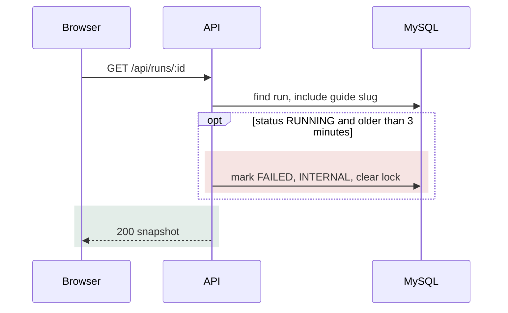
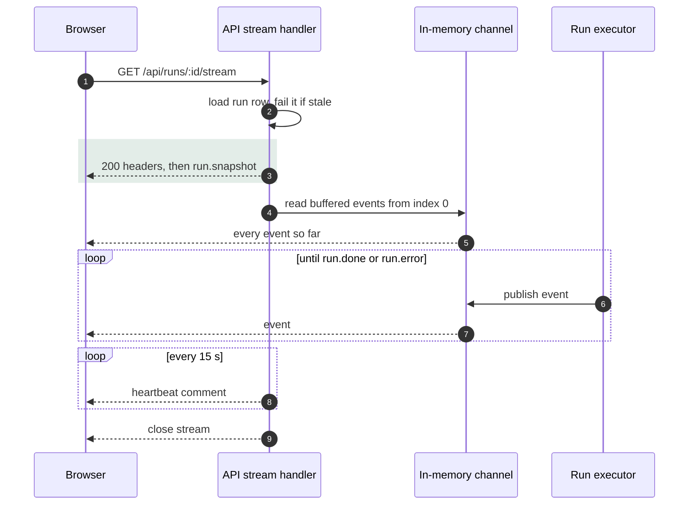

# 03b API: read a run, stream a run

## GET /api/runs/:id
- Purpose: a snapshot of one run, used to explain a closed stream (`apps/api/src/services/runs.ts:65`).
- Request: path `id`, 1 to 64 chars (`apps/api/src/schemas/params.ts:14`). No body. Not rate limited.
- Response `200`: `runId`, `slug`, `status`, `stageReached`, `startedAt`, `finishedAt`, `errorCode` (`packages/schema/src/api/runs.ts:38`).
- `status` is `running`, `done`, `partial` or `failed`. `stageReached` is 0 to 8 or `null`.

- A read can write: a stale run is failed on read (`apps/api/src/services/run-view.ts:33`).
- The update only fires if the row is still `RUNNING`, so a finishing run is safe (`apps/api/src/services/run-lock.ts:39`).
- `errorCode` outside the four known codes is shown as `null` (`apps/api/src/mappers/run-mapper.ts:17`).

| Trigger | Code | HTTP | User sees |
| --- | --- | --- | --- |
| `id` over 64 chars | `VALIDATION_ERROR` | 400 | Not shown directly; the run page says "Stamp lost the run" |
| No run with that id | `NOT_FOUND` | 404 | "Run not found" |
| Database error | `INTERNAL` | 500 | "Stamp lost the run" with a server-fault message |

## GET /api/runs/:id/stream
- Purpose: live progress as server-sent events (SSE) (`apps/api/src/controllers/runs.ts:33`).
- Request: path `id`. Headers sent back: `text/event-stream`, `no-cache, no-transform`, `X-Accel-Buffering: no` (`apps/api/src/utils/sse.ts:18`).
- Wire format: `event: <type>` then `data: <full event JSON>` then a blank line. No `id:` or `retry:` field.

- The first event is read before headers go out, so an unknown run is a JSON 404 (`apps/api/src/controllers/runs.ts:40`).
- Any number of browsers can follow one run; each keeps its own read index (`apps/api/src/services/run-stream.ts:20`).
- The channel keeps up to 2000 events; later non-terminal events are dropped (`apps/api/src/services/run-events.ts:46`).
- Heartbeat is a fixed 15 s timer, sent even while events flow (`apps/api/src/controllers/runs.ts:42`).
- A closed tab aborts the read loop and clears the timer; the run keeps going (`apps/api/src/controllers/runs.ts:35`).
- With no channel (restart, or 10 minutes after the end) the stream is rebuilt from the row (`apps/api/src/services/run-stream.ts:82`).

| Trigger | Code | HTTP | User sees |
| --- | --- | --- | --- |
| No run with that id | `NOT_FOUND` | 404, JSON, no stream | "Run not found" |
| `id` over 64 chars | `VALIDATION_ERROR` | 400, JSON | "Stamp lost the run" |
| Database error before the first event | `INTERNAL` | 500, JSON | "Stamp lost the run" |
| Error after headers were sent | none | connection drops | "Connection lost. Reconnecting." then a full replay |
| Server restarts mid-run | none | connection drops | Reconnect, then `run.error INTERNAL` after the 3-minute rule |
| Run fails | `run.error` event | 200 | See `02a-feature-flows-search.md` |

- Errors after headers cannot be JSON; Express closes the socket (`apps/api/src/middleware/error-handler.ts:19`).
- Limits: no rate limit on any GET, no cap on open streams, one 15 s timer per open stream.

## Every SSE event
- Defined once in `packages/schema/src/events.ts:79`. Every payload also has `runId`.
- Agent events are `AgentEvent`; the executor adds `run.done` and `run.error` (`apps/api/src/agent/run-agent.ts:13`).

| Event | Payload fields | Sent by and when |
| --- | --- | --- |
| `run.snapshot` | `snapshot` (same shape as `GET /api/runs/:id`) | Stream service, first on every connect (`run-stream.ts:75`) |
| `stage.started` | `stage` 0 to 8, `name` | Every stage, before its body (`agent/stage-node.ts:31`) |
| `stage.done` | `stage`, `durationMs` | Stage ends without a failure; never sent for the failing stage (`stage-node.ts:40`) |
| `search.query` | `query` | Resolve (name search) and Search, once per distinct query (`nodes/search.ts:31`) |
| `page.fetched` | `url`, `tier` | Fetch, once per page loaded, cached or new (`nodes/fetch.ts:41`) |
| `claim.verified` | `claimId`, `url` | Verify, for each Sourced claim (`verify/claim-events.ts:33`) |
| `claim.downgraded` | `claimId`, `reason` | Verify, reason `quote_not_found` or `sources_disagree` (`claim-events.ts:27`) |
| `run.done` | `slug`, `status` (`done` or `partial`) | Executor, after the run row is updated (`services/run-executor.ts:100`) |
| `run.error` | `stage`, `code`, `message`, `options?` (`name`, `domain`) | Executor, after the run row is updated (`run-executor.ts:32`) |

- Stage names on the wire: `resolve_app`, `plan_searches`, `search`, `fetch_pages`, `extract_facts`, `verify_quotes`, `probe_endpoints`, `score`, `save` (`packages/schema/src/constants.ts:17`).
- A retry pass repeats stages 2 to 5, so those `stage.started` events appear twice.
- Time estimates never send `claim.downgraded`; they are Uncertain by rule (`apps/api/src/agent/verify/claim-events.ts:15`).
- `stale_source`, `schema_failed` and `time_budget` are allowed by the schema but the real agent never sends them.
- `options` is lost after a restart or expiry, because it is not stored (`apps/api/src/services/run-view.ts:55`).
