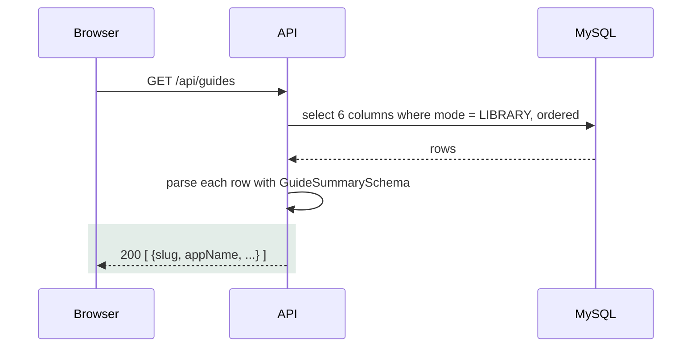
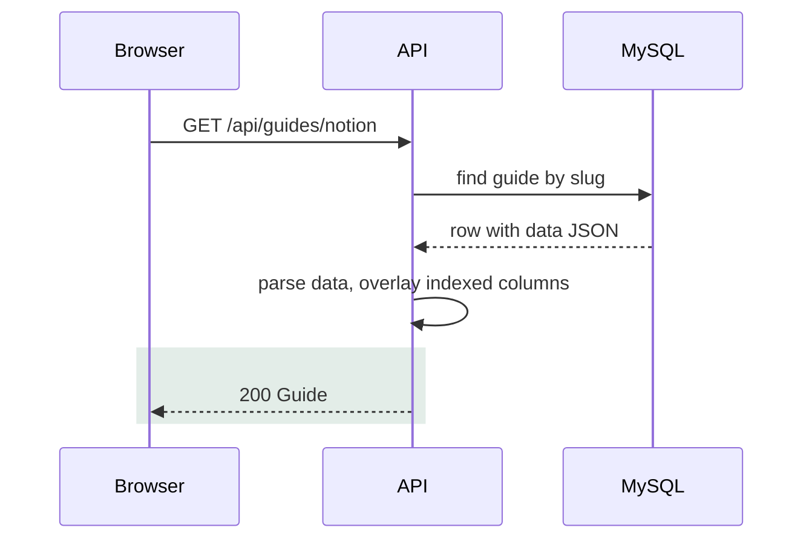
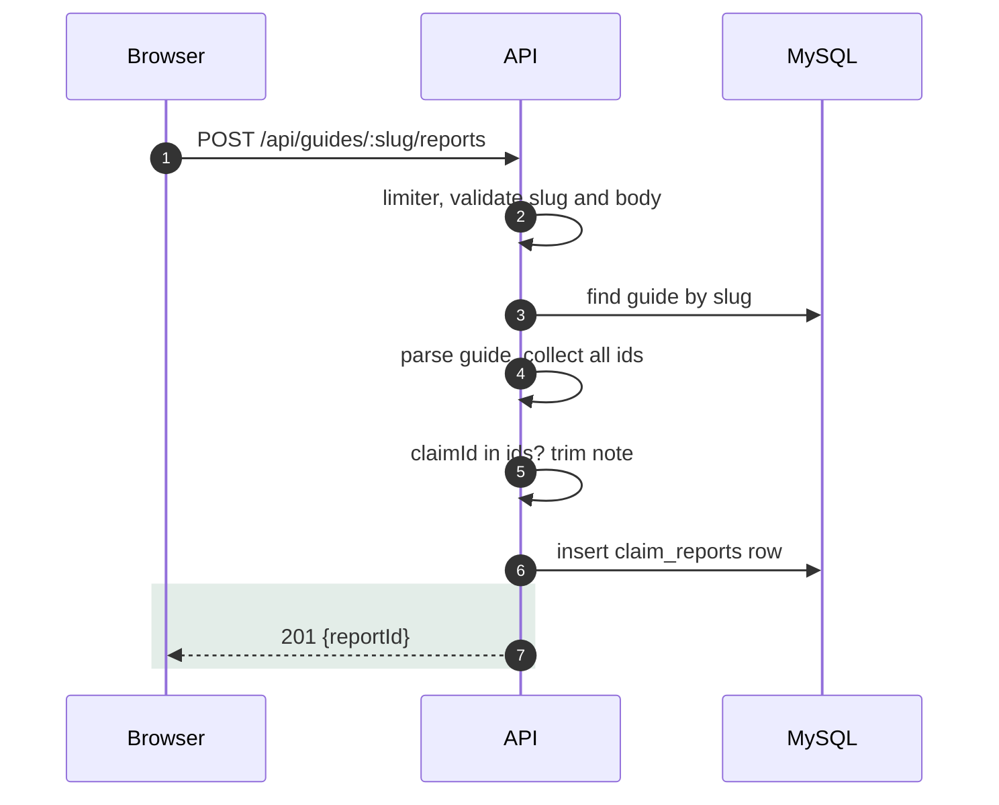

# 03c API: list guides, read a guide, report a claim

## GET /api/guides
- Purpose: list library guides for the home page (`apps/api/src/services/guides.ts:14`).
- Request: no body, no params. Not rate limited, no paging.
- Response `200`: array of `slug`, `appName`, `archetype`, `difficulty`, `mode`, `asOf` (`packages/schema/src/guide/guide.ts:20`).
- Order: `difficulty` ascending, then `appName`. Only `mode = LIBRARY` rows.

- Live guides never appear here, so a live research result has no list entry (`apps/api/src/services/guides.ts:16`).
- The guide JSON column is not selected, which keeps the list cheap.
- Today the answer is `[]`: no library rows exist and no seed script is in the repo.

| Trigger | Code | HTTP | User sees |
| --- | --- | --- | --- |
| Database error | `INTERNAL` | 500 | "The library did not load." and a retry button |
| A row fails `GuideSummarySchema` | `INTERNAL` | 500 | Same |
| Offline, 15 s timeout | `NETWORK` (browser) | none | Same, with the network message |

- A bad `asOf` or archetype in one row fails the whole list (`apps/api/src/mappers/guide-mapper.ts:38`).

## GET /api/guides/:slug
- Purpose: return one full guide (`apps/api/src/services/guides.ts:31`).
- Request: path `slug`, 1 to 100 chars (`apps/api/src/schemas/params.ts:10`). Not rate limited.
- Response `200`: the whole `Guide` (`packages/schema/src/guide/guide.ts:30`).

| Guide part | Holds |
| --- | --- |
| Identity | `schemaVersion` 1, `slug`, `appName`, `domain`, `mode`, `archetype`, `difficulty` 1 to 5, `asOf`, `coverage` |
| `verdict` | `summary` claim, `nextStepId`, `topBlockerId` |
| `milestones` | `firstTest` and `production`, each with `effort` and `wait` claims |
| Lists | `requirements`, `scopes`, `steps`, `blockers`, `limits`, `conflicts` |
| `difficultyBreakdown` | Four factor points, `total` 0 to 9, `score` 1 to 5 |

- Expired live guides are returned too; only `POST /api/runs` treats expiry as stale (`apps/api/src/services/runs.ts:29`).
- Columns win over JSON for slug, name, domain, mode, archetype, difficulty and date (`apps/api/src/mappers/guide-mapper.ts:20`).
- The browser parses the reply again with `GuideSchema` (`apps/web/src/services/guides.service.ts:24`).

| Trigger | Code | HTTP | User sees |
| --- | --- | --- | --- |
| Slug over 100 chars | `VALIDATION_ERROR` | 400 | "The guide did not load" |
| No row | `NOT_FOUND` | 404 | Not found panel |
| Stored JSON fails `GuideSchema` | `INTERNAL` | 500 | "The guide did not load" |

## POST /api/guides/:slug/reports
- Purpose: let a reader flag a wrong claim (`apps/api/src/services/reports.ts:19`).
- Request: `{ "claimId": "steps.5", "note": "Callback path changed" }`. Note is optional, up to 2000 chars (`packages/schema/src/api/guides.ts:10`).
- Response `201`: `{ "reportId": "<cuid>" }`.

- `claimId` must match `^[a-z][a-z0-9_]*(\.[a-zA-Z0-9][a-zA-Z0-9_]*)*$` (`packages/schema/src/claim.ts:14`).
- The guide is parsed on every report, so a corrupt row is a 500 and stores nothing (`apps/api/src/services/reports.ts:26`).
- No dedupe and no login: the same claim can be reported again and again.
- A report keeps `guideId`, `claimId`, `note`, time. After a refresh the id may name different content.

| Trigger | Code | HTTP | User sees |
| --- | --- | --- | --- |
| Over 10 reports per 60 s per IP (own counter) | `RATE_LIMITED` | 429 | "Try again in N seconds." |
| Bad `claimId` shape, note over 2000 chars, extra key, bad JSON | `VALIDATION_ERROR` | 400 | "Stamp could not use that input." |
| `claimId` is not an id inside this guide | `VALIDATION_ERROR` | 400 | Same text |
| Unknown slug | `NOT_FOUND` | 404 | "Stamp could not find that." |
| Stored guide is corrupt, or database error | `INTERNAL` | 500 | "Something went wrong on our side." |

- Limits: 16 KB body, 10 per 60 s per IP (defaults), note 2000 chars (`apps/api/src/app.ts:30`).
- Limiter message: "Too many reports. Try again in a minute." (`apps/api/src/middleware/rate-limit.ts:34`).
