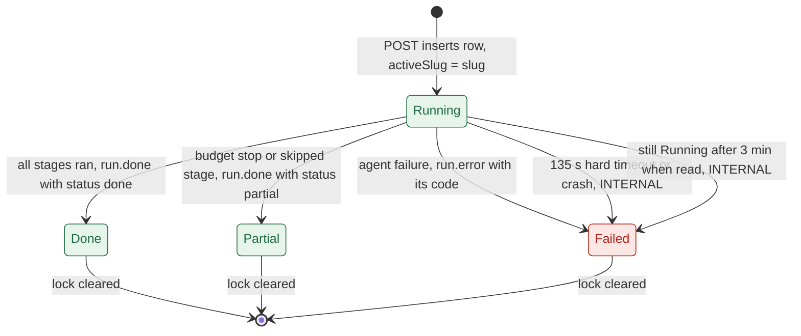
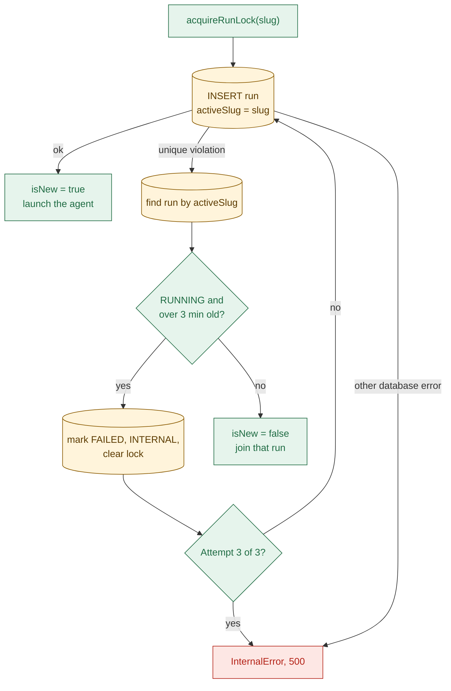

# 04a Run lifecycle: states, lock, stale rule, daily cap

## Run states
- A run is one row in `runs` (`apps/api/prisma/schema.prisma`). Status: `RUNNING`, `DONE`, `PARTIAL`, `FAILED`.
- Detached means the run is not tied to the HTTP request that started it (`apps/api/src/services/run-executor.ts:153`).

- Only the executor ends a live run; it writes the row, then publishes the terminal event (`apps/api/src/services/run-executor.ts:135`).
- Order matters: the row is final before `run.done` is sent, so the guide is readable on arrival.
- A library-protected save counts as `done`, never `partial` (`apps/api/src/agent/run-real-agent.ts:49`).
- Stage progress is written on every `stage.started` (`apps/api/src/services/run-lock.ts:109`).
- Failed rows keep `stageReached`; stale ones keep the last value written (`apps/api/src/services/run-lock.ts:38`).

| How it ends | `status` | `errorCode` | `stageReached` | `guideId` |
| --- | --- | --- | --- | --- |
| Agent returns ok | `DONE` or `PARTIAL` | null | Last stage started | Saved guide id |
| Agent returns a failure | `FAILED` | `AMBIGUOUS_APP`, `NOT_OAUTH`, `NO_PUBLIC_DOCS`, `INTERNAL` | Failure's stage | null |
| Hard timeout or thrown error | `FAILED` | `INTERNAL` | Last stage started, else 0 | null |
| Stale when read | `FAILED` | `INTERNAL` | Value written so far | null |
| Agent says ok but no guide row | `FAILED` | `INTERNAL` | Last stage started | null |

- Sources: `apps/api/src/services/run-executor.ts:55`, `apps/api/src/services/run-executor.ts:68`.
- If the final row write fails, it is only logged; the lock stays until the stale rule (`apps/api/src/services/run-executor.ts:44`).

## The run lock (`activeSlug`)
- The lock is a nullable unique column. MySQL allows many NULLs but only one of each value.
- While a run is live `activeSlug = slug`; any terminal write sets it back to `NULL` (`apps/api/src/services/run-lock.ts:102`).

- The insert is the lock: two simultaneous starts cannot both win (`apps/api/src/services/run-lock.ts:75`).
- The lock is per slug, not per domain. `hubspot` and `hubspot.com` share a slug; `google` and `gmail` do not.
- The stale check is lazy: no timer sweeps; it runs only on a join or a run read (`apps/api/src/services/run-lock.ts:54`).
- A crash leaves the row `RUNNING`, so new requests for that app join a dead run for 3 minutes.
- Stale window is 3 minutes; a run lasts at most 135 s (`apps/api/src/services/run-lock.ts:16`).

## Numbers that govern a run

| Number | Value | Source |
| --- | --- | --- |
| Agent time budget | 120 s; env can only lower it | `apps/api/src/agent/budget.ts:15`, `apps/api/src/config.ts:41` |
| Hard timeout | 120 s + 15 s grace = 135 s | `apps/api/src/services/run-executor.ts:23` |
| Stale lock window | 3 minutes | `apps/api/src/services/run-lock.ts:16` |
| Lock insert attempts | 3 | `apps/api/src/services/run-lock.ts:17` |
| Live guide freshness | 7 days | `apps/api/src/services/guide-save.ts:13` |
| Page cache freshness | 7 days | `apps/api/src/services/page-cache.ts:17` |
| Event buffer after the end | 10 minutes, 2000 events | `apps/api/src/services/run-events.ts:17` |
| Graph step limit | 40 node runs; a retry run uses 13 | `apps/api/src/agent/graph.ts:21` |

## The daily run cap
- `assertUnderRunCap` counts `runs` rows with `startedAt` since 00:00 UTC (`apps/api/src/services/run-cap.ts:20`).
- It throws `RUN_CAP_REACHED` (503) when the count is at or above `DAILY_RUN_CAP`.
- Every outcome counts: done, partial, failed, stub runs, and runs a user abandoned.
- Cached and joined requests never reach the check (`apps/api/src/services/runs.ts:46`).
- Two simultaneous starts can overshoot by one; the code calls it a cost guard, not a ledger (`apps/api/src/services/run-cap.ts:14`).
- A failed run still uses up one slot, so a flaky app can burn the day's cap through retries.
