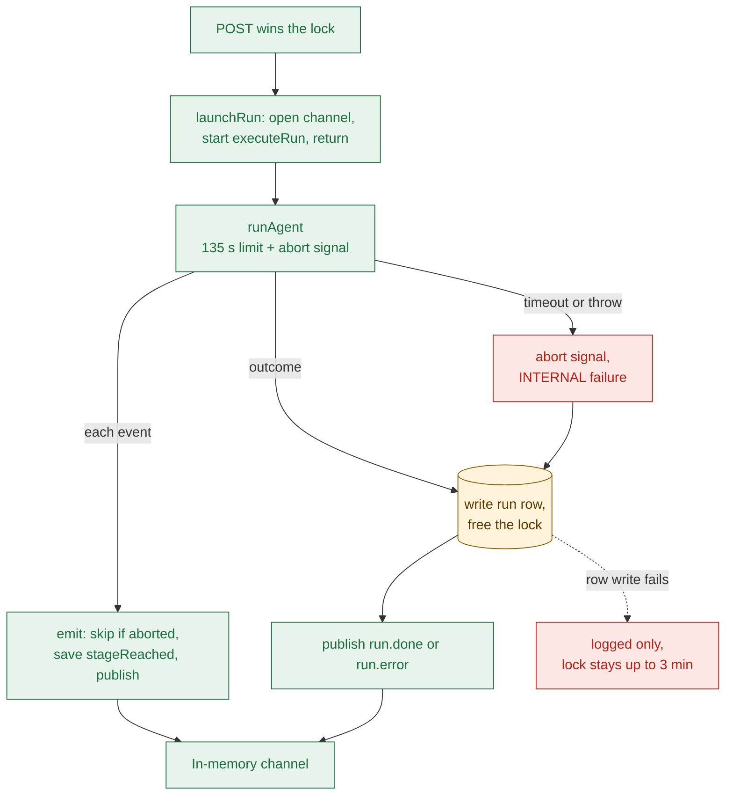
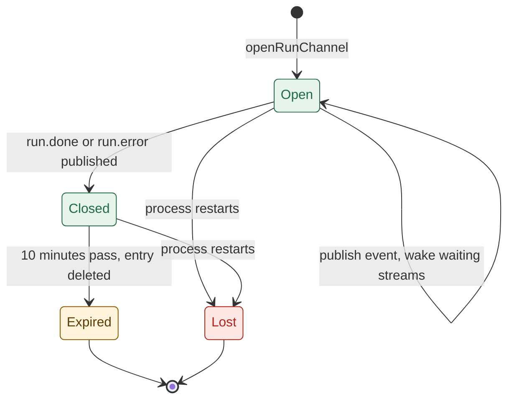
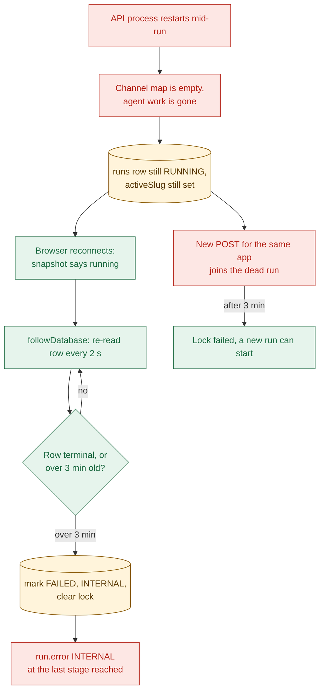

# 04b Run lifecycle: detached run, event bus, reconnect, restart

## Detached execution
- The executor runs the agent in the background and returns to the HTTP request at once (`apps/api/src/services/run-executor.ts:153`).

- The channel opens before the agent starts, so no early event is lost (`apps/api/src/services/run-executor.ts:154`).
- An uncaught executor crash is only logged; the stale rule cleans up later (`apps/api/src/services/run-executor.ts:155`).
- After an abort, `emit` returns without publishing (`apps/api/src/services/run-executor.ts:112`).
- `withTimeout` abandons work, it does not cancel it (`apps/api/src/utils/with-timeout.ts:8`).
- Likely, untested: a save already running at the timeout may finish after the row says `FAILED`.
- Each `stage.started` waits for one database write before it is published (`apps/api/src/services/run-executor.ts:117`).

## The event bus
- The bus is one `Map` of run id to channel inside the API process (`apps/api/src/services/run-events.ts:20`).

- A channel holds an append-only event list and a set of waiting readers (`apps/api/src/services/run-events.ts:10`).
- Each reader keeps its own index, so late joiners replay from event 0 (`apps/api/src/services/run-stream.ts:24`).
- Publishing to a closed or missing channel throws (`apps/api/src/services/run-events.ts:42`).
- At 2000 events only the terminal event is still accepted (`apps/api/src/services/run-events.ts:46`).
- Expired and lost both mean "no channel": the stream then reads the database (`apps/api/src/services/run-stream.ts:77`).

| Situation | Run | Stream | Lock |
| --- | --- | --- | --- |
| Tab closed | Keeps going | Aborted, timer cleared | Held until the run ends |
| Second visitor, same app | One shared run | Own stream, full replay | One lock |
| Join within 10 min of the end | Finished | Replay from memory | Free |
| Join after 10 min, or after restart | Finished | Snapshot plus rebuilt terminal event | Free |
| Restart mid-run | Dead | Snapshot, then database polling | Held up to 3 min |

## Reconnect and replay

```mermaid
sequenceDiagram
    autonumber
    participant B as Browser
    participant A as API
    participant C as Channel
    B->>A: GET stream
    A-->>B: run.snapshot, events 1 to 5
    Note over B,A: network drops
    B--xA: connection lost
    rect rgba(31, 78, 153, 0.12)
    B->>A: EventSource retries by itself
    A-->>B: run.snapshot
    C-->>B: events 1 to 8 from index 0
    end
    Note over B: snapshot empties the page's list, so no duplicates
    C-->>B: live events continue
    C-->>B: run.done, stream closes
```

- The server sends no `id:` field and ignores `Last-Event-ID`, so every connect starts at event 0 (`apps/api/src/utils/sse.ts:30`).
- While `EventSource` is retrying, the page shows "Connection lost. Reconnecting." (`apps/web/src/services/run-stream.service.ts:127`).
- A snapshot clears the page's events, so a replay never doubles a row (`apps/web/src/utils/run-stream-state.ts:37`).
- If the connection ends for good, the page asks `GET /api/runs/:id` why (`apps/web/src/services/run-stream.service.ts:83`).
- The retry delay is the browser's default; the server sends no `retry:` hint.

## Server restart
- Nothing is saved between nodes: the graph is compiled with no checkpointer (`apps/api/src/agent/graph.ts:90`).

- For up to 3 minutes the page says "Researching" with no new events and no error.
- The orphan poll runs every 2 s and ends on a terminal row or an abort (`apps/api/src/services/run-stream.ts:17`).
- A finished run after a restart shows summary-only copy: "Its trace is no longer kept" (`apps/web/src/components/run/run-copy.ts:79`).
- `AMBIGUOUS_APP` loses its options after a restart, so the page offers a fresh search (`apps/web/src/components/run/run-error-copy.ts:34`).
- The dead run still used one slot of the daily cap (`apps/api/src/services/run-cap.ts:20`).
