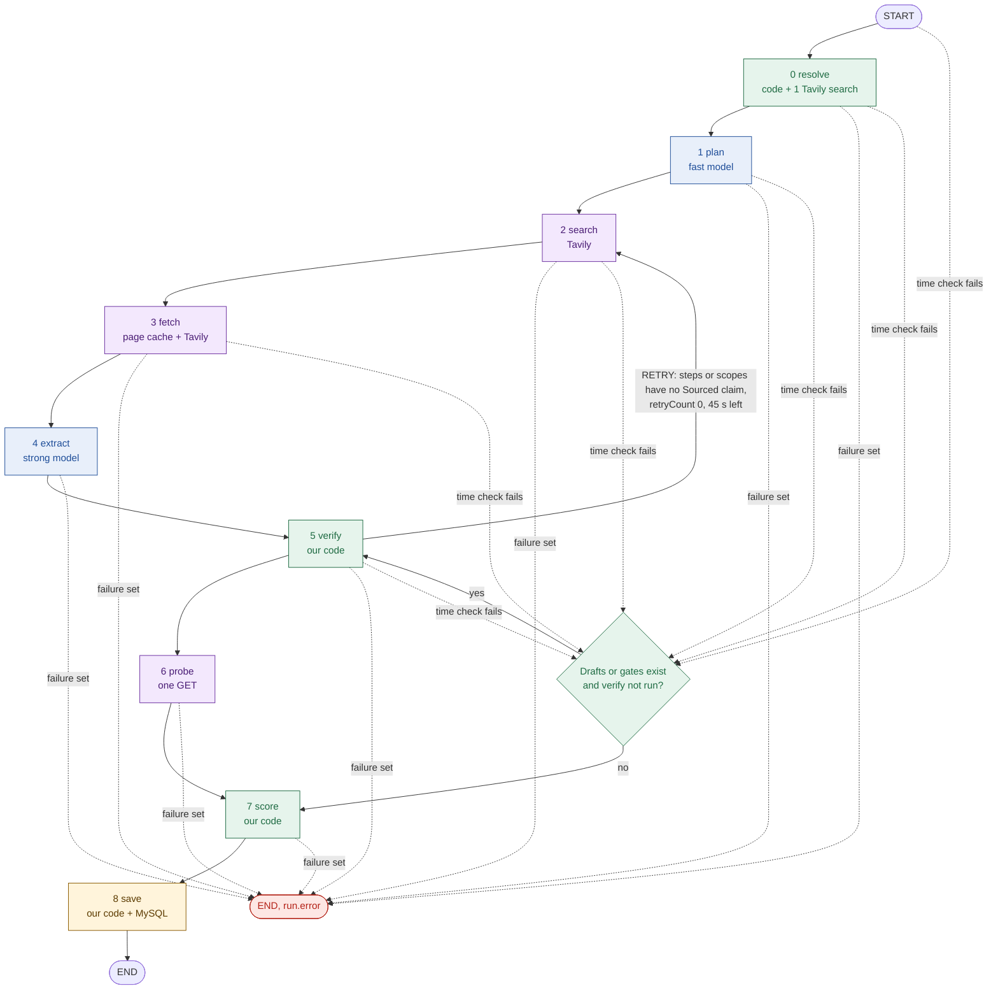
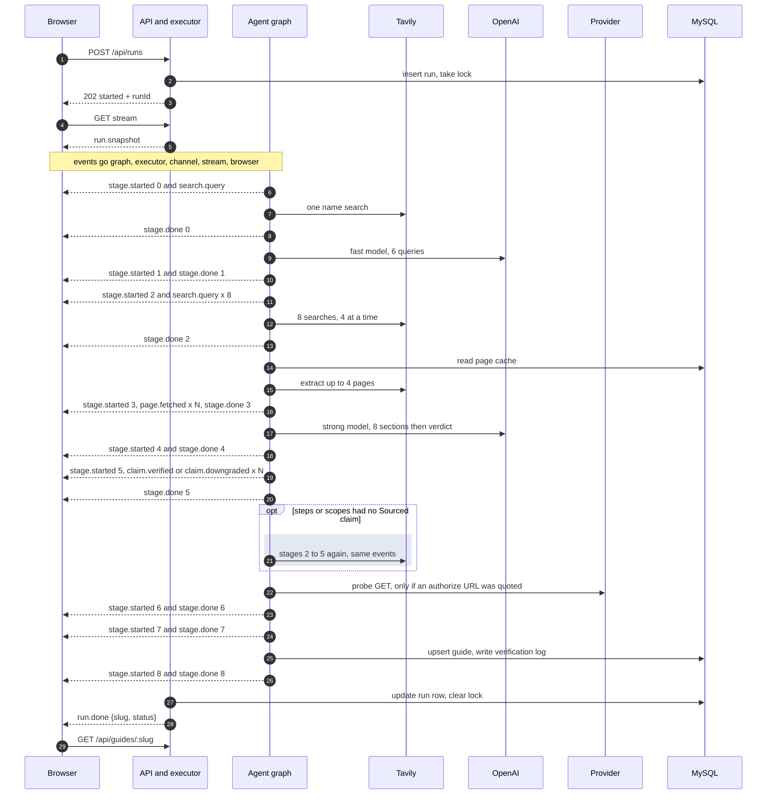

# 05a Agent graph: stages, retry edge, budget stop, one full run

## The graph
- Nine stages are nodes in a LangGraph `StateGraph` (`apps/api/src/agent/graph.ts:42`).
- A node is one stage. It reads the shared state and returns an update. A router picks the next node.

- Every edge goes through `routeTo`: failure ends the run, then the clock is checked (`apps/api/src/agent/routes.ts:41`).
- The retry is the only back edge. It loops through stages 2 to 5 once (`apps/api/src/agent/graph.ts:81`).
- Extract never stops on time: verify needs 0 ms, so drafts are always checked (`apps/api/src/agent/budget.ts:61`).
- A failing node emits `stage.started` but not `stage.done` (`apps/api/src/agent/stage-node.ts:37`).
- The graph holds at most 13 node runs; the step limit is 40 (`apps/api/src/agent/graph.ts:21`).
- State fields avoid node names, so the results are `probeResult` and `difficulty` (`apps/api/src/agent/state.ts:66`).

## Workflow or autonomous agent?
- Answer: a workflow. Code fixes the order, and the model only fills fields.

| Evidence | Where |
| --- | --- |
| Nodes and edges are written in code, not chosen at run time | `apps/api/src/agent/graph.ts:42` |
| Routers are pure functions of state and the clock | `apps/api/src/agent/routes.ts:41` |
| Only 2 of 9 stages call a model: plan and extract | `apps/api/src/agent/nodes/plan.ts:26`, `nodes/extract.ts:50` |
| Model calls return JSON that is checked; no tools, no actions | `apps/api/src/lib/openai.ts:98` |
| Labels and scores come from code, never from the model | `apps/api/src/agent/evidence/labelling.ts:29` |
| One loop only, bounded by a counter and the clock | `apps/api/src/agent/budget.ts:157` |

## Exact conditions

| Rule | Condition | Source |
| --- | --- | --- |
| Retry edge | No `failure`, `missingSections` not empty, `retryCount` below 1, at least 45 s left | `agent/routes.ts:55`, `budget.ts:157` |
| `missingSections` | `steps` or `scopes` has no claim labelled Sourced or Tested | `verify/missing-sections.ts:12` |
| Counting the retry | Search adds 1 to `retryCount` when it starts with `missingSections` set | `graph.ts:27` |
| Retry work | At most 2 new queries, pages up to 6 in all, only the missing sections, then verify again | `queries.ts:106`, `budget.ts:148` |
| Budget stop | Time left is below the next node's minimum: 3, 3, 4, 6, 20, 0, 3, 0, 0 s | `budget.ts:55` |
| Where a stop goes | To verify if drafts or gates are unchecked, else to score, then save | `agent/routes.ts:50` |
| Result of a stop | `coverage: partial` when any of stages 0 to 7 never completed | `pipeline.ts:46` |
| Stop before extract | No drafts, no claims, so save fails `INTERNAL` ("no sourced claim") | `nodes/save.ts:31` |

- Paths above are under `apps/api/src/agent/`.
- The 120 s total can only be lowered by `AGENT_RUN_BUDGET_MS` (`apps/api/src/config.ts:41`).

## One full run, with the SSE events the browser receives

- `search.query` at stage 0 appears only when a name was typed; a typed domain skips the search (`apps/api/src/agent/nodes/resolve.ts:27`).
- Stage 5 events come before its `stage.done`, because they are emitted inside the node (`apps/api/src/agent/nodes/verify.ts:29`).
- The run row is updated before `run.done`, so the final guide read succeeds (`apps/api/src/services/run-executor.ts:95`).
- On failure the sequence stops at the failing stage's `stage.started`, then `run.error` (`apps/api/src/services/run-executor.ts:55`).
- Real log, Notion, 30.2 s: one retry, 6 pages, 10 strong calls, 11 Tavily credits (`api.log`).
