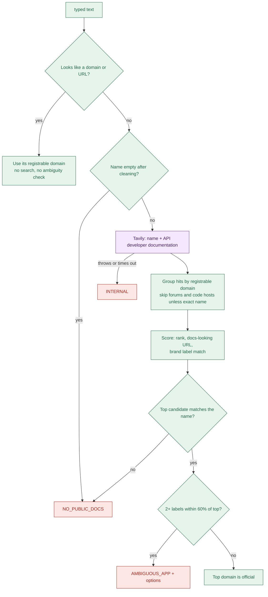

# 05b Node cards: resolve, plan, search

- "Cap" is a stage's time ceiling. "Min left" is the time that must remain to start it (`apps/api/src/agent/budget.ts:34`).
- For `INTERNAL`, the user sees "The run stopped at <stage name>", plus Retry run and Open the library.
- Typical times come from the one real run in `api.log` (Notion, 30.2 s). n=1, so treat them as a sample.

## Stage 0: resolve (`apps/api/src/agent/nodes/resolve.ts:25`)

| Field | What to write |
| --- | --- |
| Purpose | Turn the typed name or URL into one official domain, or stop with a clear error |
| Type | Our code, plus one outside call (Tavily search) when a name was typed |
| Reads from state | `typed`, `slug` |
| Writes to state | `app` (`appName`, `domain`, `slug`) or `failure`; `completed` |
| Budget | Cap 6 s, min left 3 s, one search for 8 results, 1 Tavily credit |
| Events emitted | `stage.started` (`resolve_app`), `search.query` (name only), `stage.done` |
| Success | `app.domain` is a registrable domain like `notion.com`; log `resolve summary` says `official` |
| Failure modes | See the list below the card |
| Typical time | About 3.6 s (search call 3.5 s) |

- Empty name after cleaning: `NO_PUBLIC_DOCS`, stage 0. User sees "No public docs for this app" (`resolve.ts:33`).
- Search throws or times out: `INTERNAL`, stage 0 (`resolve.ts:55`).
- No domain matches the name: `NO_PUBLIC_DOCS` (`resolve/decide.ts:39`).
- Two brand labels match and the runner-up scores 60% of the leader: `AMBIGUOUS_APP`, up to 3 options (`resolve/decide.ts:51`).
- A typed domain or URL is trusted as official with no search. A wrong domain gives a wrong guide (`resolve.ts:27`).

- Weights: exact label 3, partial 1.5, title-only 1, docs hint 0.5 per hit up to 1 (`apps/api/src/agent/resolve/candidates.ts:30`).
- The registrable domain is a heuristic with 8 two-part suffixes and no public suffix list (`apps/api/src/utils/registrable-domain.ts:9`).
- "Official" later means "any host under this one domain", so `learn.microsoft.com` is official for Microsoft.
- Thresholds are first guesses to tune against live searches (`apps/api/src/agent/resolve/decide.ts:13`).

## Stage 1: plan (`apps/api/src/agent/nodes/plan.ts:18`)

| Field | What to write |
| --- | --- |
| Purpose | Get one search query for each of 6 topics: setup, scopes, review, limits, authType, approvalWait |
| Type | AI model, fast tier (`gpt-4.1-mini` in the log). It only writes search strings, which code checks |
| Reads from state | `app` |
| Writes to state | `queries` (`topic`, `text`); `completed` |
| Budget | Cap 6 s, min left 3 s, one call, no repair, no retry |
| Events emitted | `stage.started` (`plan_searches`), `stage.done` |
| Success | 6 queries, each from the model if it passes the checks, else a template; log `model call plan_queries ok` |
| Failure modes | Never fails the run; see the list below the card |
| Typical time | About 2.8 s; 381 input and 64 output tokens |

- Model error, timeout, bad JSON or schema mismatch: warning logged, template queries used, the user sees nothing (`nodes/plan.ts:35`).
- A suggestion is dropped for a URL, no app name, or bad length (`apps/api/src/agent/queries.ts:43`).
- Length rule: 8 to 160 chars and 3 to 16 words.
- Quotes and operators such as `site:` are stripped before use (`apps/api/src/agent/queries.ts:47`).
- The prompt allows `null` and forbids facts, scope names, URLs and times (`apps/api/src/agent/prompts/plan.ts:23`).
- `app` missing gives `INTERNAL`; this cannot follow a successful resolve (`nodes/plan.ts:20`).

## Stage 2: search (`apps/api/src/agent/nodes/search.ts:23`)

| Field | What to write |
| --- | --- |
| Purpose | Find candidate pages: all topics on the official domain, plus 2 open-web queries |
| Type | Outside call (Tavily search, basic depth, 5 results each); ordering is our code |
| Reads from state | `app`, `queries`, `missingSections`, `retryCount` |
| Writes to state | `searchResults` (new URLs only, with tier and score); `completed` |
| Budget | Cap 8 s (retry 6 s), min left 4 s, 4 searches at once, a search needs 1.5 s left or is skipped |
| Events emitted | `stage.started` (`search`), `search.query` once per distinct query, `stage.done` |
| Success | At least one search answered; log `search summary` (Notion: 8 queries, 25 results, 17 official) |
| Failure modes | See the list below the card |
| Typical time | About 5.3 s first pass, 4.2 s on the retry (1 query) |

- Every search failed or was skipped: `INTERNAL`, stage 2 (`search.ts:64`).
- Some searches failed: fewer results, counted as `failedQueries` in the log, no event (`search.ts:73`).
- Retry pass: 1 or 2 differently worded queries on the official domain only (`apps/api/src/agent/queries.ts:109`).
- Results are tiered by host against the official domain, then ordered official, third party, forum (`apps/api/src/agent/search/order-results.ts:41`).
- The domain filter keeps results on that domain, not on the right product (`apps/api/src/agent/search/jobs.ts:38`).
