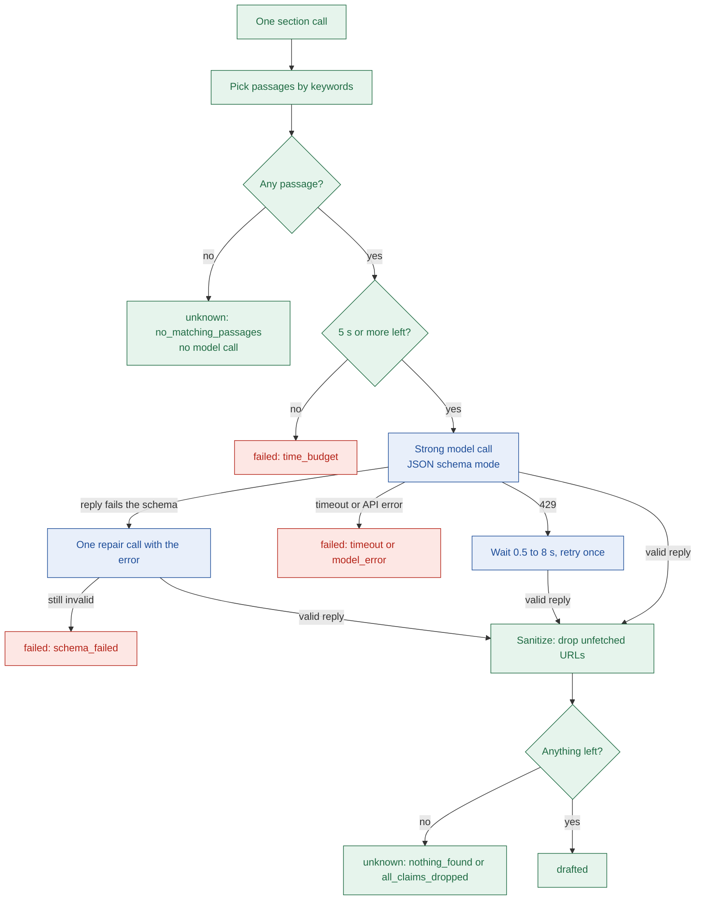

# 05c Node cards: fetch, extract, verify

- Terms and "User sees" rules are the same as in `05b-nodes-resolve-plan-search.md`.
- Typical times come from the Notion run in `api.log` (30.2 s, n=1).

## Stage 3: fetch (`apps/api/src/agent/nodes/fetch.ts:18`)

| Field | What to write |
| --- | --- |
| Purpose | Pick up to 4 pages (6 in all after a retry), load them, and keep one official page at least |
| Type | Outside call (Tavily extract, basic depth, text) plus database (`page_cache`); page choice is our code |
| Reads from state | `app`, `searchResults`, `pages`, `retryCount` |
| Writes to state | `pages` (new ones only, tier set against this app); `completed`; maybe `failure` |
| Budget | Cap 12 s (retry 8 s), min left 6 s, 1 extract call for all cache misses, a page needs 300+ chars |
| Events emitted | `stage.started` (`fetch_pages`), `page.fetched` (`url`, `tier`) per page kept, `stage.done` |
| Success | At least one official page held; log `pages loaded` with `requested`, `cacheHits`, `fetched`, `dropped`, `failed` |
| Failure modes | See the list below the card |
| Typical time | About 2.0 s for 4 pages (extract call 1.9 s); retry 0.8 s for 2 pages |

- No official page held: `NO_PUBLIC_DOCS`, stage 3 (`fetch.ts:67`).
- If the extract call itself failed and nothing is held: `INTERNAL`, not the app's fault (`fetch.ts:64`).
- Pages under 300 chars, or not asked for, are dropped with no event (`apps/api/src/agent/fetch/load-pages.ts:112`).
- Cache read or write errors are logged; a failed write drops that page (`load-pages.ts:55`).
- Skipped URLs: images, archives, login and sign-up paths (`apps/api/src/agent/fetch/select-pages.ts:14`).
- Official pages come first; one slot goes to a non-official page when 3 or more are allowed (`select-pages.ts:57`).
- Page text is what Tavily returned, and cached text is reused for 7 days (`apps/api/src/services/page-cache.ts:17`).

## Stage 4: extract (`apps/api/src/agent/nodes/extract.ts:24`)

| Field | What to write |
| --- | --- |
| Purpose | Draft each guide section from keyword-picked page passages; the verdict runs last |
| Type | AI model, strong tier (`gpt-4.1` in the log). It reads messy pages and must quote exactly |
| Reads from state | `app`, `pages`, `drafts`, `gates`, `retryCount`, `missingSections` |
| Writes to state | `drafts` (drafted, unknown or failed per section), `gates`, `partial`, `failure`; `completed` |
| Budget | Cap 40 s (retry 18 s), min left 20 s, 5 calls at once; each call needs 5 s left, max 25 s |
| Events emitted | `stage.started` (`extract_facts`), `stage.done`. No claim events here |
| Success | At least one section or the gates drafted; Notion: 5 of 9 drafted, 36k input and 1.8k output tokens |
| Failure modes | See the list below the card |
| Typical time | About 10.1 s (calls 1.4 to 6.5 s); retry pass 1.2 s for one section |

- Limits per section: 14,000 chars of passages, 8,000 for the verdict, one repair, one 429 retry (`apps/api/src/agent/extract/keywords.ts:10`).
- `NOT_OAUTH`: gates say `api_key_only`, the quote is on an official page, and no steps or scopes exist (`extract/decisions.ts:24`).
- Every section unknown: `NO_PUBLIC_DOCS`. Every section failed: `INTERNAL` (`extract/decisions.ts:56`).
- A failed section becomes an Uncertain claim: "Could not be read reliably from the fetched sources." (`guide/unknown-claim.ts:15`).
- Only `time_budget` failures mark the run partial; timeouts do not (`apps/api/src/agent/extract/results.ts:48`).
- Claims citing a URL that was not fetched are dropped; kept URLs are rewritten to the fetched page (`extract/sanitize.ts:38`).
- Page text sits in tags with a per-call token and the prompt says to ignore orders in it (`prompts/shared.ts:27`).

- Passages are picked by generic keywords like "oauth". Nothing checks the page is about this product (`extract/keywords.ts:14`).
- `unknown` is a normal answer; the prompt says it is a good one (`apps/api/src/agent/prompts/shared.ts:35`).
- A second 429, or no time to wait, fails the section as `rate_limited` (`apps/api/src/lib/openai-retry.ts:69`).
- The verdict points at steps and blockers by position, so it runs after them (`extract/verdict-context.ts:16`).

## Stage 5: verify (`apps/api/src/agent/nodes/verify.ts:19`)

| Field | What to write |
| --- | --- |
| Purpose | Give every claim its label from code: quote check, conflicts, gates evidence, missing sections |
| Type | Our code only. No model, no network |
| Reads from state | `drafts`, `pages`, `gates`, `claims` (the previous pass) |
| Writes to state | `claims`, `conflicts`, `missingSections`, `gates` (verified evidence only), `checks`; `completed` |
| Budget | Cap 2 s but not enforced, min left 0 so it always runs |
| Events emitted | `stage.started` (`verify_quotes`), `claim.verified`, `claim.downgraded`, `stage.done` |
| Success | Log `verify summary`; Notion: 16 claims, 13 Sourced, 0 conflicts, `missing: ["scopes"]` |
| Failure modes | It sets no `failure`; each downgrade is listed below the card |
| Typical time | About 0.08 s |

- Quote not found on the cited page: Uncertain, source removed, `quote_not_found` (`apps/api/src/agent/verify/verify-claims.ts:54`).
- Quote under 10 normalised chars counts as not found (`apps/api/src/agent/evidence/quote-match.ts:35`).
- A confirmed conflict makes both claims Uncertain with `sources_disagree` (`apps/api/src/agent/evidence/labelling.ts:33`).
- Time estimates are Uncertain with no event (`apps/api/src/agent/verify/claim-events.ts:15`).
- A gates fact with an unmatched quote becomes unknown, so the score ignores it (`apps/api/src/agent/verify/verify-gates.ts:33`).
- No Sourced claim in `steps` or `scopes` sets `missingSections` and may trigger the retry (`verify/missing-sections.ts:12`).
- On a retry pass only new or changed claims send events (`apps/api/src/agent/verify/claim-events.ts:26`).
