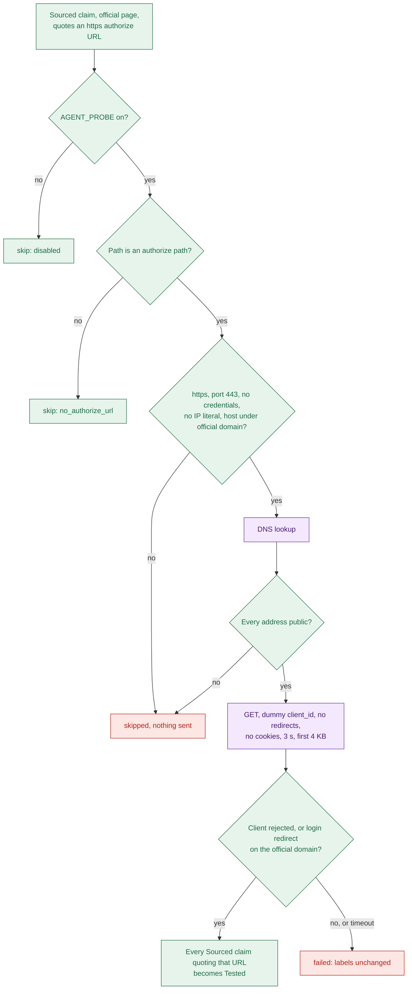

# 05d Node cards: probe, score, save

- Terms and "User sees" rules are the same as in `05b-nodes-resolve-plan-search.md`.
- Typical times come from the Notion run in `api.log` (30.2 s, n=1).

## Stage 6: probe (`apps/api/src/agent/nodes/probe.ts:19`)

| Field | What to write |
| --- | --- |
| Purpose | Send one GET to a quoted authorize URL with a fake client ID; a good rejection makes the claims Tested |
| Type | Outside call to the provider, plus a DNS lookup. The pass or fail decision is our code |
| Reads from state | `app`, `claims`, `checks` |
| Writes to state | `probeResult`, `checks` (probe rows added), `claims` (labels upgraded); `completed` |
| Budget | Cap 4 s, min left 3 s, request 3 s at most, body read 4 KB at most, `AGENT_PROBE=off` skips it |
| Events emitted | `stage.started` (`probe_endpoints`), `stage.done`. No claim events, even when claims become Tested |
| Success | Status 400, 401 or 403 naming `invalid_client`, `client_id` or `redirect_uri`; or a 3xx to a login or error page on the official domain |
| Failure modes | It never fails the run; see the list below the card |
| Typical time | About 0.01 s in the Notion run: no authorize URL was quoted, so nothing was sent |

- Off, or no Sourced official claim quotes an authorize URL: skipped, labels stay Sourced (`probe.ts:23`).
- A guard refuses the target: skipped, nothing is sent (`apps/api/src/agent/probe/probe-url.ts:79`).
- 404, 5xx, other statuses, a 4xx without client words, or a redirect off the domain: failed, labels unchanged (`probe/evaluate-response.ts:36`).
- Timeout or network error: failed with reason `timeout` or `network_error` (`probe-url.ts:119`).
- Every probe, pass or fail, writes `probe` rows to the verification log (`probe.ts:40`).

- SSRF (server-side request forgery) tricks a server into calling an address it should not, like an internal service.
- The probe guards exist to block SSRF.
- Known limit: the name is resolved once for the check and again by `fetch`, so DNS rebinding is possible (`probe-url.ts:66`).
- A pass upgrades all Sourced claims that quote the same URL, not only one (`apps/api/src/agent/probe/find-authorize-url.ts:58`).
- Tested here means "the endpoint exists and rejects a fake client". It does not prove the claim's text.
- The first authorize URL found, in claim order, is the only one probed (`find-authorize-url.ts:53`).

## Stage 7: score (`apps/api/src/agent/nodes/score.ts:19`)

| Field | What to write |
| --- | --- |
| Purpose | Compute the difficulty breakdown and the archetype from the verified gates |
| Type | Our code only |
| Reads from state | `gates`, `completed` |
| Writes to state | `difficulty` (four factors, `total` 0 to 9, `score` 1 to 5), `archetype`; `completed` |
| Budget | Cap 1 s but not enforced, min left 0 so it always runs, even after a budget stop |
| Events emitted | `stage.started` (`score`), `stage.done` |
| Success | Notion: review gate 1 + wait 2 + prerequisites 0 + limits 0 = 3, score 2, archetype `instant` |
| Failure modes | None intended; see the list below the card |
| Typical time | Not logged on its own; score and save together took about 0.05 s |

- If verify never ran (budget stop), gates are ignored and every fact counts as unknown (`score.ts:20`).
- Unknown review gate scores 0; unknown wait scores 2, so the score is a lower bound (`apps/api/src/agent/scoring/difficulty.ts:12`).
- A thrown error (bad counts or range) would end the run as `INTERNAL`; inputs are pre-checked (`scoring/gate-facts.ts:23`).
- The rule and a worked example are in `06b-unknowns-difficulty.md`.

## Stage 8: save (`apps/api/src/agent/nodes/save.ts:20`)

| Field | What to write |
| --- | --- |
| Purpose | Build the guide from drafts and verified claims, check it, store it, write the verification log |
| Type | Our code plus database writes (`guides`, `verification_log`) |
| Reads from state | `app`, `difficulty`, `archetype`, `drafts`, `claims`, `conflicts`, `checks`, `partial`, `completed` |
| Writes to state | `guide`, `libraryProtected`, `failure`; `completed` |
| Budget | Cap 5 s but not enforced, min left 0 so it always runs |
| Events emitted | `stage.started` (`save`), `stage.done`; then the executor sends `run.done` |
| Success | Row stored as `LIVE`, `expiresAt` +7 days; Notion: coverage full, difficulty 2, 17 checks |
| Failure modes | See the list below the card |
| Typical time | About 0.05 s, with score included (probe summary to `guide saved`) |

- No Sourced or Tested claim at all: `INTERNAL`, "guide not saved" (`save.ts:31`).
- Missing app or score, or the guide fails `GuideSchema`: `INTERNAL`; the log names paths, not text (`save.ts:27`).
- A library guide owns the slug: nothing is written; the run is `done` with `libraryProtected` (`save.ts:56`).
- Guide write fails: the error ends the run as `INTERNAL` at the last stage reached (`apps/api/src/agent/run-real-agent.ts:106`).
- Verification-log write fails: warning only; the guide stays and the run succeeds (`save.ts:67`).
- Upsert by slug replaces any earlier live guide, with no comparison of old and new (`apps/api/src/services/guide-save.ts:50`).
- Gaps become Uncertain claims with no sources; texts are in `06b-unknowns-difficulty.md`.
