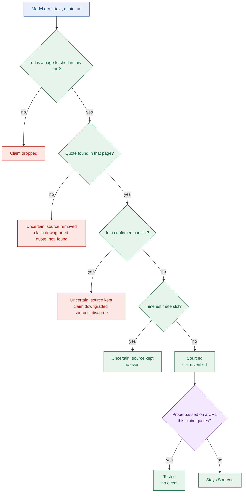
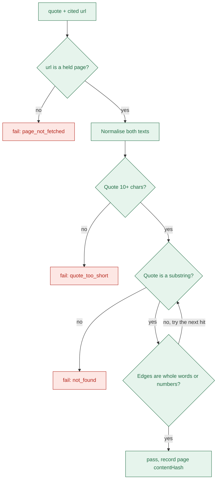

# 06a Evidence: claim lifecycle, quote check, tiers, downgrades

## From draft to label
- The model returns `text`, `quote` and `url` only. It has no label field (`apps/api/src/agent/draft-claim.ts:9`).
- Code sets the label in verify, and the probe may raise it (`apps/api/src/agent/evidence/labelling.ts:29`).

- Order of tests is fixed: quote, then conflict, then estimate (`apps/api/src/agent/evidence/labelling.ts:29`).
- Estimate slots are step `effort` and the four milestone claims (`apps/api/src/agent/guide/claim-slots.ts:51`).
- A dropped claim leaves its slot empty, and the guide fills it with "Not found in the fetched sources."
- A draft that verify never saw becomes an unknown claim, even if it has text (`apps/api/src/agent/guide/claim-lookup.ts:32`).
- The schema rejects a Sourced or Tested claim with no source (`packages/schema/src/claim.ts:36`).

## The quote check
- Verify looks the quote up in the one page its URL names, not in all pages (`apps/api/src/agent/verify/check-quote.ts:28`).

- Normalising means NFKC (folds look-alike Unicode), lowercase, smart quotes and dashes to ASCII, no invisible characters, one space (`apps/api/src/utils/normalize-text.ts:20`).
- The match is exact. No stemming, no reordering, no ellipsis handling (`apps/api/src/agent/evidence/quote-match.ts:25`).
- "25 installs" cannot match inside "125 installs" because of the whole-word test (`apps/api/src/agent/evidence/quote-match.ts:51`).
- Every check, pass or fail, is logged with the page's `contentHash` (`apps/api/src/agent/verify/check-quote.ts:35`).

| The check proves | The check does not prove |
| --- | --- |
| The quote text is in the page text Stamp holds | The claim `text` follows from the quote |
| Which page version was used (`contentHash`) | The page is about this product or this API |
| The cited URL was fetched in this run | The page is current, or is the live page |
| The quote has 10 or more characters | The quote means what the claim says in context |

## Source tiers
- A tier is set by code from the URL host and the official domain (`apps/api/src/agent/evidence/source-tier.ts:66`).

| Tier | Rule |
| --- | --- |
| `forum` | Host under stackoverflow, stackexchange, serverfault, superuser, askubuntu, reddit, news.ycombinator or quora; or a `community`, `forum`, `discuss`, `answers` style subdomain |
| `official` | Host is the official domain or any subdomain of it, and not a forum |
| `third_party` | Everything else, including unparseable or non-http URLs |

- Forum wins over official, so `community.hubspot.com` is a forum (`apps/api/src/agent/evidence/source-tier.ts:63`).
- Tier orders search results, picks pages, and weights passages: official 1, third party 0.5, forum 0.4 (`apps/api/src/agent/extract/passages.ts:16`).
- `NOT_OAUTH` and the probe accept official sources only (`apps/api/src/agent/extract/decisions.ts:41`).
- Tier cannot tell products apart: every page under `google.com` or `microsoft.com` is official.

## Every downgrade reason

| Reason | Sent as event? | Trigger | Result |
| --- | --- | --- | --- |
| `quote_not_found` | Yes | Quote not on the cited page, page not held, or quote too short | Uncertain, source removed |
| `sources_disagree` | Yes | Claim is one side of a confirmed conflict | Uncertain, source kept |
| `schema_failed` | No | A section's reply failed the schema after one repair | Section unknown: "Could not be read reliably from the fetched sources." |
| `time_budget` | No (stub only) | Section skipped or draft not verified before time ran out | "Not researched before the time budget ran out." |
| `stale_source` | Never | Defined in the schema, no code sets it | None |

- Enum: `packages/schema/src/enums.ts:56`. Emission: `apps/api/src/agent/verify/claim-events.ts:27`.
- A conflict needs both quotes found, two different pages, and different statements (`apps/api/src/agent/evidence/conflicts.ts:64`).
- Nothing checks that the two statements are about the same fact; the model proposes the topic.
- The preferred source is the better tier. With equal tiers and no page dates, the first listed wins (`conflicts.ts:99`).
- The conflict's own reason claim is labelled Sourced by code, with both sources (`apps/api/src/agent/verify/verify-conflicts.ts:87`).
