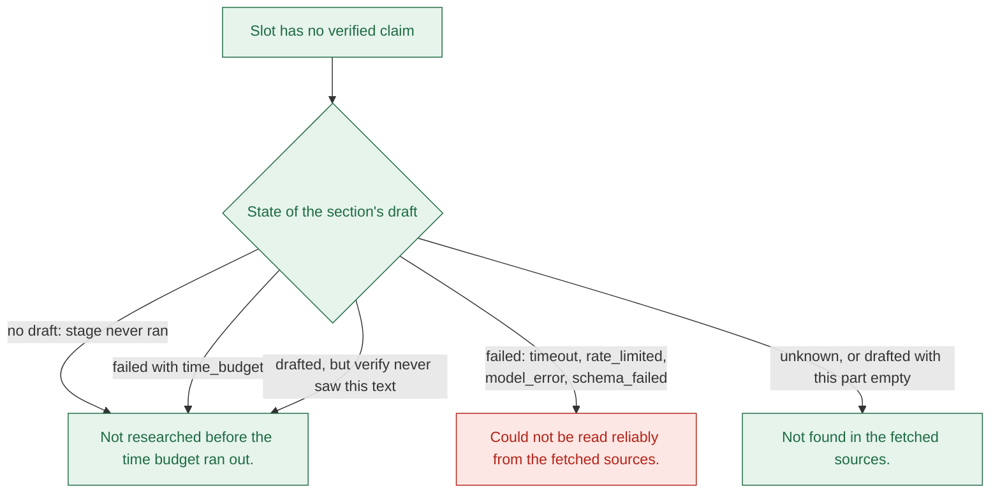
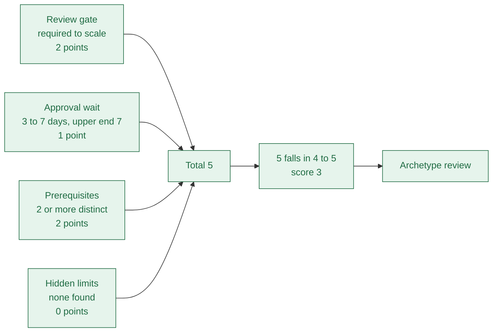

# 06b Unknown claims and the difficulty rule

## The three "unknown" texts
- An unknown claim is Uncertain, has no sources, and says what is missing (`apps/api/src/agent/guide/unknown-claim.ts:19`).
- The schema allows sourceless claims only when they are Uncertain (`packages/schema/src/claim.ts:36`).

| Text | Key | Used when |
| --- | --- | --- |
| "Not found in the fetched sources." | `not_found` | The section answered unknown, or it was drafted but this one part is empty |
| "Could not be read reliably from the fetched sources." | `unreadable` | The section failed: timeout, 429, model error or schema failure |
| "Not researched before the time budget ran out." | `time_budget` | The section never ran, ran out of time, or its draft was never verified |

- The pick is made in one function (`apps/api/src/agent/guide/unknown-claim.ts:32`).
- Requirements and limits always hold at least one claim, so an empty list becomes one unknown claim (`apps/api/src/agent/guide/assemble-sections.ts:58`).
- Milestones and the verdict summary also show an unknown claim when nothing was found.
- Steps, scopes and blockers become empty lists instead, with no unknown claim (`apps/api/src/agent/guide/assemble-sections.ts:20`).
- "Not found" is true only if the right pages were read. Wrong-product pages can hide a gap.

## The difficulty rule
- Code computes it from verified gates. The model never picks a number (`apps/api/src/agent/scoring/difficulty.ts:96`).

| Factor | Points | Rule |
| --- | --- | --- |
| Review gate | 0 to 3 | none or unknown 0; optional listing 1; required to scale 2; assessment or vetting 3 |
| Approval wait | 0 to 3 | Upper end of range: under 1 day 0; to 7 days 1; to 28 days 2; longer 3. Unknown 2 |
| Prerequisites | 0 to 2 | Count of distinct quotes, capped at 2 |
| Hidden limits | 0 or 1 | 1 if any limit that applies after launch was found |
| Total to score | 1 to 5 | Totals 0-1 give 1; 2-3 give 2; 4-5 give 3; 6-7 give 4; 8-9 give 5 |

- A verified review gate of `none` forces the wait to 0 (`apps/api/src/agent/scoring/difficulty.ts:101`).
- A fact without a verified quote counts as unknown (`apps/api/src/agent/scoring/gate-facts.ts:41`).
- The score table is `difficultyScoreForTotal`, and the schema re-checks it on every guide (`packages/schema/src/constants.ts:30`).
- Archetype is the first match: partner vetting, enterprise plan, assessment, hidden limits, required review, none or optional (`apps/api/src/agent/scoring/archetype.ts:15`).
- Otherwise the archetype is `unknown`.

## Worked example: the stored Gmail guide
- Stored values were read from `GET /api/guides/gmail` (Confirmed). The reasons behind each factor are inferred (Likely).

- The production wait claim says "3 to 7 days", from a third-party blog. That likely set the wait to 1.
- The "2" for the review gate matches the blocker about Google's verification of sensitive scopes.
- Both inputs are model judgments backed by a quote that exists; the code only adds them up.
- Change the wait to "8 days" and the total becomes 6, so the score becomes 4.

| Stored guide | Gate | Wait | Prereq | Hidden | Total | Score | Archetype |
| --- | --- | --- | --- | --- | --- | --- | --- |
| `gmail` | 2 | 1 | 2 | 0 | 5 | 3 | `review` |
| `microsoft` | 0 | 2 | 1 | 0 | 3 | 2 | `unknown` |
| `notion` | 1 | 2 | 0 | 0 | 3 | 2 | `instant` |

- Microsoft: gate 0 with wait 2 means the gate is unknown, because a verified `none` would force wait 0.
- Microsoft's score of 2 comes mostly from unknowns, not from evidence that it is easy.
- Notion: gate 1 is an optional listing. Wait 2 is either unknown or 8 to 28 days.
- Sources: `apps/api/notion.json` for Notion; the other two from the running API.
