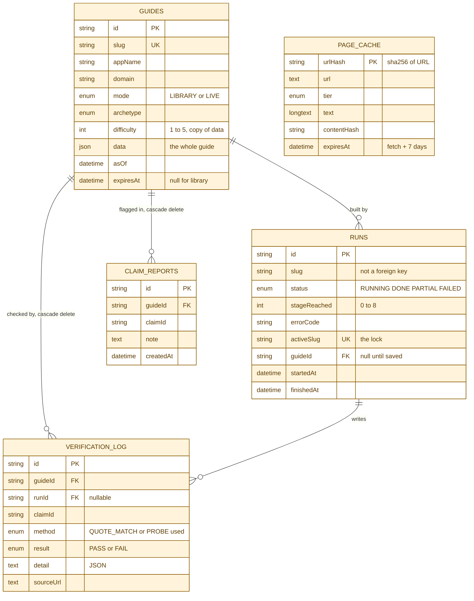
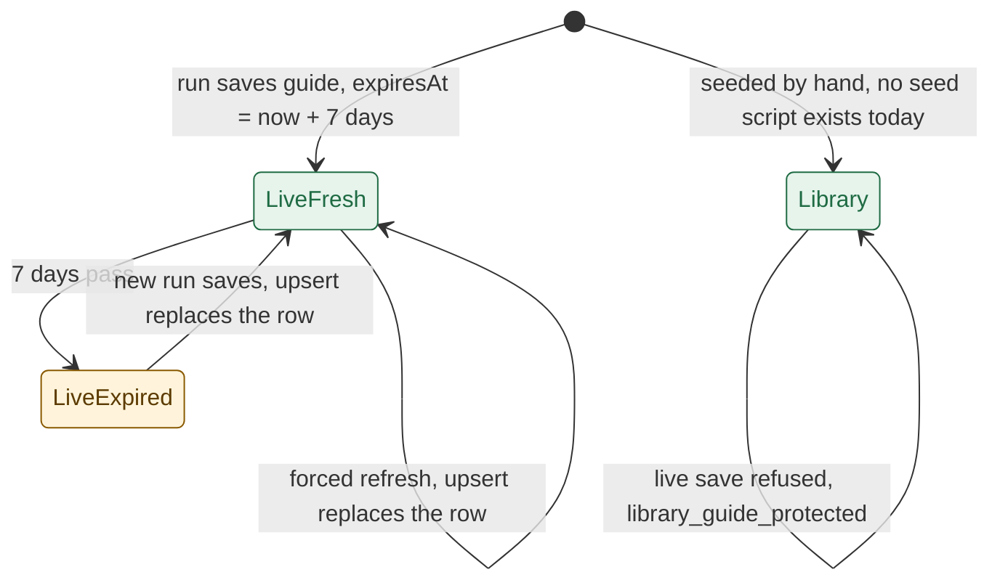
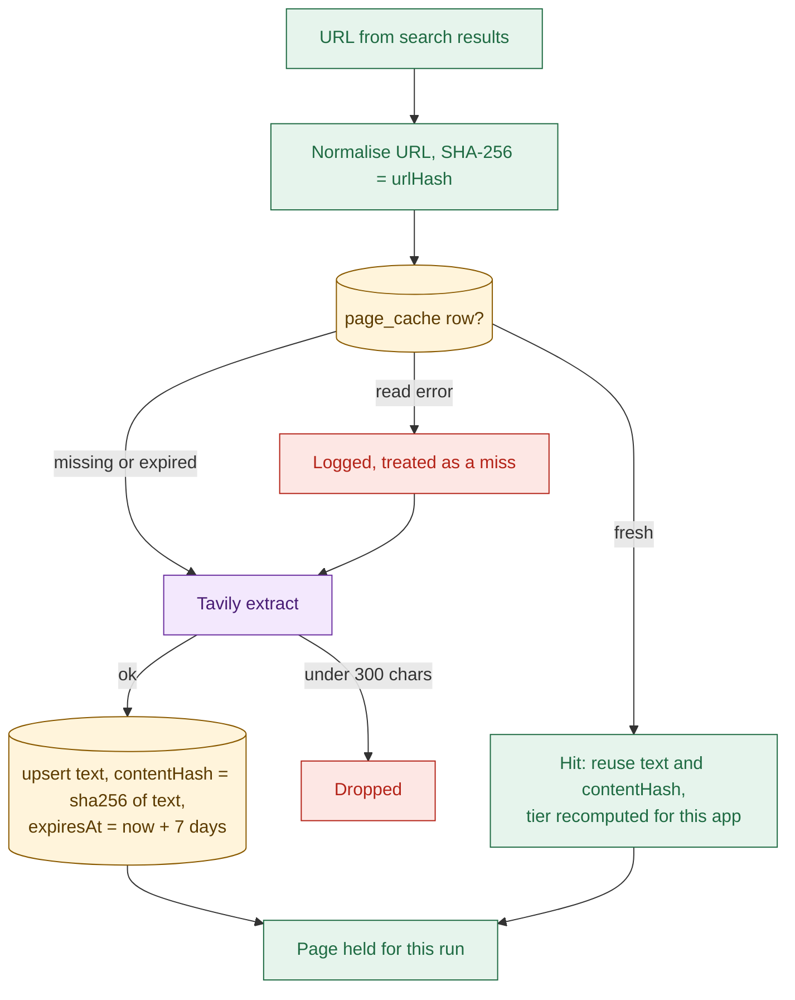

# 07 Data model

## The five tables
- Schema source: `apps/api/prisma/schema.prisma`. Migration: `apps/api/prisma/migrations/20261028103848_init/migration.sql`.

- `page_cache` stands alone: keyed by URL hash, shared by every run and guide.
- `runs.slug` is plain text, so a run can name a slug that has no guide (`apps/api/prisma/schema.prisma`).
- Indexes: unique `guides.slug`, unique `runs.activeSlug`, `guides(mode, difficulty)`, `runs(slug, startedAt)`.
- Nothing deletes rows: no code calls `delete`, so `runs`, `page_cache` and the log only grow.
- Reads of `verification_log` and `claim_reports` do not exist in the API; both are write-only today.

## Guide lifecycle: library, live, expiry

- A library guide is never overwritten: save checks the existing row's mode first (`apps/api/src/services/guide-save.ts:36`).
- `force` on a library slug returns `cached` and starts nothing (`apps/api/src/services/runs.ts:23`).
- An expired live guide is still served and linked; only `POST /api/runs` treats it as stale (`apps/api/src/services/runs.ts:29`).
- A refresh replaces the row in place. There is no history, so the old guide is gone (`apps/api/src/services/guide-save.ts:50`).
- A failed refresh leaves the old row, because save is the last stage. A weaker successful refresh still wins.
- Claim ids are positions like `steps.0`, so after a refresh an old report may point at different content.

## Page cache

- Normal form: lowercase host, no fragment or credentials, tracking params removed, params sorted (`apps/api/src/utils/hash-url.ts:17`).
- Removed params: `utm_*`, `fbclid`, `gclid`, `msclkid`, `mc_cid`, `mc_eid` (`apps/api/src/utils/hash-url.ts:10`).
- A row is a hit while `expiresAt` is in the future (`apps/api/src/services/page-cache.ts:27`).
- Two runs storing one new URL at once: the second falls back to an update (`apps/api/src/services/page-cache.ts:63`).
- Cache hits still send `page.fetched`, so the trace cannot tell cached from new pages.
- A cached page can be up to 7 days old. No re-check is made against the live page.

## Verification log
- One row per quote check or probe, written once per run at save (`apps/api/src/services/verification-log.ts:26`).
- Quote checks cover claim slots, gates evidence, and both sides of each proposed conflict (`apps/api/src/agent/nodes/verify.ts:49`).
- `detail` is JSON: `contentHash` of the page checked, plus `reason` or HTTP `status` (`apps/api/src/services/verification-log.ts:15`).
- Rows pile up across runs on purpose; each row names its run (`apps/api/src/services/verification-log.ts:23`).
- A failed log write is a warning; the guide and the run still succeed (`apps/api/src/agent/nodes/save.ts:67`).
- The log is skipped when a library guide owns the slug (`apps/api/src/agent/nodes/save.ts:56`).
- `MANUAL` and `BROWSER` methods exist in the enum but nothing writes them.

## Claim reports
- One row per report: guide, claim id, optional note, time (`apps/api/src/services/reports.ts:31`).
- No status, owner, run id or claim text is stored, and no screen or endpoint reads the rows.
- Deleting a guide would delete its reports and log rows (`apps/api/prisma/schema.prisma`).
- There is no dedupe, so one reader can file the same report many times within the rate limit.
