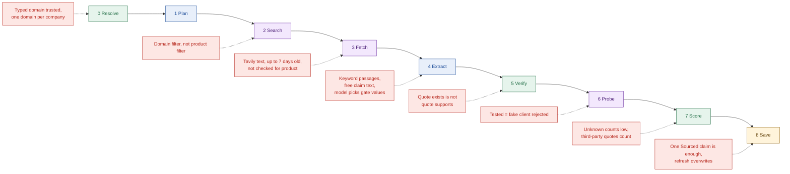

# 08a Trust map: where wrong information can enter

- Observations only. No fixes are proposed here.
- "Guard" means code that exists today. "Gap" means something the code does not check.

## The pipeline with its gaps
- Stage order and names: `apps/api/src/agent/pipeline.ts:14`.

- Red boxes are gaps. Stage boxes keep the usual colours.
- The strongest guards are the quote check and the rule that only code sets labels and scores.
- Most gaps are about meaning. Code checks strings and hosts, not whether a page fits the product.
- Product scope is not checked at any stage.
- Plan and Probe have the fewest ways to let a wrong fact in.

## Stage by stage

| Stage | How wrong information can enter | Current guard | Gap |
| --- | --- | --- | --- |
| 0 Resolve | A wrong site ranks first, or the typed domain is wrong | Deny-list of forums and code hosts; label match; 60% ambiguity rule (`resolve/decide.ts:34`) | Official means one domain for every product of a company; a typed domain is never checked (`nodes/resolve.ts:27`) |
| 1 Plan | The model writes a vague or misleading query | Checks on length, app name, URLs, operators; templates (`queries.ts:43`) | Queries carry only the app name, so sibling products are not separated |
| 2 Search | Tavily returns pages for another product on the same domain | Search is scoped to the official domain; results ordered by tier (`search/jobs.ts:38`) | No relevance floor and no product filter; the retry stays on the same domain |
| 3 Fetch | Extracted text is partial, stale or off-topic | 300-char minimum; login URLs skipped; 7-day cache with `contentHash` (`fetch/select-pages.ts:12`) | Nothing checks product, date or live-page match; tier is set by host only |
| 4 Extract | The model picks the wrong passage, rewords beyond its quote, or chooses a gate level the quote does not state | Strict JSON schema; URL must be a fetched page; unknown allowed; injection tags (`extract/sanitize.ts:38`) | Passages come from generic keywords; claim text is free; gate values are model choices (`extract/keywords.ts:14`) |
| 5 Verify | A real quote that does not support the text, or comes from another product | Exact, whole-word match of 10+ chars; conflicts need two real quotes (`evidence/quote-match.ts:30`) | No support check; a third-party quote still earns Sourced; conflict topics are not compared (`evidence/conflicts.ts:64`) |
| 6 Probe | A different authorize URL is tested | SSRF guards; official host only; Sourced official claims only (`probe/target.ts:17`) | Tested proves a fake client is rejected, not that the guide is right; no event is sent (`nodes/probe.ts:59`) |
| 7 Score | A wrong gate level or wait range feeds the rule | Fixed rule in code; evidence quote must exist (`scoring/difficulty.ts:96`) | Unknown facts score low, so thin data looks easy; the wait uses the upper end of a model range |
| 8 Save | A weak guide is stored and shared | Schema check; at least one Sourced claim; unknown claims are explicit (`nodes/save.ts:31`) | One Sourced claim is a low bar; a refresh replaces the old guide; `coverage` tracks time only |
| Read path | The UI shows a model's prose as data | Guide is re-parsed on read; labels and tiers are shown (`mappers/guide-mapper.ts:17`) | Durations are regex-read from claim text; reports are stored but never read |
| Runs | A dead run is shown as live | 3-minute stale rule (`services/run-lock.ts:16`) | The rule is lazy; for up to 3 minutes new requests join a dead run |

- Paths in the table are under `apps/api/src/agent/` unless they start with `services/` or `mappers/`.

## What the guards do not cover, in one list
- Whether the right product is being described.
- Whether a claim's text follows from its quote.
- Whether a page is current.
- Whether two "conflicting" quotes are about the same fact.
- Whether a Sourced claim came from the provider or a blog.
- Whether a refreshed guide is better than the one it replaced.
- Sources for these statements: `06a-evidence.md` and `05c-nodes-fetch-extract-verify.md`.
