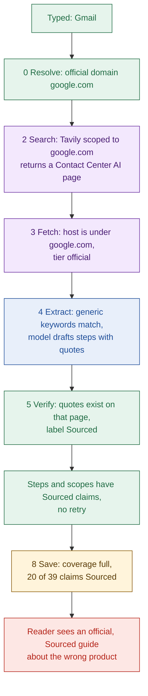

# 08b Trust map: your six real cases

- Data: stored guides `gmail` and `microsoft` read from `GET /api/guides/:slug` on 2026-10-29. Run logs: `api.log` (Notion only).
- Symptom mark: Confirmed means visible in code or stored guides. Likely means inferred.
- The entry stage is always an inference, because no run logs exist for these two guides.

| Case | Symptom | Entry stage (Likely) |
| --- | --- | --- |
| 1 Gmail cites Contact Center AI docs | Confirmed | 2 Search, tiered at 3 Fetch |
| 2 Gmail scopes are add-on scopes | Confirmed | 4 Extract (scopes) |
| 3 Microsoft steps are Azure AD B2C; top blocker is a blog | Confirmed | 0 Resolve and 2 Search; 4 Extract |
| 4 Microsoft `app.read`, `app.write` are tutorial examples | Confirmed | 4 Extract (scopes) |
| 5 Milestone effort holds prose | Confirmed | 4 Extract, and the schema |
| 6 4 of 6 pages in about 23 of 120 s | Confirmed mechanism; this run Likely | 3 Fetch allowance, 5 Verify routing |

## Case 1: Gmail requirements and steps cite another product
- Evidence: 11 of 39 claims cite `docs.cloud.google.com/contact-center/ccai-platform/docs/oauth-email-google`.
- Those 11 are `requirements.0` to `2` and eight step details. All are tier `official` and Sourced.
- Resolve gave `domain: google.com` for "Gmail", so every host under it is official (`apps/api/src/agent/evidence/source-tier.ts:72`).
- Guards missed it: tier reads the host only, keywords ignore product, and the quote is on the page.
- The retry did not fire, since Sourced steps and scopes existed (`apps/api/src/agent/verify/missing-sections.ts:12`).

- No stage in this chain asks which Google product a page documents.
- Each stage did its job correctly; the error passes because every check is about strings or hosts.
- The same chain explains case 3 with `learn.microsoft.com` in place of `docs.cloud.google.com`.
- Gmail's only blocker (3 claims) is Sourced from `cloudsponge.com`, a third-party blog.

## Case 2: Gmail scopes are Workspace add-on scopes
- Evidence: all 4 scopes cite `developers.google.com/workspace/add-ons/concepts/workspace-scopes`.
- The names are descriptions like "Read open message metadata", not scope strings.
- Entered at extract: the scopes call takes the highest-keyword passages from the held pages (`apps/api/src/agent/extract/keywords.ts:35`).
- Guards missed it: the prompt says "exactly as written"; no check knows a real scope string (`apps/api/src/agent/prompts/extract-sections.ts:17`).

## Case 3: Microsoft steps describe Azure AD B2C
- Evidence: 9 of 24 claims cite `learn.microsoft.com/en-us/azure/active-directory-b2c/client-credentials-grant-flow`.
- The verdict says "registering two applications in Azure AD B2C".
- The top blocker is `blockers.0`; its symptom, cause and fix cite `airlockdigital.com`, tier `third_party`, and are Sourced.
- That blocker is about attackers registering apps, not about a developer being stopped.
- The whole guide cites only 2 distinct URLs, so the run likely held few pages.
- Guards missed it: Sourced does not depend on tier, and the top blocker is the model's index pick (`apps/api/src/agent/guide/assemble-sections.ts:136`).

## Case 4: Microsoft scopes are tutorial examples
- Source: stored `microsoft` guide, `scopes.0.reason` and `scopes.1.reason` (`apps/api/src/mappers/guide-mapper.ts:17`).
- Evidence: `app.read` and `app.write` cite "Readers have the ability to read tasks." and "Writers have the ability to create tasks."
- The quotes describe roles of a sample "tasks" API. That looks like tutorial content (Likely).
- Entered at extract (scopes). Guards missed it for the same reason as case 2.

## Case 5: milestone effort holds prose, not a duration
- Evidence: effort is a `Claim` with free `text` (`packages/schema/src/guide/verdict.ts:11`).
- The prompt asks for "what it takes", so a sentence is the expected answer (`apps/api/src/agent/prompts/extract-sections.ts:31`).
- Stored example: Notion `firstTest.effort` is a full sentence about using the Quickstart to create a token.
- Effort claims are always Uncertain by rule (`apps/api/src/agent/evidence/labelling.ts:36`).
- The UI hunts for a duration with a regex over the text (`apps/web/src/utils/extract-duration.ts:13`).

## Case 6: 4 of 6 pages in about 23 of 120 seconds
- Mechanism: first pass reads at most 4 pages (`apps/api/src/agent/budget.ts:81`).
- Pages 5 and 6 are read only on a retry, and the retry needs a missing steps or scopes section.
- One Sourced step and one Sourced scope claim are enough to skip it (`apps/api/src/agent/routes.ts:55`).
- Time fits: Notion's first-pass stages sum to about 24 s in `api.log`.
- Nothing measures coverage or page quality, so about 96 s of budget goes unused.

## Other gaps seen while reading (Confirmed from code)
- A Sourced claim can come from a blog; tier shows only as a chip (`apps/api/src/agent/verify/verify-claims.ts:54`).
- Gate values and wait ranges are model choices; code checks only that the quote exists (`apps/api/src/agent/verify/verify-gates.ts:33`).
- Missing facts lower the score: Microsoft is 2 with archetype `unknown` (`06b-unknowns-difficulty.md`).
- A crash leaves a dead run that new requests join for up to 3 minutes (`apps/api/src/services/run-lock.ts:54`).
- With no library guides, the Not found "Did you mean" can never appear (`apps/web/src/utils/find-guide.ts:11`).
